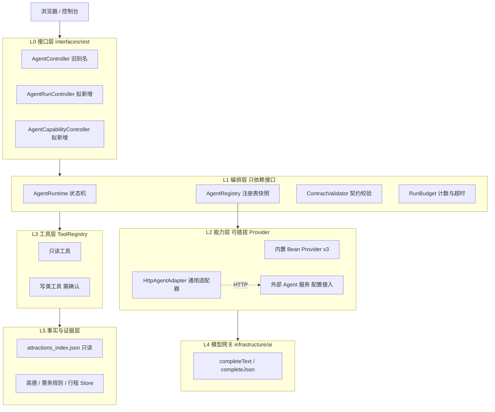
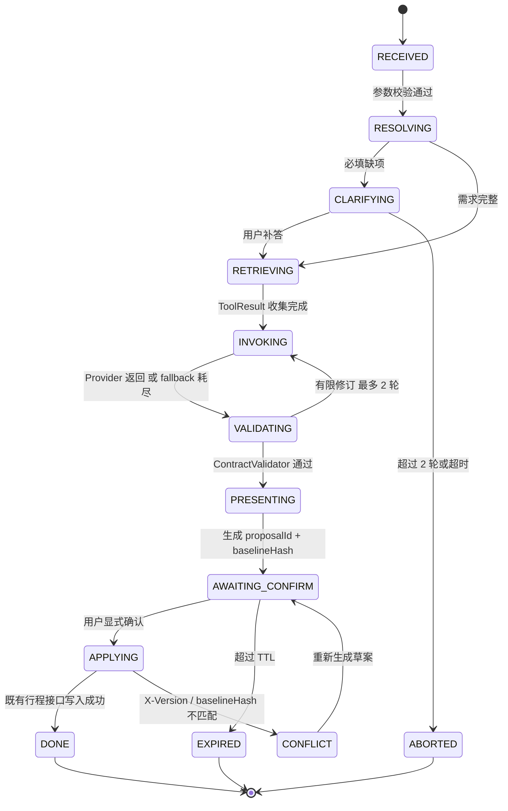

# Agent 运行时架构设计

> 设计稿。事实数字为 2026-11-08 实测，基准提交 `66f00fa`。文中所有拟新增类型、接口与配置键都未落地，模型成功路径至今没有真实密钥实测。

## 这份设计要解决什么

目标是一句话：以后接新 Agent，不改 Java。

做法是定义一个 `AgentProvider` 接口，把所有能力实现放进注册表，再配一个通用 HTTP 适配器。新增外部 Agent 只需往 `data/agent_providers.json` 加一条记录。编排层只认识接口，不 import 任何具体实现。

前提是它先通过《Agent接入规范》的 G0 至 G4 闸门。不符合规范直接拒绝，不进注册表、不参与路由、不产生用户可见结果。

有一条边界要先讲清楚：接口化的是能力供给，不是控制权。Java 运行时仍然决定何时调用、给什么事实、允许什么副作用、如何降级。新 Agent 只提供符合契约的实现。

本期的唯一主操作是 P0：把契约、注册表、配置加载、HTTP 适配器、契约校验器一次建好，把现有 3 个能力包装成内置 Provider，并同批落地《Agent接入规范》里的 `provider-contract.json` 与 G0 静态闸门。P0 做完，「加配置接新 Agent 且不合规就拒绝」才成立。

## 现在的代码长什么样

| 维度 | 实测值 | 依据 |
| --- | --- | --- |
| 模型调用点 | 3 处，都是请求级一次性调用 | `PlanningService.java:141`、`DecisionService.java:113`、`TicketAssistantService.java:77` |
| 模型接入 | OpenAI 兼容 HTTP 直连；两个 POM 已无 `spring-ai` | `DeepSeekClient.java:22-34`、`pom.xml`、`travel-server/pom.xml` |
| 调用预算 | 原 `max-tool-calls` 是死配置，2026-11-08 已从 `application.yml` 删除；当前配置与源码都不含调用预算 | `application.yml`（已无该键） |
| Agent 接口 | `POST /api/agent/plan`、`POST /api/agent/itineraries/{id}/advice`、`GET /api/agent/status`、`POST /api/agent/tickets/advice` | `AgentController.java`、`TicketAssistantController.java` |
| 前端入口 | 首页已接通 `/api/agent/plan` 与 `/api/agent/plan/materialize`；静态页共直接调用 4 个 Agent 接口 | `index.html`、`ticket-assistant.html` |
| 工具层 | `PlanningTools` 提供 3 个确定性工具，失败统一转 `ToolOutcome`，不向上抛 | `PlanningTools.java:51-130` |
| 结果契约 | `PlanDraft` 把事实与模型说的话分开 | `PlanDraft.java:26-41` |
| 保存流程 | 草案不自动写库；用户确认后由前端走既有行程接口与 `X-Version` | `AgentController.java`、`reports/current/基础业务闭环-逐环节验收-2026-11-08.md` |
| 安全 | `/api/agent/status` 匿名可读；`/api/agent/tickets/advice` 已于 2026-11-08 移出 `permitAll`，匿名返回 401 | `SecurityConfiguration.java`、`SecurityRulesTest.java` |
| 事实层 | 源库 7,745 条 / 6.30 MiB；索引 7,745 条 / 3.94 MiB，`--check` 通过 | 本次实测 |
| 核验状态 | 票价 verified 145 / unverified 729 / pending 6,871 | `china_attractions.json` 顶层计数 |
| 测试 | 覆盖降级路径；模型成功路径已有本地 OpenAI 兼容桩实测，真实密钥仍未测 | `PlanningApiTest`、`DecisionAdviceTest`、`tools/model_success_probe.py` |

按现状加一个「美食推荐」，要动 Service、DTO、Controller 方法、`AgentController` 分支、`PlanningTools` 方法、前端按钮、至少 2 个测试类、`SecurityConfiguration` 白名单，约 8 处。接口化要消掉的就是这笔成本。

### 六个结构性缺口

| 编号 | 缺口 | 后果 |
| --- | --- | --- |
| D-1 | 没有运行态，缺 `runId`、阶段、补问、断点续跑 | 缺字段时只在 `notices` 里提示，用户无法在同一轮补答 |
| D-2 | 模型调用散落 3 处，各自拼提示词、各自解析 | 无法统一超时、预算、输出校验和审计 |
| D-3 | 没有调用预算 | 死配置已删除；Provider SPI 落地前仍无注册表、无计数、无限流 |
| D-4 | 没有从确认到保存的流程 | 草案不能被引用、比对或应用 |
| D-5 | 证据链止于 `List<String> sources` | 未随每条结论下发来源与核验状态 |
| D-6 | 没有稳定扩展点 | 编排层直接依赖具体服务，新增能力必然改 Java |

D-6 是本版要解决的头号问题。

**目标**：新增一个符合契约的 Agent 只需一条配置，编排层、控制器、前端入口、预算、证据、降级、审计全部复用，旧接口与现有回归不破。

**非目标**：不引 Spring AI / LangChain4j / 图编排框架；不让模型或外部 Agent 自主选工具、自主写库；不做向量库与长期记忆；不做交易；不承诺任何形态的新 Agent 都零代码。

## 零代码的边界

下面这张表是本文最需要说清楚的部分。

| 级别 | 接入方式 | 改 Java | 改配置 | 重启 |
| --- | --- | --- | --- | --- |
| L0 配置式 HTTP Provider | 加一条 `data/agent_providers.json` 记录 | 否 | 是 | P0 阶段需重启或触发 reload，P1 热加载后不需要 |
| L1 内置 Bean Provider | 实现 `AgentProvider` 并标 `@Component` | 是，只写新类 | 否 | 是，编译期 |
| L2 契约扩展 | 新增 `Capability` / `Fact` 类型或写类工具 | 是，改契约 | 否 | 是 |

| 场景 | 是否零代码 | 说明 |
| --- | --- | --- |
| 新 Agent 复用既有 intent 与 Fact 类型，例如美食推荐、夜游路线 | 是 | 加配置；能力协商接口自动列出，前端动态渲染入口 |
| 换模型供应商、换提示词、调预算 | 是 | 模型网关配置，改 env 即可 |
| 只换算法，输出形态相同 | 是 | 加一条路由，可灰度切换 |
| 新意图类别 | 半 | 加一条路由配置即可；若要新状态机阶段，编排层要改 |
| 需要新的内部数据源或写操作 | 否 | 要扩 `ToolSpec` 并升契约主版本 |
| 需要新的展示组件，例如地图图层、日历 | 否 | 后端零代码，前端仍需开发 |
| 外部 Agent 想自行保存行程 | 不允许 | 写类副作用只开放给内置 Provider |

零代码成立的前提是契约稳定，且新 Agent 落在既有契约内。契约本身要演进时，改契约是必要的。所以 P0 的契约设计必须留足扩展位：`hints`、`extensions`、语义化版本。否则第一版就会腐化。

## 方案取舍

| 维度 | A 每 Agent 一套 Controller 加 Service | B Provider SPI 加注册表加配置路由 | C 引入外部 Agent 框架或图编排 |
| --- | --- | --- | --- |
| 新增 Agent 改 Java | 每次都要 | 符合契约时不要 | 通常要写适配节点 |
| 控制权与可追溯 | 分散，各写各的 | 集中，统一预算、证据、审计 | 取决于框架，常把决策交给模型 |
| 缺密钥可用性 | 各处自己判断 | 统一降级 | 需验证自动配置，曾导致启动失败 |
| 测试确定性 | 每个能力单独写测试 | 同一组契约测试跑所有 Provider | 需 mock 框架运行时 |
| 依赖成本 | 0 | 0，JDK 加 Spring 已有 | 新增数 MB 依赖与版本锁定风险 |
| 演进空间 | 低 | 高，可灰度、可热插拔、可外部化 | 高但耦合框架 |

选 B。理由：项目已经清理掉 Spring AI 死依赖，C 会把它带回来；A 无法达成目标。B 的全部机制都能用现有 JDK 21、Spring Bean 后处理和 Jackson 实现，不新增依赖。

何时改选 C：出现跨多 Agent 的长事务、复杂人工介入、断点恢复图，且 B 的状态机已无法表达时。引入前先验证缺密钥启动行为与版本兼容性。

## 分层与控制流



图约束：Mermaid 10.1.0 的词法器不接受 `×`、`÷` 等数学符号，会报 `Lexical error: Unrecognized text`。节点文本统一用双引号包裹，倍数用 ASCII `x`。

| 层 | 职责 | 硬约束 |
| --- | --- | --- |
| L0 | 鉴权、参数校验、HTTP 语义 | 不 import 任何具体 Provider |
| L1 | 唯一控制流：状态机、路由、预算、契约校验、降级 | 只认识 `AgentProvider` 接口，新增能力不改本层 |
| L2 | 各 Agent 实现，内置或外部 | 输入输出符合契约；不持有运行态，不自行调工具 |
| L3 | 白名单工具 | 写类工具需确认令牌 |
| L4 | 模型唯一出口 | 只接受已组装事实 |
| L5 | 事实来源 | Java 对索引只读 |

依赖方向单向向下。`domain` 不依赖 Spring、HTTP 或 AI 库。Provider 不读写文件，不指定操作身份。

## 稳定契约

以下是拟新增类型，尚未落地。

```java
// application/agent/spi/AgentProvider.java —— 唯一扩展点
public interface AgentProvider {
  AgentDescriptor descriptor();
  AgentResult invoke(AgentContext context, RunBudget budget);
}

// application/agent/spi/AgentDescriptor.java
public record AgentDescriptor(
    String id,                    // 全局唯一，如 "builtin.planning" / "food.recommender"
    String version,               // 实现版本，语义化
    String schemaVersion,         // 契约主版本，如 "1.0"
    Set<Capability> capabilities, // 能力标签，决定可路由到哪些 intent
    ProviderKind kind,            // BEAN | HTTP
    SideEffect sideEffect,        // NONE | READ | WRITE（外部 Provider 禁止 WRITE）
    boolean enabled) {}

// application/agent/spi/AgentContext.java —— 传给 Provider 的全部内容
public record AgentContext(
    String runId,
    String userIdHash,            // 脱敏标识，不传账号明文
    Intent intent,
    PlanningState state,
    List<Fact> facts,             // 已带证据的事实
    Map<String, String> hints,    // 预留扩展位，避免为小需求改契约
    Instant deadlineAt) {}

// application/agent/spi/AgentResult.java —— 所有 Provider 的统一返回
public record AgentResult(
    Status status,                // OK | DEGRADED | REFUSED
    List<Fact> facts,
    String advice,                // 纯文字，可为 null
    List<String> unknownFields,
    List<String> notices,
    Usage usage) {}

// application/agent/spi/AgentRegistry.java
public interface AgentRegistry {
  Optional<AgentProvider> find(String providerId);
  List<AgentDescriptor> descriptors();          // 供能力协商接口
  Resolution resolve(Intent intent, String userIdHash); // primary + fallback 链
  void reload();                                // 原子替换快照
}
```

配套保留的类型：`PlanningState`、`Evidence`、`Fact`、`ToolSpec`、`RunBudget`、`AgentRun`。

`ContractValidator` 是所有 Provider 的公共闸门，内置与外部一视同仁。规则集来自《Agent接入规范》「机器可读规范源」一节的 `tools/agent/provider-contract.json`，注册期与运行期共用同一套判定。

判定口径是默认拒绝，不做「悄悄降级后继续用」。

| 检查 | 注册期 | 运行期，已 ACTIVE |
| --- | --- | --- |
| `schemaVersion` 主版本兼容 | `REJECTED`，`E_META_SCHEMA` | 整体拒绝该次响应 |
| `facts` 每条带 `Evidence`，`sourceKind` 在白名单 | `REJECTED`，`E_SEMANTIC_EVIDENCE` | 整体拒绝该次响应 |
| 外部 Provider 不得自称 `verified` | `REJECTED`，`E_SEMANTIC_VERIFIED` | 整体拒绝该次响应 |
| `advice` 不含 URL、HTML、facts 之外的数字与景点名 | `REJECTED`，`E_SEMANTIC_ADVICE` | 整体拒绝该次响应 |
| 响应体大小、字段数量上限 | `REJECTED`，`E_TRANSPORT_SIZE` | 整体拒绝该次响应，切 fallback |
| `sideEffect=WRITE` 且 kind=HTTP | `REJECTED`，`E_META_SIDEEFFECT` | 立即 `SUSPENDED` |

运行期违规时，整体丢弃该响应，走 fallback 链并在 `notices` 留痕，违规计数加 1。连续 3 次转 `SUSPENDED`，需重新走准入。每次拒绝都产出带原因码的 `AdmissionReport`，接入方可自助修复。

## 注册与发现

三种来源按固定优先级合并。`id` 重复即 fail fast 拒绝启动，并打印冲突 id，不静默覆盖。

| 优先级 | 来源 | 说明 |
| --- | --- | --- |
| 1 | 环境变量覆盖 | 只用于开关与 endpoint 覆盖，便于临时灰度 |
| 2 | `data/agent_providers.json` | 主要配置入口，运行态文件，不入库 |
| 3 | Spring Bean 自动发现 | 启动时注入 `List<AgentProvider>`，内置 3 个能力在此注册 |

注册表只接受 `ACTIVE` Provider。每个候选先过 `AdmissionController` 的 G0 至 G4 闸门：静态规则、契约探针、安全探针、影子运行、启用。任一 `BLOCK` 规则失败即 `REJECTED`，不进注册表、不发用户流量。规则、原因码与 gold cases 见《Agent接入规范》的「规则集」「行为探针用例」「接入流程总览」三节。内置 Provider 同样过 G0，只是 G1 / G2 用内存桩执行。`capabilities` 接口暴露状态与最近一次拒绝原因码。

注册表用 `AtomicReference<RegistrySnapshot>` 保存不可变快照。配置变更走文件 mtime 轮询，默认 10 s，全量校验后一次性替换。进行中的 run 绑定创建时的快照，不会跑到一半换实现。失败的配置不替换，保留上一版并在日志与 `capabilities` 里标 `LAST_KNOWN_GOOD`。

`data/agent_providers.json` 默认被 `.gitignore` 的 `/data/*` 黑名单挡住，这符合项目「运行态不入库」的约定。应提供 `data/agent_providers.example.json` 种子文件，`*.example.json` 已在白名单内，本机复制后填写 endpoint。密钥不写文件，用 `authRef` 指向环境变量名。

内置 Provider 包装现有能力，行为完全不变。

| Provider id | 包装对象 | capability |
| --- | --- | --- |
| `builtin.planning` | `PlanningService` | `PLAN_DRAFT` |
| `builtin.decision` | `DecisionService` | `DECISION_ADVICE` |
| `builtin.ticket` | `TicketAssistantService` | `TICKET_ADVICE` |
| `builtin.rules` | 无模型纯规则 | 所有 intent 的兜底 |

## 配置式 HTTP Provider

### 配置文件

```json
{
  "schemaVersion": "1.0",
  "providers": [
    {
      "id": "food.recommender",
      "kind": "HTTP",
      "endpoint": "https://agent.example.com/v1/invoke",
      "healthPath": "/healthz",
      "authRef": "FOOD_AGENT_TOKEN",
      "version": "0.1.0",
      "owner": "travel-team",
      "description": "外部美食推荐 Provider",
      "capabilities": ["FOOD_RECOMMEND"],
      "schemaVersion": "1.0",
      "timeoutMs": 4000,
      "maxResponseBytes": 65536,
      "sideEffect": "NONE",
      "enabled": false
    }
  ],
  "routes": [
    {
      "intent": "FOOD_RECOMMEND",
      "primary": "food.recommender",
      "fallback": ["builtin.rules"]
    }
  ]
}
```

`authRef` 是环境变量名，凭据值由运行时注入，绝不写进配置文件或日志，这是项目 `AGENTS.md` 的硬性要求。`version`、`owner`、`description`、`healthPath` 是《Agent接入规范》M-03 / M-07 / M-12 的必填或建议项。

`enabled` 提交时必须为 `false`，对应 M-11。先过 G0 至 G3，由 G4 人工确认置 `true` 才转 `ACTIVE` 并参与路由。在此之前该 id 在 `capabilities` 可见，但不接用户流量，请求走 `fallback`。

### 线上请求与响应

`HttpAgentAdapter` 发出的请求：

```json
{
  "schemaVersion": "1.0",
  "runId": "9f3c...",
  "intent": "FOOD_RECOMMEND",
  "context": { "city": "武汉", "date": "2026-11-10", "budget": "200 CNY" },
  "facts": [
    { "factId": "a1", "type": "ATTRACTION", "value": { "id": "amap-B001B0IZIP" },
      "evidence": { "sourceKind": "KB", "verificationStatus": "unverified",
                    "fetchedAt": "2026-11-08T11:00:00Z" } }
  ],
  "hints": {},
  "deadlineAt": "2026-11-08T11:00:15Z"
}
```

期望响应，结构必须与内置 Provider 的 `AgentResult` 一致：

```json
{
  "schemaVersion": "1.0",
  "providerId": "food.recommender",
  "status": "OK",
  "facts": [],
  "advice": "……",
  "unknownFields": ["人均价格"],
  "notices": [],
  "usage": { "elapsedMs": 820 }
}
```

完整的字段约束见《Agent接入规范》的「请求与响应契约」一节。

### 接入步骤

1. 新服务实现上面这一个 HTTP 端点，返回统一结构，任何语言均可。
2. 在 `data/agent_providers.json` 的 `providers` 加一条、`routes` 加一条。
3. 设置环境变量 `FOOD_AGENT_TOKEN`，若需鉴权。
4. 触发 `POST /api/agent/providers/reload`（P0），或等 P1 热加载生效。
5. `GET /api/agent/capabilities` 出现新 id，前端从该接口动态渲染入口，无需改页面代码。

全程不改 Java、不重新编译。校验方式：把 endpoint 指向本地桩服务，返回合法响应则结果进统一信封；返回非法 JSON、超长、超时、自称 `verified`，应被拒或降级且 `notices` 留痕。

用 Python 写 Provider 的完整示例，见《Agent接入规范》的附录 A。

### 外部调用的安全边界

| 项 | 约束 |
| --- | --- |
| 目标地址 | host 白名单；默认拒绝环回、内网段与 `169.254.169.254`；默认仅 https |
| 凭据 | `authRef` 指向环境变量；不落日志、不进响应 |
| 时限 | `timeoutMs` 默认 4,000 ms，最大 10,000 ms；不重试，避免重复副作用 |
| 体积 | `maxResponseBytes` 默认 64 KiB；超限整体拒绝 |
| 熔断 | 连续 3 次失败熔断 30 s，半开探测，期间走 fallback |
| 副作用 | 外部 Provider 一律 `NONE`；声明 `WRITE` 在注册期拒绝 |
| 事实等级 | 外部 facts 只允许 `unverified` / `pending`；自称 `verified` 触发 `E_SEMANTIC_VERIFIED`，注册期拒绝接入、运行期整体拒绝 |

## 路由与能力协商

`AgentRegistry.resolve(intent, userIdHash)` 按 `routes` 配置给出 `primary + fallback` 链，支持 `weight` / `userHashBucket` 做灰度与 A/B。解析时先过滤掉所有非 `ACTIVE` 状态，包括 `REJECTED`、`SUSPENDED`、`DEPRECATED`、`SHADOW`。被拒绝的 Provider 不参与路由，也不算作一次失败。

运行时按链依次尝试。任一 Provider 返回 `DEGRADED` / `REFUSED` 或超时，就切下一个。全部失败时由 `builtin.rules` 给出「只有事实、没有建议」的结果，HTTP 仍为 200。

`GET /api/agent/capabilities` 返回已注册 Provider 的 id、版本、capabilities、`enabled`、`health`、`schemaVersion` 与 `sideEffect`。前端据此动态生成入口与禁用态，这是「接新 Agent 不改前端」的关键。

## 运行时状态机



`INVOKING` 是唯一与 Provider 打交道的阶段。运行时只调 `AgentProvider.invoke(...)`，不知道背后是内置 Bean 还是外部 HTTP 服务。`RESOLVING` 新增，负责按 intent 选链。

`APPLYING` 不由 Agent 自行触发。必须用户显式调用既有行程接口，走同一套权限、预算、时间校验与 `X-Version`。

## 模型网关与调用预算

把 `DeepSeekClient` 演进为网关，保留现有 HTTP 实现与 401 / 402 / 429 状态翻译，新增 `completeText` / `completeJson(schema)` 两个受限入口。`completeJson` 复用 `TicketAssistantService.java:78-105` 已验证的字段白名单，以及「数值必须原样出现在用户消息里」校验。

| 预算项 | 默认 | 配置键 | 现状 |
| --- | --- | --- | --- |
| 单次 run 模型调用 | 2 | `travel.ai.max-model-calls`，拟新增 | 无限制概念 |
| 单次 run 工具调用 | 6（目标值） | 随 Provider SPI 落地时引入 | 当前无配置、无实现；死配置已删除 |
| 单次 run Provider 调用 | 3 | 拟新增，含 fallback 计数 | 无 |
| 整体墙钟 | 15,000 ms | `travel.ai.run-timeout-ms`，拟新增 | 无 |
| 外部 Provider 单次 | 4,000 ms | 配置文件 `timeoutMs` | 仅高德侧有类似值 |
| 补问轮次 | 2 | 拟新增 | 无 |
| 单用户并发 run | 2 | 拟新增 | 无 |

成本量级（估算，未实测）：一次规划约 1,200 输入加不超过 800 输出 tokens，约 2,000 tokens；按 100 次/日、22 天/月约 4.4 M tokens/月。单价需按服务商当期公告核实，本文不编金额。外部 Provider 的成本由配置里的 `usage` 回传并计入审计，避免账外调用。

### 降级矩阵

| 触发 | 行为 | HTTP |
| --- | --- | --- |
| 未配置 `DEEPSEEK_API_KEY` | 不调模型，返回事实加规则建议，`advice=null` | 200 |
| 模型超时 / 429 / 5xx | 同上，`notices` 写原因，重试不超过 1 次 | 200 |
| 模型返回非法 JSON 或越界字段 | 忽略输出，降级到结构化表单 | 200 |
| 外部 Provider 超时 / 熔断 / 契约不合规 | 切 fallback，仍失败则由 `builtin.rules` 出结果 | 200 |
| 知识库缺库或索引损坏 | 候选为空，`notices` 写「本库未收录」，不推断现实不存在 | 200 |
| 工具调用超预算 | 停止后续工具，用已有事实出结果 | 200 |
| 鉴权失败 / 参数非法 / 越权 | 拒绝 | 401 / 400 / 403 |

原则：事实层、模型、外部 Provider 失败都不是服务端错误，只有调用方错误才是 4xx。这与《服务端REST接口文档》的口径一致。

## 事实、证据与安全

源库三态一路透传到响应：票价 verified 145 / unverified 729 / pending 6,871。只有 `verified` 才可显示为确定值，`unverified` 带「待核验」，`pending` 或 `null` 写「未知」。未知不等于免费，未知不等于全天开放。`AttractionView` 已做状态归一，Provider 不得绕过。

三条硬规则：

1. Provider 只接收 `AgentContext.facts`。知识库内容放在 data 段，不拼进系统提示词，防止景点描述里的文本被当指令执行。
2. `advice` 是纯文本，不允许 URL、未出现在 `facts` 里的数字或景点名。`ContractValidator` 做字符串级检查，命中即丢弃该次输出。
3. 外部 Provider 返回的 facts 一律标 `unverified`。只有内部源白名单（KB / AMAP / TICKET_RULE / USER_INPUT）且带核验日期的才可能是 `verified`。

| 编号 | 问题 | 处置 |
| --- | --- | --- |
| S-1 | **已销项（2026-11-08）**：曾允许匿名触发模型 | 已移出 `permitAll`；`SecurityRulesTest` 与真实服务回归各有匿名 401 断言 |
| S-2 | 工具可能读到他人行程 | `ITINERARY_MEMBER` 工具执行前二次调用 `ItineraryService.get(id, user)` |
| S-3 | 提示注入 | 见本节三条硬规则；工具输出统一包成 `ToolResult` 数据段 |
| S-4 | 敏感信息进模型与日志 | 复用 `TicketAssistantService.java:39` 证件号正则；`AgentContext` 只带 `userIdHash`；审计只记 `runId / providerId / schemaVersion / 耗时 / 结果码` |
| S-5 | 配额被刷 | 按 `userId` 限流：并发 2、每分钟 6 次；`runId` 幂等 |
| S-6 | 外部 Provider 的 SSRF 与越权 | 端点白名单、禁内网、禁 `WRITE`，见「外部调用的安全边界」 |
| S-7 | 恶意配置热加载 | 配置文件改动需通过完整校验才替换快照，失败保留上一版并告警 |

`csrf.disable()` 与会话 Cookie 现状沿用 `SecurityConfiguration.java:33-35`，生产启用 HTTPS 的要求不变。

## 接口增量与持久化

| 方法 | 路径 | 说明 |
| --- | --- | --- |
| `POST` | `/api/agent/runs` | 创建 run，body 兼容现有 `PlanningRequest`，可带 `intent` |
| `GET` | `/api/agent/runs/{runId}` | 查询运行态与草案 |
| `POST` | `/api/agent/runs/{runId}/answers` | 补答 `missingFields`，最多 2 轮 |
| `POST` | `/api/agent/runs/{runId}/apply` | 唯一写库入口：`proposalId` + `baselineHash` + `X-Version` |
| `GET` | `/api/agent/capabilities` | 能力协商：已注册 Provider、版本、健康度、能力标签 |
| `GET` | `/api/agent/providers` | 注册表快照，脱敏，不含凭据 |
| `POST` | `/api/agent/providers/reload` | 手动重载配置，管理员；P1 后由热加载替代 |
| `GET` | `/api/agent/status` | 保留匿名；补 `registryVersion`、`providerCount`、`budgetDefaults` |

现有 4 个接口保留为只读别名。内部转成「创建 run → 按路由解析 Provider → 同步跑完 → 返回旧结构」，保证现有前端与此前记录的 41 条端到端回归不破。别名层不做一次性替换。

`AgentRun` 走现有 `data/` JSON Store：`PersistenceSupport.writeAtomically` 原子写、`finally deleteIfExists(tmp)`、64 分片锁，路径 `data/agent_runs/{runId}.json`，TTL 24 h 惰性清理。`/data/*` 已在 `.gitignore` 黑名单，运行态不入库，新增配置用 `*.example.json` 种子。

注册表快照是纯内存不可变对象，配置热加载只做一次引用替换，不产生写竞争。不引入数据库的理由：需要跨实例续跑，或运行态写入成为锁竞争热点时再升级，触发条件用 `budget.elapsedMs` P95 观测。

## 测试与实施路线

接口型架构最重要的一条：所有 Provider 跑同一组契约测试。否则「加配置不改代码」会变成「加配置悄悄破坏编排层」。

| 层 | 覆盖内容 | 现有基础 |
| --- | --- | --- |
| 契约一致性 | 对每个候选 Provider 跑《Agent接入规范》「行为探针用例」一节的 GC-01 至 GC-08：合法输出、空事实、未知费用、注入文本、超长、幂等、自称 `verified`、超时 | 新增；G1 / G2 探针与测试共用同一组用例，内置与 HTTP 适配器共用测试基类 |
| 单元 | 状态机迁移、注册表冲突 fail fast、路由 fallback 顺序、预算计数 | `AttractionViewTest`、`PersistenceSupportTest` 可作模板 |
| 集成 | 用 JDK 内置 `com.sun.net.httpserver.HttpServer` 起本地桩，模拟外部 Provider 的 200 / 超时 / 500 / 非法响应 | `DeepSeekClientTest` 已有 4 条成功路径 |
| 端到端 | 现有回归加「只加配置接新 Provider」全流程，以及确认到保存 CAS / `X-Version` 冲突 / 越权 apply | 现有端到端套件 |
| 故障注入 | 缺密钥、KB 缺库、索引损坏、高德超时、外部熔断、配置损坏热加载、契约版本不兼容、并发 apply | 部分已有 |

需显式标注：截至 2026-11-08，`/api/agent/plan` 的模型成功路径已用本地 OpenAI 兼容桩走通（`tools/model_success_probe.py`，记录 HTTP 200、耗时、桩请求摘要与输出样例），但**没有真实 `DEEPSEEK_API_KEY` 实测记录**；自然语言提取与按天编排仍由规则完成，模型只产出一段文字建议。真实密钥实测仍属「未实测」，不得写进通过项。

| 阶段 | 主要改动 | 退出条件，可核验 |
| --- | --- | --- |
| P0，唯一主操作 | 建 `AgentProvider` 契约、`ContractValidator`、`AgentRegistry`、配置加载、`HttpAgentAdapter`；同批落地 `tools/agent/provider-contract.json` 与 G0 静态准入并纳入 `gate.sh`；把 3 个现有服务包成内置 Provider；抽模型网关、按契约引入调用预算；修 S-1 | 只加一条 `agent_providers.json` 配置、不改任何 Java，合规者即可让 `/api/agent/capabilities` 出现新 id 且能路由；写入 `token` 内联字段或 `schemaVersion: 2.0` 的违规配置被 G0 判 `REJECTED` 且带原因码；关掉配置自动回退内置；此前记录的 41 条回归全绿 |
| P1 | 路由规则、灰度权重、能力协商接口、前端动态入口、配置热加载 | 改配置文件不必重启即生效；配置写坏时保留上一版并告警 |
| P2 | `AgentRun` 状态机、补问流程、`proposalId/baselineHash` 确认到保存 | 过期草案 apply 返回 `CONFLICT` 且不写库；成功 apply 行程版本加 1 |
| P3 | 外部 Provider 熔断与 A/B 对照实验 | 量化：约束满足率、无依据事实数、P95 响应时间、外部调用成功率 |

P0 验收命令，可直接复制，离线构建：

```bash
MAVEN_HOME=/f/apache-maven-3.9.16 bash tools/gate.sh
PYTHONPATH="F:/pythons/pkgs" "C:/Users/zipei/.workbuddy/binaries/python/versions/3.13.12/python.exe" tools/build_attraction_index.py --check
```

## 风险

| 编号 | 风险 | 影响 | 缓解 |
| --- | --- | --- | --- |
| R-1 | 《需求文档》把 2026-11-02 的三角色目标态列为「最高口径」，与本文的 Provider SPI 落地稿并存 | 读者不确定按哪份实施 | 已于 2026-11-08 更正：《需求文档》「版本口径」删除该表述；《多Agent与票务能力方案》《架构设计》《业务功能技术实现方案》均补口径更正说明，三角色拆分降为 P3 对照实验 |
| R-2 | 三份设计文档的事实数字必须同源；改动事实层后若只更新其中一份，会出现互相矛盾的容量估算 | 评审依据失实 | 以《知识库架构与周更工作流》「事实层现状」一节为唯一基线，改动时同步三份 |
| R-3 | `POST /api/agent/plan` 前端无直接入口 | 新运行时可能只有测试在跑 | P1 由 `capabilities` 动态生成入口，不再手写按钮 |
| R-4 | 事实层质量门禁未纳入 `tools/gate.sh` | 带病知识库会让 Agent 输出看似有据的错误结论 | 检索前校验 `quality_report --strict` 结果快照 |
| R-5 | 模型成功路径无真实密钥实测 | 网关重构可能引入未覆盖回归 | 拿到密钥后补 4 条真实联调，之前标注「未实测」 |
| R-6 | 契约腐化：为接新 Agent 不断加字段，最终契约变成大杂烩 | 零代码承诺失效 | `hints` / `extensions` 预留位、语义化主版本、契约评审；改契约必须升主版本 |
| R-7 | 外部 Provider 成为隐性依赖 | 服务不可用时用户感知为助手变笨 | 熔断、`builtin.rules` 兜底、`capabilities` 显示健康度、审计留痕 |
| R-8 | 配置文件被误提交或写入密钥 | 凭据泄露 | `*.example.json` 种子、`authRef` 环境变量、`/data/*` 黑名单；提交前检查 |
| R-9 | 运行态 JSON 文件残留 | 文件堆积 | TTL 惰性清理加启动扫描；不写 C 盘、不入 Git |
| R-10 | 热加载换实现导致同一 run 前后不一致 | 结果不可复现 | run 绑定创建时快照；`capabilities` 暴露 `registryVersion` |
| R-11 | 准入规范过严或过松 | 过严挡住正常接入，过松等于没规范 | 规则分 `BLOCK` / `WARN`，`WARN` 只记录；规则集与 GC 用例集一起评审 |

## 附录：复核命令

```bash
# 编排层是否仍然直接依赖具体实现，应为空
grep -rn "PlanningService\|DecisionService\|TicketAssistantService" travel-server/src/main/java/com/travelassistant/server/application/agent/runtime 2>/dev/null

# Provider 注册来源与配置
grep -rn "AgentProvider\|agent_providers" travel-server/src/main data/*.example.json

# 调用预算：死配置已删除，配置与源码应同时为空（期望 0 命中）
grep -rn "max-tool-calls" travel-server/src/main || true

# 接入规范 G0 静态准入，离线，落地后纳入 gate.sh
PYTHONPATH="F:/pythons/pkgs" "C:/Users/zipei/.workbuddy/binaries/python/versions/3.13.12/python.exe" -B tools/agent/check_provider_contract.py data/agent_providers.example.json

# 匿名白名单是否收口
grep -n "permitAll\|api/agent" travel-server/src/main/java/com/travelassistant/server/infrastructure/security/SecurityConfiguration.java

# 事实层新鲜度与回归
PYTHONPATH="F:/pythons/pkgs" "C:/Users/zipei/.workbuddy/binaries/python/versions/3.13.12/python.exe" tools/build_attraction_index.py --check
MAVEN_HOME=/f/apache-maven-3.9.16 bash tools/gate.sh
```

本文是设计稿，不是实现说明，也不是验收报告。「零代码接入」的成立范围严格限定在「零代码的边界」一节的表格内，超出契约的新能力仍需扩契约。
