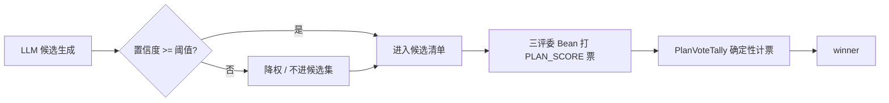

# 决策机制评审：置信度达标 LLM 输出与投票计票模式对比

> 评审日期：2026-11-09。背景：本项目已落地多 Agent 方案投票编排（项目文档称为范式 B，详见《多 Agent 方案投票编排设计》的「实现状态」一节）。开发者提出一个问题：用「置信度达标的 LLM 输出」和「投票模式」做方案决策，哪一个更好。本文给出定义、对比、结论和落地边界。
>
> 结论先行：对本项目，投票计票模式更好。置信度达标不能作为唯一采纳闸门，只能作为候选阶段的预筛信号。

## 1. 两套方案的定义

先锁定定义，避免讨论时各说各话。

### A. 置信度达标 LLM 输出

单个 LLM 直接生成行程方案。它的「置信度」越过阈值就直接采纳，否则降级或拒绝。

- 决策点只有一个模型调用。
- 置信度有三个可能来源：输出 token 的 logprob 聚合；模型自报的「我有 X% 把握」；独立校准打分器。
- 关键特征：采纳与否由单一置信数字决定，方案质量押在这个数字上。

### B. 投票计票模式

这是本项目已落地的实际形态，即范式 B：

1. 候选生成调用 `VoteOrchestrator.modelPlans()`。有 DeepSeek key 时走 `complete()`，并严格校验 `factId` 不得编造。无 key、异常或输出非法时，降级到 A、B、C 三套侧重不同的规则草案。
2. 三个评委 Bean 各自复用 `DECISION_ADVICE` 能力，声明独立的权重表：`judge.ticket`（购票成本与预约风险，权重 1.2，可否决）、`judge.food`（餐饮体验，权重 1.0）、`judge.parking`（停车与步行，权重 0.8，无专属数据时如实写 `notices`）。
3. 第二轮 `SCORE` 收齐选票后，交给 `PlanVoteTally.tally()` 做确定性计票。计票规则包括：VETO 硬剔除、弃票不进分母、按权重求和、三步平局（得分、有效评委数、planId 字典序）、同构检测。
4. 选票是 `CONTENT` 加 `value.category=PLAN_SCORE` 的事实，过同一套契约校验，也受三条 `E_VOTE_*` 局部码约束。

B 的「投票」本质是结构化事实加上可审计权重的聚合。这个性质决定了下文结论。

## 2. 对比

| 对比项 | A 置信度达标 LLM | B 投票计票模式 | 胜方 |
| --- | --- | --- | --- |
| 校准可靠性 | 开放式行程生成没有真值可校准。logprob 高不等于方案好，自报分数容易被套话抬高 | 每个视角有固定权重表，裁决可复现 | B |
| 可解释性 | 模型说它 95% 确定，但说不清好在哪里 | 每张票带 `Breakdown`（评分项加依据事实 ID），落选原因可追溯 | B |
| 失效模式 | 自信地犯错：高置信输出错误方案，且没有警报 | VETO、权重、平局把分歧摆出来。无数据的评委如实写 `notices`，不编造 | B |
| 确定性与可测 | 同样输入两次调用可能不同，难写断言 | `PlanVoteTally` 有 22 个单测，逐例等价于 `plan_vote.py`，门禁可卡 | B |
| 离线降级 | 没有 key 就没有置信度来源，只能整体降级 | 候选无 key 走规则草案，评委 Bean 不依赖模型，照样计票 | B |
| 成本与延迟 | 一次调用 | 也只有一次候选生成调用，评委本地零 token，与 A 同量级 | 持平 |
| 契约契合 | 进不了 `ContractValidator` 的事实与证据框架 | 选票就是 `CONTENT` 事实，过同一套契约与 `E_VOTE_*` 校验 | B |

## 3. 结论

对本项目，B（投票计票模式）更好，A 不能作唯一采纳闸门。

根因只有一条：开放式行程生成里，LLM 置信度既不可校准也不可审计。把它当「达标即采纳」的硬门，等于把用户方案质量押在一个会被套话抬高、出错时不报警的数字上。

B 用固定且可审计的 rubric 权重，把「好方案」拆成成本、餐饮、步行三个独立视角。分歧被摆到明处，过程可测试、可降级。这正契合本项目的硬约束：确定性门禁、契约校验、无 key 诚实降级、审计留痕。

第 2 节对比表把「成本与延迟」判给 A，前提是默认评委也是 LLM。本项目评委是本地权重表，这一项实际与 A 打平，不构成劣势。

## 4. 两套方案可以共存

置信度应作为投票模式的输入信号，而不是替代裁决。

推荐做法：候选生成阶段，如果 LLM 对方案的置信低于阈值，就降权或排除出候选集。这与 `plan_vote.py` 已有的「模型编造 `factId` 即降级规则草案」思路相同。最终采纳仍由 `PlanVoteTally` 的加权计票决定。这样 A 的廉价预筛价值保留，B 的可靠裁决也保留。

如果「置信度」指用历史满意数据校准过的独立二分类器（例如预测「该方案被用户采纳的概率」），它本质上是 B 的第四个评委维度，可以并入 rubric，不必单独立门。此时 A 被 B 吸收，不与 B 竞争。

## 5. 成本与延迟

多 Agent 不等于成本乘以 agent 数。本项目的投票链路里，只有候选生成是 LLM 调用。

一次投票的 LLM 调用只有一处：`VoteOrchestrator.modelPlans()` 调用 `model.complete()`。三位评委和两个轮次都是本地逻辑，返回 `Usage(0L, 0)`，不消耗 token。

延迟也只卡在那一处网络往返。评委打分是内存查表，单次亚毫秒；计票是微秒级。总延迟约等于一次 DeepSeek 调用的耗时，加一点可忽略的本地开销。

三种形态对照：

| 形态 | LLM 调用数 | 相对 token | 相对延迟 |
| --- | --- | --- | --- |
| 范式 A（置信度单 LLM） | 1 | 1× | 1× |
| 范式 B（本实现，本地评委） | 1 | 1× | ≈1× |
| 范式 B（评委也用 LLM） | 4 | 4× | 3～4× |

本实现选第一种，既拿到投票的可靠性，又不付出 4× 的代价。第 2 节对比表把「成本与延迟」判给 A，前提是默认评委也是 LLM；本项目评委是权重表，这一项实际打平。

唯一真实的成本旋钮在候选生成那次调用：行程输入 `context` 越大、事实 ID 越多、计划数越接近 `MAX_PLANS=5`，token 越多。无 key 或调用失败时 `rulePlans()` 兜底，整条链路 0 LLM token。

一个前提：评委零 token 成立，是因为当前评委是本地桩。若以后把 `judge.ticket` 换成真正的购票功能 Agent，或 `judge.parking` 接入高德、百度实时数据，那些评委就会引入自己的调用，成本随真实评委数上升。评委默认本地，只有必要时才接外部能力，且接入前先评估延迟与配额影响。

## 6. 待澄清与落地建议

影响结论微调的变量只有一个：置信度达标的具体定义。

| 定义 | 结论 |
| --- | --- |
| logprob 或自报（最可能的语义） | 只作候选预筛，不立门。维持当前 B 架构不变 |
| 独立校准二分类器 | 吸收为 B 的第四个 rubric 维度 |
| 多次采样一致性（self-consistency） | 作候选稳定性信号，并入预筛。终审仍交给 B |

如果采用「预筛」语义，最小改动方案是：在 `VoteOrchestrator.modelPlans()` 内，模型输出校验通过、写入候选清单之前，插入一步置信度评估。低于阈值就把该候选标记为 `lowConfidence` 或直接剔除。不动 `PlanVoteTally`，不升契约，不加 capability。需要先确认「置信度」的定义再开工。

## 7. 决策记录

| 项 | 内容 |
| --- | --- |
| 议题 | 置信度达标 LLM 输出对比投票计票模式，哪个更好 |
| 结论 | 采用投票计票模式。置信度只作候选预筛信号，不作唯一采纳闸门 |
| 依据 | 开放式生成无真值可校准，置信度不可审计。B 契合本项目的确定性、契约、降级、审计硬约束。成本与延迟一维因评委本地零 token，与 A 打平 |
| 状态 | 评审完成。待澄清「置信度」定义后，再决定是否落地预筛改造 |
| 负责人 | 开发者（用户） |
| 关联文档 | 《多 Agent 方案投票编排设计》（实现状态）、《Agent 运行时架构设计》（L1 编排层、评委 Provider 表） |

本文是设计评审，不是验收报告。第 6 节的预筛改造是建议方案，尚未写入代码，也未提交。
