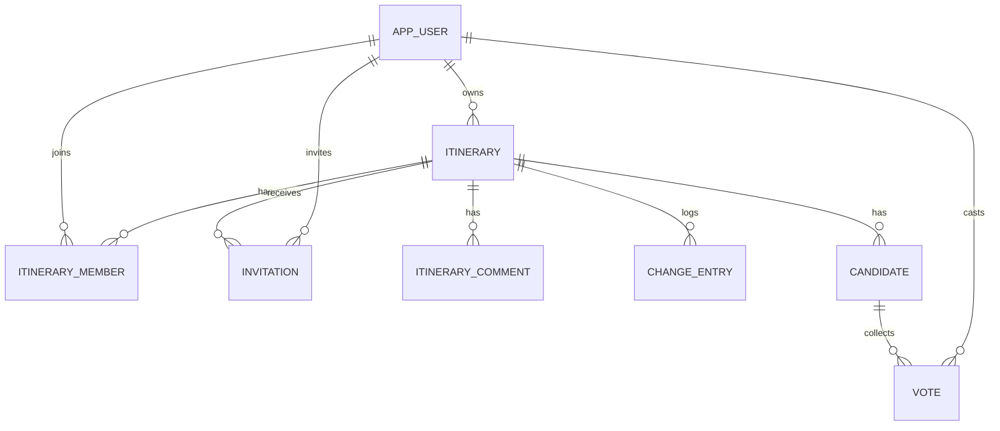

# 旅行助手数据库设计

本文给出 Travel-Assistant-Agent 在 MySQL 8 上的库表设计、索引、事务边界和迁移方案。

当前实现仍以 JSON 文件存储。本文只做设计储备，不改代码，不加依赖，也不改 `docs/架构设计.md` 里“不引入数据库”的约定。读者是后续决定落地数据库的开发，读完应能建库、迁移数据、改造 Store 层，并且清楚哪些数据不能入库。

## 1 设计边界

### 1.1 与现有架构约定的关系

有四份文档明确写了不引入数据库：`docs/架构设计.md` 第 128 行和第 295 行、`docs/旅行助手-三个递进版本.md` 第 95 行、`docs/知识库架构与周更工作流.md` 第 90 行、`docs/Agent运行时架构设计.md` 第 609 行。`docs/服务端REST接口文档.md` 第 7 节把文件存储和原子写列为现制度。

本文是演进预案，不推翻这些约定。真正实施前，需要先做架构评审，再同步修订上述文档的接口与部署章节。在此之前，分片治理、门禁脚本、文件 Store 和验收流程全部照旧运行。

### 1.2 范围划分

按数据性质分四类。判断依据有三个：是否有用户写入、是否需要跨表事务、是否已有独立治理流程。

**第一类，入库。** 七个运行态 JSON 文件对应七类业务数据：账号、行程、邀请、留言、修改记录、候选、选票。这些数据有并发写、有跨实体的一致性问题，也最能从数据库的外键与事务里得到好处。本文第 4 节到第 8 节只设计这一类。

**第二类，保留文件。** 景点知识库三件套、`ticket_channels.json`、`ticket_rules.json`、`agent_providers.json`，以及构建期复制进 jar 的契约规范源。它们只读、无用户写入、各有独立的发布与校验流程。

知识库尤其不适合迁移。`data/attractions/` 下 30 个省份分片是唯一编辑源，`tools/kb_shards.py --check` 要求分片合成结果与主库逐字节一致，`--sync` 再贯通主库和运行索引。Java 侧 `AttractionStore` 在启动时把 7757 条记录建成 id、城市、名称三个内存索引，外加 256 条有界模糊缓存。迁进数据库会同时改掉编辑源、门禁和查询路径，收益却很小，因为这些记录从不按行更新。

**第三类，明确不落库。** `FoodPlace` 的类注释写明地图服务条款禁止把 POI（Point of Interest，兴趣点）原始字段落库、缓存成数据集或再分发。天气、路线、地点查询结果同理，它们是外部接口的一次性快照。对话状态、规划草案、决策报告、两轮多 Agent 投票结果由请求体携带，服务端不保存。`HttpSession` 与 `DeepSeekClient` 的进程内用量计数也保持内存态，重启归零是现有设计的选择。

**第四类，预留设计，本期不建。** Provider 准入状态、准入报告、Agent 运行审计、会话表。这些目前是内存态，`DefaultAdmissionController` 的注释明确写了重启后要重跑 G1 到 G4。第 9 节给出字段口径，供后续评审，不作为本期交付。

### 1.3 本文不做什么

不写迁移脚本，不改 `pom.xml`，不改任何 Java 类，不建真实数据库，不执行 DDL（Data Definition Language，数据定义语言）。第 6 节的 SQL 是设计产物，用来检查字段、约束和索引是否自洽，没有在任何 MySQL 实例上执行过。

## 2 现状与容量

### 2.1 文件到表的映射

| 现有文件 | 记录形态 | 对应设计表 |
| --- | --- | --- |
| `data/accounts.json` | 顶层数组 | `app_user` |
| `data/itineraries.json` | 顶层数组，聚合根 | `itinerary`、`itinerary_member` |
| `data/invitations.json` | 顶层数组 | `invitation` |
| `data/comments.json` | 顶层数组 | `itinerary_comment` |
| `data/changelog.json` | 顶层数组 | `change_entry` |
| `data/candidates.json` | 顶层数组 | `candidate` |
| `data/votes.json` | 顶层数组 | `vote` |

七份文件都由 `PersistenceSupport` 原子替换：同目录写临时文件，再 `ATOMIC_MOVE` 覆盖。写操作是单 JVM 内的 `synchronized`，每次写都要序列化整份数组。跨进程没有文件锁，多实例部署会互相覆盖。

### 2.2 实测规模

2026-11-12 统计，只取条数和字节数，没有读取数据内容。

| 文件 | 字节 | 行数 |
| --- | --- | --- |
| `accounts.json` | 6248 | 41 |
| `itineraries.json` | 8736 | 1 |
| `invitations.json` | 3 | 0 |
| `comments.json` | 3 | 0 |
| `changelog.json` | 846 | 3 |
| `candidates.json` | 304 | 1 |
| `votes.json` | 324 | 1 |
| `attractions_index.json` | 4,361,613 | 7757 |
| `china_attractions.json` | 6,621,359 | 7757 |

业务数据量很小，处于课程开发和演示阶段。按 100 个账号、每人 10 个行程、每个行程 20 条日程项、50 条旁路记录估算，最大的表也在 10 万行以内，单表数据量约几十 MB。

这个规模用单机 MySQL 8 足够。不需要分区、分库、读写分离，也不需要引入缓存层。引入数据库主要解决跨进程并发控制和事务一致性。按当前规模，容量不需要额外处理。

## 3 选型与关键取舍

### 3.1 数据库产品

| 候选 | 优点 | 边界 |
| --- | --- | --- |
| MySQL 8 | 本机已有 MySQL80，无需安装；`JSON` 类型可承接行程内嵌集合；`CHECK` 约束和函数索引可用 | 需确认小版本，`CHECK` 从 8.0.16 起才真正生效 |
| PostgreSQL | `JSONB` 可索引，约束与事务能力更强，适合后续做复杂统计 | 本机未安装，课程演示要多一套部署 |
| SQLite 或 H2 | 零运维，测试启动快 | 不支持多实例并发写入，与解决文件锁问题的目标相悖 |

选 MySQL 8。项目是 Java 21 加 Spring Boot 3.5.16，JDBC 生态成熟，本机环境现成。要求最低 8.0.16，建议 8.0.19 以上。本机 MySQL80 的小版本没有核实，实施前先执行 `SELECT VERSION();` 确认；若低于 8.0.16，把 `CHECK` 约束改为应用层校验。

### 3.2 行程内嵌集合怎么存

`Itinerary` 有五个内嵌集合：`members`、`plan`、`dailySchedules`、`transports`、`lodgings`、`expenses`。现有接口按板块整块读写，例如 `GET/PUT /itineraries/{id}/daily`。一次写操作读出整份聚合，改一个板块，整份回写，同时 `version` 加 1。

两个方案对比如下。

| 方案 | 做法 | 代价 |
| --- | --- | --- |
| 全拆子表 | 日程、活动、交通、住宿、费用各建一张表 | 一次 PUT 变成多条删除加插入，必须包事务，版本校验要放进事务，Service 层改动大 |
| 主表加 JSON 列 | 五个集合各存一列 `JSON`，`version` 留在主表 | 按单个日程项做条件查询要用 `JSON_SET` 或读改写，无法直接对费用做 SQL 聚合 |

推荐主表加 JSON 列，另外把 `members` 拆成 `itinerary_member` 表。理由有三条。第一，现有接口的读写粒度是“整个板块”，JSON 列与它同构，迁移后 Store 层的读写语句几乎不变。第二，预算分析现在由 `BudgetCalculator` 在应用层算，不依赖 SQL 聚合，JSON 列不会挡住现有功能。第三，成员表有独立的查询需求，接口要列成员、改授权、按用户查可见行程，拆表后可以直接建联合索引。

有两个操作要特别处理。`PUT /activities/{activityId}/ticket-record` 和 `POST /activities` 是按单个日程项写入，需要先读出 `daily_json`，在应用层定位并改写，再整列写回。这与当前“读整份再回写”的做法一致。改写的 SQL 仍是单条 `UPDATE`，配合 `WHERE version = ?` 保住乐观锁。

拆表的触发条件写清楚：当需要对费用做跨行程的 SQL 统计，或需要按日程项做条件检索时，把 `expenses` 和 `dailySchedules` 迁成独立表。第 9 节给出这两张表的字段口径。

### 3.3 通用约定

**主键。** 内部用 `BIGINT UNSIGNED AUTO_INCREMENT` 做聚簇主键。外部可见的 UUID 保留为 `public_id CHAR(36)`，加唯一索引。这样前端和接口里的 id 不用改，同时避免用 36 字节随机字符串做聚簇主键带来的页分裂和二级索引膨胀。

**时间。** 统一 `DATETIME(3)`，存 UTC，不用 `TIMESTAMP`。Java 侧现在是 `Instant`，Jackson 序列化成 ISO-8601 的 UTC 字符串，迁移时按 UTC 解析即可。用 `DATETIME` 可以避开 JDBC 时区转换和 2038 年上限。展示时区由应用层处理。

**字符。** 库级 `utf8mb4` 加 `utf8mb4_0900_ai_ci`。若小版本不支持该排序规则，退回 `utf8mb4_unicode_ci`。用户名沿用现有校验 `^[A-Za-z0-9_]{3,32}$`，用 `VARCHAR(32)`。BCrypt 哈希固定 60 字符，用 `CHAR(60)`。

**金额。** 现有 `Expense.amount` 是 `BigDecimal`，暂时留在 `expenses_json` 里。将来拆表时用 `DECIMAL(12,2)`，不用 `FLOAT` 或 `DOUBLE`。

**枚举。** 用 `VARCHAR` 加 `CHECK` 兜底，不用 MySQL 的 `ENUM` 类型。状态值由 Java 枚举校验，`CHECK` 只防脏数据写入。新增枚举值时要同步改 `CHECK`，这一点要在实施清单里记下来。

**弱引用改外键。** 现在 `owner`、`voter`、`proposedBy`、`actor`、`inviter`、`invitee`、`author` 都是 username 字符串，没有约束。入库后统一改成 `*_id` 外键指向 `app_user`。`attraction_id` 保持普通字符串列，不建外键，因为知识库仍是文件，且 `Candidate` 允许填库里没有的地点。

**删除语义。** 沿用物理删除，不加统一的 `deleted_at`。`itinerary.archived` 只标记只读状态，可以 `unarchive` 恢复。删除行程时，旁路数据用 `ON DELETE CASCADE` 清理，替代现在应用层三次独立原子写。`vote` 只通过 `candidate_id` 级联，避免同一个父表经两条路径级联到同一行。

## 4 概念模型



八张表分成两组。`itinerary` 是聚合根，五个板块以 JSON 列内嵌。`invitation`、`itinerary_comment`、`change_entry`、`candidate`、`vote` 是行程外的旁路数据，按 `itinerary_id` 分区。

`itinerary_member` 是多对多关联表。现有实现把 `Member` 数组内嵌在行程里，拆表后成员权限可以单独授权和查询，也不会因为加成员而推动行程版本号。

## 5 表结构

字段类型按 MySQL 8 写。`JSON` 列都设为 `NOT NULL`，插入时应用层必须显式写入 `{}` 或 `[]`，不依赖表达式默认值，以兼容较老的 8.0 小版本。

### 5.1 app_user

| 字段 | 类型 | 约束 | 说明 |
| --- | --- | --- | --- |
| `id` | `BIGINT UNSIGNED` | 主键，自增 | 内部主键 |
| `username` | `VARCHAR(32)` | 唯一，非空 | 登录名，保留现有校验规则 |
| `password_hash` | `CHAR(60)` | 非空 | BCrypt 哈希，禁止明文 |
| `roles_json` | `JSON` | 非空 | 对应 `Account.roles`，默认写 `[]` |
| `created_at` | `DATETIME(3)` | 非空 | 补审计字段，现有实体没有 |
| `updated_at` | `DATETIME(3)` | 非空 | 补审计字段 |

### 5.2 itinerary

| 字段 | 类型 | 约束 | 说明 |
| --- | --- | --- | --- |
| `id` | `BIGINT UNSIGNED` | 主键，自增 | 内部主键 |
| `public_id` | `CHAR(36)` | 唯一，非空 | 现有 UUID 字符串 |
| `owner_id` | `BIGINT UNSIGNED` | 外键，非空 | 指向 `app_user` |
| `title` | `VARCHAR(120)` | 非空 | 行程标题 |
| `version` | `BIGINT` | 非空，默认 1，检查 `>= 1` | 乐观锁，对应 Java `long` |
| `plan_json` | `JSON` | 非空 | `Plan` 对象 |
| `daily_json` | `JSON` | 非空 | `DailySchedule` 数组，含 `DailyActivity` 与 `TicketRecord` |
| `transports_json` | `JSON` | 非空 | `Transport` 数组 |
| `lodgings_json` | `JSON` | 非空 | `Lodging` 数组 |
| `expenses_json` | `JSON` | 非空 | `Expense` 数组，金额保留十进制语义 |
| `archived` | `TINYINT(1)` | 非空，默认 0 | 归档后所有写路径拒绝，返回 409 |
| `archived_at` | `DATETIME(3)` | 可空 | 归档时间 |
| `created_at` | `DATETIME(3)` | 非空 | 对应 `Instant` |
| `updated_at` | `DATETIME(3)` | 非空 | 每次写更新 |

### 5.3 itinerary_member

| 字段 | 类型 | 约束 | 说明 |
| --- | --- | --- | --- |
| `itinerary_id` | `BIGINT UNSIGNED` | 联合主键，外键级联 | 指向 `itinerary` |
| `user_id` | `BIGINT UNSIGNED` | 联合主键，外键 | 指向 `app_user` |
| `sections_json` | `JSON` | 非空 | `Section` 数组，值为 `PLAN` 等五种 |

### 5.4 invitation

| 字段 | 类型 | 约束 | 说明 |
| --- | --- | --- | --- |
| `id` | `BIGINT UNSIGNED` | 主键，自增 | 内部主键 |
| `public_id` | `CHAR(36)` | 唯一，非空 | 现有 UUID |
| `itinerary_id` | `BIGINT UNSIGNED` | 外键级联，非空 | 指向 `itinerary` |
| `inviter_id` | `BIGINT UNSIGNED` | 外键，非空 | 发起人 |
| `invitee_id` | `BIGINT UNSIGNED` | 外键，非空 | 受邀人 |
| `sections_json` | `JSON` | 非空 | 拟授予的板块集合 |
| `status` | `VARCHAR(16)` | 非空，默认 `PENDING`，检查四种取值 | `PENDING`、`ACCEPTED`、`REJECTED`、`CANCELLED` |
| `created_at` | `DATETIME(3)` | 非空 | 发起时间 |
| `responded_at` | `DATETIME(3)` | 可空 | 处理时间 |

### 5.5 itinerary_comment

| 字段 | 类型 | 约束 | 说明 |
| --- | --- | --- | --- |
| `id` | `BIGINT UNSIGNED` | 主键，自增 | 内部主键 |
| `public_id` | `CHAR(36)` | 唯一，非空 | 现有 UUID |
| `itinerary_id` | `BIGINT UNSIGNED` | 外键级联，非空 | 指向 `itinerary` |
| `author_id` | `BIGINT UNSIGNED` | 外键，非空 | 留言人 |
| `content` | `VARCHAR(2000)` | 非空 | 现有上限 2000 字 |
| `created_at` | `DATETIME(3)` | 非空 | 发表时间 |

留言没有编辑和删除接口，设计里也不加软删除列。

### 5.6 change_entry

| 字段 | 类型 | 约束 | 说明 |
| --- | --- | --- | --- |
| `id` | `BIGINT UNSIGNED` | 主键，自增 | 内部主键 |
| `public_id` | `CHAR(36)` | 唯一，非空 | 现有 UUID |
| `itinerary_id` | `BIGINT UNSIGNED` | 外键级联，非空 | 指向 `itinerary` |
| `actor_id` | `BIGINT UNSIGNED` | 外键，非空 | 操作人 |
| `section` | `VARCHAR(16)` | 非空 | `PLAN`、`DAILY`、`MEMBER`、`COMMENT` 等 |
| `summary` | `VARCHAR(500)` | 非空 | 服务端生成的中文摘要 |
| `version` | `BIGINT` | 非空 | 写入后的行程版本号 |
| `occurred_at` | `DATETIME(3)` | 非空 | 对应现有 `at` 字段 |

单行程 500 条上限现在由 `CollaborationStore` 维护。入库后仍由应用层按 `itinerary_id` 定期清理，也可以改用定时任务，不需要数据库触发器。

### 5.7 candidate

| 字段 | 类型 | 约束 | 说明 |
| --- | --- | --- | --- |
| `id` | `BIGINT UNSIGNED` | 主键，自增 | 内部主键 |
| `public_id` | `CHAR(36)` | 唯一，非空 | 现有 UUID |
| `itinerary_id` | `BIGINT UNSIGNED` | 外键级联，非空 | 指向 `itinerary` |
| `kind` | `VARCHAR(16)` | 非空，检查三种取值 | `ATTRACTION`、`LODGING`、`OTHER` |
| `name` | `VARCHAR(80)` | 非空 | 现有上限 80 字 |
| `city` | `VARCHAR(64)` | 可空 | 城市 |
| `attraction_id` | `VARCHAR(64)` | 可空，无外键 | 允许填知识库里没有的地点 |
| `note` | `VARCHAR(500)` | 可空 | 现有上限 500 字 |
| `proposed_by_id` | `BIGINT UNSIGNED` | 外键，非空 | 提议人 |
| `created_at` | `DATETIME(3)` | 非空 | 提议时间 |

### 5.8 vote

| 字段 | 类型 | 约束 | 说明 |
| --- | --- | --- | --- |
| `id` | `BIGINT UNSIGNED` | 主键，自增 | 内部主键 |
| `public_id` | `CHAR(36)` | 唯一，非空 | 现有 UUID |
| `itinerary_id` | `BIGINT UNSIGNED` | 非空，无外键 | 冗余列，用于按行程查票 |
| `candidate_id` | `BIGINT UNSIGNED` | 外键级联，非空 | 指向 `candidate` |
| `voter_id` | `BIGINT UNSIGNED` | 外键，非空 | 投票人 |
| `choice` | `VARCHAR(12)` | 非空，检查三种取值 | `SUPPORT`、`OPPOSE`、`ABSTAIN` |
| `voted_at` | `DATETIME(3)` | 非空 | 首次投票时间 |
| `updated_at` | `DATETIME(3)` | 非空 | 改票时间 |

`UNIQUE (candidate_id, voter_id)` 是这张表最关键的约束。现有 `DecisionStore` 靠应用层保证“一人一票、再投改票”，入库后由唯一索引承担，配合 `INSERT ... ON DUPLICATE KEY UPDATE` 实现改票。`itinerary_id` 不加外键，避免删除行程时经 `itinerary` 和 `candidate` 两条路径同时级联到同一行。

## 6 建表语句

下面的 SQL 用于检查设计的自洽性，没有在任何实例上执行过。执行前先确认 MySQL 小版本，低于 8.0.16 时删掉全部 `CHECK` 子句。

```sql
CREATE DATABASE IF NOT EXISTS travel_assistant
  DEFAULT CHARACTER SET utf8mb4
  DEFAULT COLLATE utf8mb4_0900_ai_ci;

USE travel_assistant;

CREATE TABLE app_user (
  id            BIGINT UNSIGNED NOT NULL AUTO_INCREMENT,
  username      VARCHAR(32)     NOT NULL,
  password_hash CHAR(60)        NOT NULL,
  roles_json    JSON            NOT NULL,
  created_at    DATETIME(3)     NOT NULL,
  updated_at    DATETIME(3)     NOT NULL,
  PRIMARY KEY (id),
  UNIQUE KEY uk_app_user_username (username)
) ENGINE=InnoDB;

CREATE TABLE itinerary (
  id              BIGINT UNSIGNED NOT NULL AUTO_INCREMENT,
  public_id       CHAR(36)        NOT NULL,
  owner_id        BIGINT UNSIGNED NOT NULL,
  title           VARCHAR(120)    NOT NULL,
  version         BIGINT          NOT NULL DEFAULT 1,
  plan_json       JSON            NOT NULL,
  daily_json      JSON            NOT NULL,
  transports_json JSON            NOT NULL,
  lodgings_json   JSON            NOT NULL,
  expenses_json   JSON            NOT NULL,
  archived        TINYINT(1)      NOT NULL DEFAULT 0,
  archived_at     DATETIME(3)     NULL,
  created_at      DATETIME(3)     NOT NULL,
  updated_at      DATETIME(3)     NOT NULL,
  PRIMARY KEY (id),
  UNIQUE KEY uk_itinerary_public_id (public_id),
  KEY idx_itinerary_owner (owner_id, archived, updated_at),
  CONSTRAINT fk_itinerary_owner FOREIGN KEY (owner_id) REFERENCES app_user (id),
  CONSTRAINT ck_itinerary_version CHECK (version >= 1)
) ENGINE=InnoDB;

CREATE TABLE itinerary_member (
  itinerary_id  BIGINT UNSIGNED NOT NULL,
  user_id       BIGINT UNSIGNED NOT NULL,
  sections_json JSON            NOT NULL,
  PRIMARY KEY (itinerary_id, user_id),
  KEY idx_member_user (user_id, itinerary_id),
  CONSTRAINT fk_member_itinerary FOREIGN KEY (itinerary_id)
    REFERENCES itinerary (id) ON DELETE CASCADE,
  CONSTRAINT fk_member_user FOREIGN KEY (user_id) REFERENCES app_user (id)
) ENGINE=InnoDB;

CREATE TABLE invitation (
  id            BIGINT UNSIGNED NOT NULL AUTO_INCREMENT,
  public_id     CHAR(36)        NOT NULL,
  itinerary_id  BIGINT UNSIGNED NOT NULL,
  inviter_id    BIGINT UNSIGNED NOT NULL,
  invitee_id    BIGINT UNSIGNED NOT NULL,
  sections_json JSON            NOT NULL,
  status        VARCHAR(16)     NOT NULL DEFAULT 'PENDING',
  created_at    DATETIME(3)     NOT NULL,
  responded_at  DATETIME(3)     NULL,
  PRIMARY KEY (id),
  UNIQUE KEY uk_invitation_public_id (public_id),
  KEY idx_invitation_inbox (invitee_id, status, created_at),
  KEY idx_invitation_itinerary (itinerary_id),
  CONSTRAINT fk_invitation_itinerary FOREIGN KEY (itinerary_id)
    REFERENCES itinerary (id) ON DELETE CASCADE,
  CONSTRAINT fk_invitation_inviter FOREIGN KEY (inviter_id) REFERENCES app_user (id),
  CONSTRAINT fk_invitation_invitee FOREIGN KEY (invitee_id) REFERENCES app_user (id),
  CONSTRAINT ck_invitation_status
    CHECK (status IN ('PENDING', 'ACCEPTED', 'REJECTED', 'CANCELLED'))
) ENGINE=InnoDB;

CREATE TABLE itinerary_comment (
  id            BIGINT UNSIGNED NOT NULL AUTO_INCREMENT,
  public_id     CHAR(36)        NOT NULL,
  itinerary_id  BIGINT UNSIGNED NOT NULL,
  author_id     BIGINT UNSIGNED NOT NULL,
  content       VARCHAR(2000)   NOT NULL,
  created_at    DATETIME(3)     NOT NULL,
  PRIMARY KEY (id),
  UNIQUE KEY uk_comment_public_id (public_id),
  KEY idx_comment_itinerary (itinerary_id, created_at),
  CONSTRAINT fk_comment_itinerary FOREIGN KEY (itinerary_id)
    REFERENCES itinerary (id) ON DELETE CASCADE,
  CONSTRAINT fk_comment_author FOREIGN KEY (author_id) REFERENCES app_user (id)
) ENGINE=InnoDB;

CREATE TABLE change_entry (
  id            BIGINT UNSIGNED NOT NULL AUTO_INCREMENT,
  public_id     CHAR(36)        NOT NULL,
  itinerary_id  BIGINT UNSIGNED NOT NULL,
  actor_id      BIGINT UNSIGNED NOT NULL,
  section       VARCHAR(16)     NOT NULL,
  summary       VARCHAR(500)    NOT NULL,
  version       BIGINT          NOT NULL,
  occurred_at   DATETIME(3)     NOT NULL,
  PRIMARY KEY (id),
  UNIQUE KEY uk_change_public_id (public_id),
  KEY idx_change_itinerary (itinerary_id, occurred_at),
  CONSTRAINT fk_change_itinerary FOREIGN KEY (itinerary_id)
    REFERENCES itinerary (id) ON DELETE CASCADE,
  CONSTRAINT fk_change_actor FOREIGN KEY (actor_id) REFERENCES app_user (id)
) ENGINE=InnoDB;

CREATE TABLE candidate (
  id             BIGINT UNSIGNED NOT NULL AUTO_INCREMENT,
  public_id      CHAR(36)        NOT NULL,
  itinerary_id   BIGINT UNSIGNED NOT NULL,
  kind           VARCHAR(16)     NOT NULL,
  name           VARCHAR(80)     NOT NULL,
  city           VARCHAR(64)     NULL,
  attraction_id  VARCHAR(64)     NULL,
  note           VARCHAR(500)    NULL,
  proposed_by_id BIGINT UNSIGNED NOT NULL,
  created_at     DATETIME(3)     NOT NULL,
  PRIMARY KEY (id),
  UNIQUE KEY uk_candidate_public_id (public_id),
  KEY idx_candidate_itinerary (itinerary_id, created_at),
  CONSTRAINT fk_candidate_itinerary FOREIGN KEY (itinerary_id)
    REFERENCES itinerary (id) ON DELETE CASCADE,
  CONSTRAINT fk_candidate_proposer FOREIGN KEY (proposed_by_id) REFERENCES app_user (id),
  CONSTRAINT ck_candidate_kind
    CHECK (kind IN ('ATTRACTION', 'LODGING', 'OTHER'))
) ENGINE=InnoDB;

CREATE TABLE vote (
  id            BIGINT UNSIGNED NOT NULL AUTO_INCREMENT,
  public_id     CHAR(36)        NOT NULL,
  itinerary_id  BIGINT UNSIGNED NOT NULL,
  candidate_id  BIGINT UNSIGNED NOT NULL,
  voter_id      BIGINT UNSIGNED NOT NULL,
  choice        VARCHAR(12)     NOT NULL,
  voted_at      DATETIME(3)     NOT NULL,
  updated_at    DATETIME(3)     NOT NULL,
  PRIMARY KEY (id),
  UNIQUE KEY uk_vote_candidate_voter (candidate_id, voter_id),
  UNIQUE KEY uk_vote_public_id (public_id),
  KEY idx_vote_itinerary (itinerary_id),
  CONSTRAINT fk_vote_candidate FOREIGN KEY (candidate_id)
    REFERENCES candidate (id) ON DELETE CASCADE,
  CONSTRAINT fk_vote_voter FOREIGN KEY (voter_id) REFERENCES app_user (id),
  CONSTRAINT ck_vote_choice
    CHECK (choice IN ('SUPPORT', 'OPPOSE', 'ABSTAIN'))
) ENGINE=InnoDB;
```

## 7 索引与查询对应

索引按现有接口反推，不预设用不上的组合。所有旁路数据都以 `itinerary_id` 为前导列，这与当前按行程分区的查询方式一致。

| 接口 | 查询形态 | 命中索引 |
| --- | --- | --- |
| `GET /api/itineraries` | 按 `owner_id` 过滤未归档，按 `updated_at` 排序 | `idx_itinerary_owner` |
| 我参与的行程 | 按 `user_id` 查 `itinerary_member` 再回表 | `idx_member_user` |
| `GET /api/invitations` | 按 `invitee_id` 和 `status='PENDING'` 过滤 | `idx_invitation_inbox` |
| `GET /comments` | 按 `itinerary_id` 查，按 `created_at` 排序 | `idx_comment_itinerary` |
| `GET /changelog` | 同上，带 `LIMIT 50` 到 200 | `idx_change_itinerary` |
| `GET /candidates` | 按 `itinerary_id` 查候选，再按 `candidate_id` 聚合选票 | `idx_candidate_itinerary`、`uk_vote_candidate_voter` |
| 投票与改票 | 按 `(candidate_id, voter_id)` 定位 | `uk_vote_candidate_voter` |
| 删除行程 | 按主键删，级联清旁路表 | 各表外键 |

`public_id` 的唯一索引服务于接口路径参数。现有接口用 UUID 字符串定位行程，迁移后先用 `public_id` 查出内部 `id`，再走外键，避免把 36 字节字符串复制到每张旁路表。

## 8 事务与并发

### 8.1 乐观锁

现有 `ItineraryService` 用 64 条按 id 哈希分片的写锁，把“读、校验版本、写”串成原子动作。入库后由单条 UPDATE 承担：

```sql
UPDATE itinerary
SET daily_json = ?, version = version + 1, updated_at = ?
WHERE id = ? AND version = ? AND archived = 0;
```

检查受影响行数。返回 0 时查询当前 `version`，交给 `ApiExceptionHandler` 返回 409 和 `X-Version` 头。JVM 内的分片写锁可以删掉，因为数据库的行锁覆盖了跨进程场景。这是引入数据库最直接的一项收益。

推动版本号的操作不止按板块 PUT：归档与取消归档（`withArchived`）、退出行程与接受邀请（`withMembers`）在现有代码里都 `version + 1`，入库后同样要走带 `version = version + 1` 的 UPDATE 并校验受影响行数。其中接受邀请不预先校验版本（受邀者响应邀请，不是与他人的并发编辑），但写入仍在行程写锁内、版本号照常 +1；归档/取消归档对已是目标状态的请求幂等返回、不涨版本。真正不改行程版本号的是旁路操作：添加候选、投票、留言、写修改记录——它们落在 `candidate` / `vote` / `itinerary_comment` / `change_entry` 等独立表，不触碰 `itinerary` 聚合，入库后用单条 INSERT 或 UPDATE 完成。

### 8.2 事务边界

按板块 PUT 只改 `itinerary` 一行，单条 UPDATE 自带原子性，不需要显式事务。删除行程是一条 DELETE 加外键级联，替代现在 `changeLog.purge`、`decisions.purge`、`cancelPendingOf` 三次独立文件写。中途失败不会产生孤儿数据。

需要显式事务的只有两处。一是接受邀请：要同时把邀请置为 `ACCEPTED` 并插入 `itinerary_member`。二是确认候选写入日程：要改 `itinerary` 并写 `change_entry`。这两处用 `REPEATABLE READ` 默认隔离级别即可，事务范围控制在两条语句内。

建议把连接隔离级别设为 `READ COMMITTED`，减少间隙锁。实施时压测确认，本文不做结论。

## 9 预留设计

下面三类表本期不建，只记录字段口径，供后续评审 Agent 运行时持久化时使用。

**`agent_provider`。** `provider_id`、`kind`、`endpoint`、`capabilities_json`、`status`、`enabled`、`contract_version`、`updated_at`。现在这些内容在 `agent_providers.json`，状态在 `DefaultAdmissionController` 的内存 `ConcurrentHashMap`。要持久化，先决定配置与状态的边界：配置适合留在文件，状态适合入库。

**`agent_admission_report`。** `run_id`、`provider_id`、`stage`、`failures_json`、`warnings_json`、`checked_at`。对应现有 `AdmissionReport`，G0 到 G4 每次准入留一条。

**`agent_run_audit`。** `run_id`、`provider_id`、`intent`、`schema_version`、`elapsed_ms`、`result_code`、`created_at`。`docs/Agent运行时架构设计.md` 提过审计只记这些字段，没有实现。`run_id` 用哈希后的用户标识，不要存用户名。

会话表不在本文设计范围。多实例部署若需要共享会话，用 Spring Session 的表结构，由框架提供，不自己造。

两张可选拆表的字段口径也记在这里。`expense`：`itinerary_id`、`category`、`amount DECIMAL(12,2)`、`currency`、`expense_date`、`actual`、`note`。`daily_activity`：`itinerary_id`、`schedule_date`、`time_text`、`title`、`location`、`start_time`、`end_time`、`ticket_record_json`。触发条件见 3.2 节。

## 10 迁移方案

迁移按停机窗口设计，当前数据量很小，全量导入可以在分钟级完成。

**第一步，备份。** 复制七份运行态 JSON 到项目外的备份目录。这些文件含 BCrypt 哈希和用户行程，备份不要进 Git，也不要写进日志或交付清单。

**第二步，建库。** 执行第 6 节 DDL，记录 `SELECT VERSION();` 的结果。

**第三步，导入账号。** 按 `username` 插入 `app_user`，生成内部 `id`，在内存里保留 `username` 到 `id` 的映射。`created_at` 和 `updated_at` 用导入时间补齐，现有实体没有这两个字段。

**第四步，导入行程。** 先插 `itinerary`，保留原 `id` 到 `public_id`、`version` 原值、五个集合序列化成 JSON 列。再按 `members` 数组插 `itinerary_member`，把 username 换成 `user_id`。

**第五步，导入旁路数据。** 依次处理邀请、留言、修改记录、候选、选票。`itinerary_id` 和 `candidate_id` 用 `public_id` 反查内部 `id`。选票按唯一键去重，与现有“再投改票”的语义核对。

**第六步，校验。** 八张设计表的行数与源 JSON 逐一比对（`itinerary` 与 `itinerary_member` 同源于 `itineraries.json`，分别按聚合与成员数组核对）。抽查 `version` 全量一致、`archived` 状态一致、金额合计一致。金额在 JSON 列里，可用 `JSON_TABLE` 展开后求和。

**第七步，切换与回滚。** 用配置开关切换 Store 实现，先只读观察，再开放写入。回滚时保留 JSON 文件，切回文件 Store。若切换期间有新写入，需要从数据库导出补回 JSON，因此切换窗口内应先停写。

迁移脚本不在本文实现。脚本要避免打印账号哈希和行程正文，只输出行数与校验结果。

## 11 实施影响清单

决定落地时，下面这些位置要改。本期全部不动。

- 依赖：`pom.xml` 加 `spring-boot-starter-jdbc`、`mysql-connector-j`、`flyway-core`。
- 存储层：五个业务 Store 类（`AccountStore`、`ItineraryStore`、`InvitationStore`、`DecisionStore`、`CollaborationStore`，对应七份运行态 JSON）改为 JDBC 实现，`PersistenceSupport` 与原子写逻辑下线；`AttractionStore` 仍读文件知识库、不入库（见 1.2 第二类）。
- 服务层：`ItineraryService` 去掉 64 条分片锁，版本校验改成受影响行数判断；`DecisionStore.purge`、`CollaborationStore.purge` 等应用层清理逻辑删掉，交给外键级联。
- 身份：`JsonUserDetailsService` 从 `app_user` 读取；所有 username 弱引用换成 `user_id`。
- 文档：第 1.1 节列出的四份架构文档，以及接口文档第 7 节，同步修订。
- 测试：补并发版本冲突、级联删除、唯一键改票、迁移一致性四类用例。项目门禁要求新增 Java 代码同批补测试。

## 12 风险与未决项

- 本机 MySQL80 的小版本没有核实。`CHECK` 约束和 `utf8mb4_0900_ai_ci` 都依赖 8.0.16 以上，实施前先查版本。
- 时间字段由 `Instant` 转成 UTC 的 `DATETIME(3)`，跨时区展示要在应用层做，现有代码没有这层转换。
- username 改 `user_id` 会触及多数 Service 和 DTO。接口层保留 `public_id`，前端不用改，但服务端改动面不小。
- 按单个日程项写入要走读改写或 `JSON_SET`，并发下仍依赖 `version` 乐观锁，不能省。
- `FoodPlace` 与外部地图结果按合规要求不落库，这条边界不随引入数据库而改变。
- 知识库分片与逐字节门禁保持文件形态，数据库里不建景点表，`attraction_id` 始终是无外键的普通字符串。
- 当前数据量 41 个账号、1 个行程，容量估算基于假设，实施前用真实增长数据复核一次。
- 多实例会话共享未解决。`HttpSession` 仍是容器内存态，需要单独评审 Spring Session。
