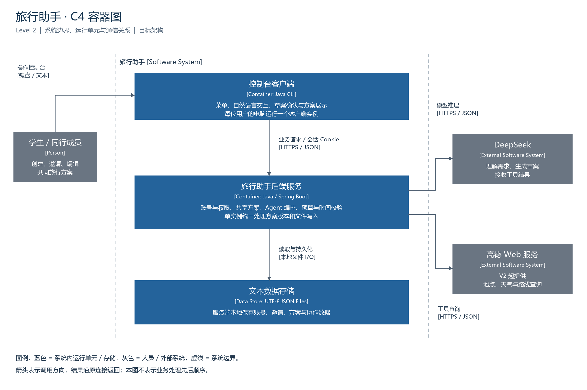
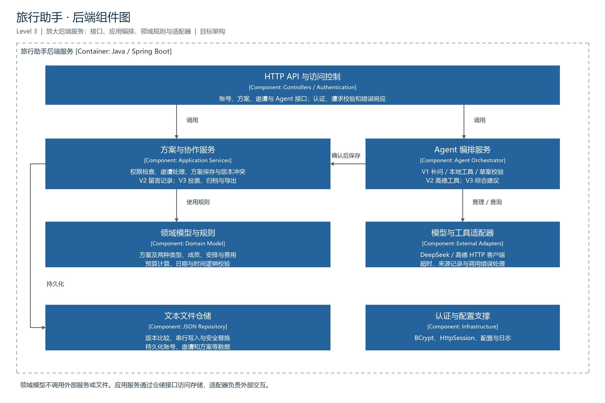

# 旅行助手架构设计

> 2026-11-04 更新：V1 五节、V2 四块能力与 V3 四节均已落地（详见[落地状态](#当前落地状态)），
> 图片为旧架构视图，尚未同步新增组件，以文字方案为准。
> 2026-11-02：Agent 目标由单 Agent 调整为 Java 显式编排的多角色流程，知识库与票务细节见[多 Agent 与票务能力方案](多Agent与票务能力方案.md)。
> 2026-11-08 更正：Agent 运行时落地口径改为 Provider SPI，见[Agent运行时架构设计](Agent运行时架构设计.md)；下文第五、六节的 Spring AI 与三角色表述保留为 2026-11-02 目标态，不再作为待落地目标。

## 一、架构视图

采用 C4 的容器与组件视图表达目标架构，分别说明系统运行边界和后端内部职责。

### 容器图（Level 2）



### 后端组件图（Level 3）



组件图展示主要调用关系；认证与配置是供各组件使用的公共支撑，其连接为简洁起见省略。

## 二、各层涉及的内容

### 第一层：客户端表现层

运行在用户自己的电脑上，负责与用户交互。

- **账号操作**：注册、登录、退出及展示登录状态。
- **方案操作**：输入自然语言需求，查看、确认、编辑行程草案及历史方案。
- **协作操作**：邀请用户、处理邀请、查看共享方案。
- **结果展示**：显示预算、时间检查结果、操作错误及 Agent 建议。
- **网络访问**：通过 HTTP/HTTPS 调用共享服务接口；不直接修改服务端数据文件。
- **后续版本**：V2 展示查询结果、留言和修改记录；V3 展示投票、预算分析及导出功能。

### 第二层：服务接口层

运行在共享服务端，负责接收客户端请求并返回结果。

- **账号接口**：注册、登录和会话相关请求。
- **方案接口**：创建、查询、更新、删除方案。
- **协作接口**：发送邀请、接受或拒绝邀请、移除成员或退出方案。
- **Agent 接口**：提交自然语言需求、获取草案和建议。
- **公共处理**：解析请求、校验格式、识别登录身份，并把业务异常转换为清晰的错误响应。
- **版本扩展**：V2 增加地点、天气、路线、留言和记录接口；V3 增加投票、预算分析、导出和归档接口。

### 第三层：业务服务层

负责实际业务规则，是系统的核心。

- **账号与会话**：注册、登录和会话管理。
- **邀请与权限**：校验创建者和成员权限，处理邀请状态及成员关系。
- **行程管理**：创建、编辑、查询和删除方案；维护两种行程类型。
- **Agent 编排**：目标方案采用 Spring AI 加 Java 显式流程，V1 划分需求理解、景点推荐和行程规划三个 Agent，V2 增加票务 Agent 的购票辅助及高德查询，V3 扩展投票与支出分析。预算、日期、权限由 Java 服务校验；草案经用户确认后由方案服务保存。**当前实现**是确定性检索流水线 + 经 OpenAI 兼容 HTTP 直连的可选文字润色，尚未接入 Agent，无自主工具调用与多轮补问。
- **知识检索与票务**：Python 离线构建景点快照，Java 通过仓储接口加载和检索；票务首期提供经核验的官方入口与规则。完整交易为 V3 之后的条件性扩展，需正式平台接口、授权及订单存储设计。
- **预算计算**：汇总已填写费用，标记缺失项；V3 增加实际支出、人均费用及超支分析。
- **时间校验**：V1 检查旅行起止时间；V2 检查具体安排的时间范围和重叠。
- **冲突处理**：检查方案版本，拒绝覆盖其他成员已保存的更新。
- **后续业务**：V2 维护留言和修改记录；V3 处理候选项、投票、归档与导出。

### 第四层：领域模型层

使用 Java 类描述系统中的业务对象和关系。

- **用户**：账号标识、登录信息及所属方案。
- **邀请**：方案、邀请人、受邀人和处理状态。
- **旅行方案**：创建者、成员、目的地、时间、预算、安排和版本号。
- **行程类型**：以旅行方案为基础，建模短途周末游和长途跨省游；共同字段由基础类维护，类型差异按实际业务逐步补充。
- **旅行安排**：交通、住宿、景点等对象及其时间、费用信息。
- **后续对象**：V2 增加留言和修改记录；V3 增加候选地点、投票和实际支出。

### 第五层：基础设施与外部服务层

为业务层提供存储、认证和外部查询能力。

- **本地文件存储**：服务端使用 UTF-8 JSON 文本文件读取和保存账号、邀请及方案等数据。
- **安全与配置**：使用成熟的密码哈希算法；API 密钥通过环境变量提供，会话和敏感信息不写入日志。
- **DeepSeek 接入**：发送模型请求、处理超时和错误，供 Agent 编排使用。
- **高德接入**：V2 起封装地点、天气和路线查询，记录来源及查询时间。
- **文件维护**：串行化写入并使用临时文件替换，发生错误时保留原数据；定期备份，损坏时从备份恢复。

## 三、典型业务调用路径

1. **生成方案**：客户端输入需求 → Agent 接口 → Agent 业务服务 → DeepSeek → 返回草案 → 用户修改确认 → 方案服务校验并保存。
2. **邀请成员**：客户端发送邀请 → 协作接口 → 邀请与权限服务 → 文件仓储保存邀请 → 受邀者接受后更新成员关系。
3. **共同编辑**：客户端读取方案及版本 → 修改后提交 → 业务服务检查权限与版本 → 文件仓储保存；版本不一致则返回冲突提示。
4. **查询路线（V2）**：客户端请求建议 → Agent 服务选择路线工具 → 高德接口查询 → 返回结果及来源 → 用户确认是否调整方案。

## 四、部署与限制

- 多个控制台客户端连接同一个 Spring Boot 服务。服务端需要位于各成员电脑可访问的网络中。
- 文本文件保存在服务端本地，服务重启后读取；客户端各自的本地文件不构成共享数据。
- 写入由单个服务进程串行管理；当前设计不支持多个服务实例同时写同一份文件。
- 服务停止或网络中断时无法共享编辑；文件损坏或磁盘故障仍有数据丢失风险，需要定期备份。
- 跨设备部署应使用 HTTPS，并保护服务端数据文件和备份。外部接口的权限、配额与费用在接入前核实。


## 五、技术选型与对应技术栈

下表为终版目标技术栈，不代表已完成实现。具体 Spring Boot 版本需按兼容性统一锁定，并通过构建和接口测试验证。

> **当前实现差异**：未引入 Spring AI 依赖（POM 已移除 `spring-ai-deepseek` 与 BOM，源码零引用），
> 模型接入为 OpenAI 兼容 HTTP 直连。下表中「模型接入」「Agent 本地工具」两行的 Spring AI 方案
> 属于 2026-11-02 目标设计，不是已落地实现。
> **2026-11-08 更正**：这两行不再作为待落地目标。Agent 运行时改为 Provider SPI 加配置式注册，
> 见[Agent运行时架构设计](Agent运行时架构设计.md)和[Agent接入规范](Agent接入规范.md)；表格其余行不变。

| 层次 / 能力 | 技术选择 | 用途 | 引入版本 |
| --- | --- | --- | --- |
| 开发语言 | Java 21 | 客户端、服务端和业务对象 | V1 |
| 控制台表现层 | Java Console / Scanner | 菜单、输入与结果展示；交互读取封装统一处理 | V1 |
| 客户端网络 | JDK HttpClient | 请求共享后端、通过 CookieManager 管理会话 Cookie | V1 |
| HTTP 接口层 | Spring Boot + Spring Web MVC | REST 接口、JSON 请求与响应 | V1 |
| 输入校验 | Jakarta Bean Validation + 业务校验 | 必填、格式、金额和日期规则 | V1 |
| 身份与权限 | Spring Security + HttpSession + BCrypt | 登录、密码哈希、成员权限校验；会话过期或退出后失效 | V1 |
| 业务服务与领域 | Java 类 / 接口 + Spring 服务组件 | 方案、邀请、两种行程类型与规则 | V1 |
| 金额与时间 | BigDecimal + java.time | 预算计算与时间校验 | V1；V2 扩展 |
| 模型接入 | Spring AI + DeepSeek API | 需求理解、补问、结构化草案 | V1 |
| Agent 本地工具 | Spring AI Tool Calling + Java 业务服务 | 授权方案读取、预算核算、日期校验 | V1 |
| Agent 外部工具 | 高德 Web API + HTTP 适配器 | 地点、天气、路线查询；服务端执行工具 | V2 |
| 文本持久化 | Jackson + Java NIO Files | UTF-8 JSON 序列化、读取、临时文件替换 | V1 |
| 编辑冲突 | 方案版本号 + 服务端锁 | 在同一临界区完成版本比较和文件保存 | V1 |
| 留言 / 投票 / 归档 | Java 业务服务 + JSON 仓储 | 复用已有架构逐步增加功能 | V2 / V3 |
| 日志与配置 | SLF4J + Logback + 环境变量 | 运行日志、密钥及服务配置 | V1 |
| 构建与测试 | Maven + JUnit + Spring Boot Test | 依赖管理、单元和接口测试 | V1 |
| 团队协作 | Git + GitHub | 分支、代码审查和版本管理 | V1 |

采用单体服务及模块化代码结构，客户端通过 HTTP 访问，不引入数据库、ORM、Redis 或消息队列。多人编辑先使用读取、提交与冲突提示，无需 WebSocket。V1 即具备本地工具调用与反馈能力，V2 扩展高德外部查询工具，V3 扩展投票与支出分析工具。

官方能力参考：[Spring AI DeepSeek 接入](https://docs.spring.io/spring-ai/reference/api/chat/deepseek-chat.html)、[Spring AI 工具调用](https://docs.spring.io/spring-ai/reference/api/tools.html)、[Spring Security 密码存储](https://docs.spring.io/spring-security/reference/7.0/features/authentication/password-storage.html)。

## 六、认证与 Agent 执行约定

- **认证采用服务端会话**：Spring Security 管理登录身份；客户端以 JDK CookieManager 管理服务端返回的会话 Cookie。退出时使服务端会话失效。会话保存在内存，重启后重新登录，历史方案不受影响。
- **权限实时检查**：服务端依据认证用户和当前成员关系授权；成员被移除后，不能继续访问方案。Agent 工具沿用同一权限检查，模型不能自行指定操作身份。
- **Agent 目标方案采用 Spring AI + DeepSeek 的多角色流程**（2026-11-02 目标态，2026-11-08 已更正）：由 Java 编排需求理解、景点推荐、行程规划及 V2 票务辅助，使用结构化状态和分角色工具权限；先验证单 Agent 基线，再比较拆分效果。初期不引入额外多 Agent 框架。当前实现尚未接入 Agent，只做确定性检索与可选文字润色。**落地口径**：编排层只认 `AgentProvider` 接口，三角色拆分降为 P3 对照实验，Spring AI 不引入，见[Agent运行时架构设计](Agent运行时架构设计.md)。
- **受控执行**：模型不直接读写文件；调用具有次数和超时限制，工具参数及模型输出均需校验；正式修改经用户确认后执行权限、时间及版本校验。
- **依赖管理**：Maven 统一管理多模块项目及兼容版本，具体版本号经构建与接口测试后锁定；API 密钥通过环境变量配置。

## 七、项目结构与模块依赖

```text
Travel-Assistant-Agent/
├── .gitignore                                      # 排除构建产物、私有配置和本地运行数据
├── LICENSE                                         # 项目开源许可文本
├── README.md                                       # 项目简介、文档索引、构建与启动说明
├── pom.xml                                         # Maven 父工程，声明模块和统一依赖版本
├── travel-common/                                  # 客户端与后端共享的传输契约模块
│   ├── pom.xml                                     # common 模块依赖配置
│   └── src/main/java/com/travelassistant/common/api/
│       └── HealthResponse.java                     # 健康检查响应的数据结构
├── travel-client/                                  # 用户电脑上运行的控制台客户端模块
│   ├── pom.xml                                     # 客户端依赖和可执行 JAR 打包配置
│   └── src/main/java/com/travelassistant/client/
│       └── TravelClient.java                       # 客户端入口；连接后端并显示健康状态
├── travel-server/                                  # 多名用户共同访问的 Spring Boot 后端模块
│   ├── pom.xml                                     # 后端 Web、安全、校验、AI 和测试依赖配置
│   └── src/
│       ├── main/
│       │   ├── java/com/travelassistant/server/
│       │   │   ├── TravelServerApplication.java    # Spring Boot 应用启动入口
│       │   │   ├── interfaces/                     # 接口层：HTTP 入口与请求契约
│       │   │   │   ├── rest/
│       │   │   │   │   ├── HealthController.java       # GET /api/health
│       │   │   │   │   ├── AccountController.java      # 注册、当前用户
│       │   │   │   │   ├── ItineraryController.java    # 行程 CRUD、五大板块、成员管理
│       │   │   │   │   ├── InvitationController.java   # 邀请的发起/查询/接受/拒绝/撤回
│       │   │   │   │   ├── AttractionController.java   # 景点按城市/名称/ID 查询
│       │   │   │   │   ├── CollaborationController.java # 留言与修改记录
│       │   │   │   │   ├── TicketController.java       # 购票辅助（官方入口、票种、规则）
│       │   │   │   │   ├── LocationController.java     # 高德地点/天气/路线查询
│       │   │   │   │   ├── AgentController.java        # 规划草案（不落库）
│       │   │   │   │   ├── ApiExceptionHandler.java    # 异常到 HTTP 状态码的统一映射
│       │   │   │   │   └── dto/                        # 各请求体对象
│       │   │   │   └── web/
│       │   │   │       └── PageController.java         # /、/login、/app 转发到静态页
│       │   │   ├── application/                    # 应用服务：编排领域模型与仓储
│       │   │   │   ├── account/                    # AccountService + 账号异常（重复、非法）
│       │   │   │   ├── itinerary/                  # ItineraryService + 行程异常
│       │   │   │   ├── invitation/                 # 邀请用例与状态机异常
│       │   │   │   ├── attraction/                 # 景点查询用例与结果模型
│       │   │   │   ├── budget/                     # 预算汇总与行程体检（只读）
│       │   │   │   ├── collaboration/              # 留言、修改记录、写入端口
│       │   │   │   ├── ticket/                     # 购票辅助
│       │   │   │   ├── location/                   # 高德查询用例与不可用异常
│       │   │   │   ├── agent/                      # 规划编排、工具集、草案模型
│       │   │   │   └── trip/package-info.java      # 旧分包占位，功能已并入 itinerary
│       │   │   ├── domain/                         # 领域模型与业务规则
│       │   │   │   ├── itinerary/                  # Itinerary 聚合根、Plan、DailySchedule、DailyActivity、Transport、Lodging、Expense、Member、Section
│       │   │   │   ├── budget/                     # BudgetCalculator、汇总与体检模型
│       │   │   │   ├── invitation/                 # Invitation 与状态机
│       │   │   │   ├── attraction/                 # 景点只读模型、占位值规范
│       │   │   │   ├── collaboration/              # Comment、ChangeEntry
│       │   │   │   ├── ticket/                     # TicketChannel、TicketType、TicketAdvice
│       │   │   │   ├── location/                   # Place、WeatherResult、RouteResult、RouteMode
│       │   │   │   ├── repository/package-info.java  # 仓储接口说明，当前由具体 Store 直接实现
│       │   │   │   └── trip/package-info.java      # 旧分包占位
│       │   │   └── infrastructure/                 # 对接文件、AI 和外部地图服务
│       │   │       ├── persistence/                # Account/Itinerary/Invitation/Collaboration Store、AttractionStore（JSON + 原子替换）
│       │   │       ├── security/                   # SecurityConfiguration、JsonUserDetailsService
│       │   │       ├── ticketing/                  # TicketChannelStore（只读白名单配置）
│       │   │       ├── ai/                         # DeepSeekClient（OpenAI 兼容协议，可降级）
│       │   │       └── amap/                       # AmapClient（地点/天气/路线，可降级）
│       │   ├── resources/
│       │   │   ├── application.yml                 # 端口、会话、数据目录、高德与模型密钥
│       │   │   └── static/                         # index.html（单页测试前端：登录卡 + 接口测试台）
│       │   └── test/java/com/travelassistant/server/
│       │       ├── ApiTestBase.java                # 测试基类：临时数据目录 + 公共登录/建行程方法
│       │       ├── V2ApiTestBase.java              # V2 基类：测试库/购票配置 + 强制空密钥
│       │       ├── HealthEndpointTest.java         # 健康接口开放、业务接口需认证
│       │       ├── account/                        # AccountApiTest（注册、登录、会话、退出）
│       │       ├── itinerary/                      # CRUD、板块、权限、版本、持久化、缺陷回归、并发、时间检查
│       │       ├── collaboration/                  # 留言与修改记录
│       │       ├── ticket/                         # 购票辅助
│       │       ├── location/                       # 高德客户端解析与降级
│       │       ├── agent/                          # 规划草案与降级路径
│       │       └── security/                       # 安全过滤链与访问规则
│       └── target/                                 # Maven 自动生成的编译、测试和打包产物
└── docs/                                           # 项目需求、设计、接口、日志和架构图
    ├── 需求文档.md                                 # 目标用户、权限、业务流程和验收标准
    ├── 架构设计.md                                 # 架构图、技术栈、项目树及设计理由
    ├── 业务功能技术实现方案.md                     # 各业务功能的实现思路和数据处理方式
    ├── 服务端REST接口文档.md                       # 账号与行程接口、权限模型、乐观锁、错误码
    ├── 知识库使用文档.md                           # 景点 JSON 结构、检索函数与 Agent 接入
    ├── 测试说明.md                                 # 测试环境、分层、用例清单与运行方式
    ├── 文档编写规范.md                             # 术语约定、文档归属、日志模板与自检清单
    ├── 行程用例-杭州西湖三日游.md                  # 端到端用例 UC-ITIN-001 与断言说明
    ├── 旅行助手-各版本功能模块.md                  # V1、V2、V3 功能模块及验收场景
    ├── 旅行助手-三个递进版本.md                    # 三阶段版本目标、范围和技术边界
    ├── 多Agent与票务能力方案.md                    # 角色分工、实施顺序与购票边界
    ├── cross_source_review.md                      # 知识库同名景点风险与合并口径
    ├── 开发日志/                                   # 按岗位归档的成员工作日志
    │   ├── 项目经理/                               # 需求、迭代路线与交付状态
    │   ├── 开发负责人/                             # 环境搭建、功能实现与构建记录
    │   ├── 测试负责人/                             # 测试补齐、缺陷清单与回归
    │   └── 文档负责人/                             # 文档一致性核查与整改进度
    ├── assets/                                     # 架构图等图片资源
    │   ├── 旅行助手-C4容器图.png                   # 人员、系统边界、容器与外部依赖关系图
    │   ├── 旅行助手-后端组件图.png                 # 后端内部组件和主要调用关系图
    │   └── 旅行助手-技术架构图.png                 # 含层级和版本演进的技术架构示意图
    └── tools/                                      # 用于重新生成架构图片的脚本
        ├── render_architecture.py                  # 生成分层技术架构图
        └── render_c4.py                            # 生成 C4 容器图与后端组件图
```

> 根目录另有 `tools/acceptance.py`（隔离服务端到端与重启回归入口，调用 `tools/itinerary_acceptance.py`）与 `data/china_attractions.json`（景点知识库快照）。

树中的 `target/`、`.idea/` 和本地运行数据由 `.gitignore` 排除。2026-11-05 起账号、行程等运行态数据已撤出版本控制；`data/` 现在入库的只有按省分片编辑源、主库与索引产物、购票配置和 `*.example.json` 种子。

**已实现**：`interfaces`（账号、行程、邀请、景点、协作、购票、外部查询、规划、候选投票、决策建议、页面）、
`application`（account、itinerary、invitation、attraction、budget、collaboration、ticket、location、agent、decision、export）、
`domain`（itinerary、budget、invitation、attraction、collaboration、ticket、location、decision）、
`infrastructure`（persistence 八个 JSON 仓库、security、ticketing、ai、amap），
以及 27 个测试类共 232 条用例。

**仍为占位**：`application/trip`、`domain/trip` 为早期分包遗留，功能已并入 `itinerary`。
`repository/package-info.java` 只说明预定职责，仓储仍由具体 Store 实现。

**V3 的三条结构性决定**：

| 决定 | 理由 |
|---|---|
| 候选与选票独立落盘，不进行程聚合 | 投票是讨论，不是改方案；进了聚合就会让讨论引发 409 |
| 归档标记放在行程聚合根上 | 「归档即全站只读」的判断点和版本校验在同一处，不会漏掉某个写入口 |
| 决策建议的风险由 Java 规则算出 | 预算差额、时间冲突、交通衔接都可以用数字说清楚，交给模型就有编造空间 |

**V2 的外部依赖是可降级的**：

| 依赖 | 未配置时 | 影响范围 |
|---|---|---|
| `AMAP_KEY`（高德） | `/api/location/**` 返回 503 + 原因 | 行程、景点、预算、协作不受影响 |
| `DEEPSEEK_API_KEY`（模型） | `/api/agent/plan` 返回候选但 `advice=null` | 仍能拿到带来源的候选清单 |
| `ticket_channels.json`（购票白名单） | 全部景点提示「无经核验入口」 | 不生成任何猜测链接 |

这三条设计是为了让「本机能跑起来」不依赖任何一个外部账号。V2/V3 仍在既有模块中扩展业务，不拆微服务。


### 模块依赖约束

- `travel-client → travel-common`；`travel-server → travel-common`。客户端不依赖服务端实现。
- `interfaces → application → domain`；基础设施实现领域层定义的接口，通过依赖注入供应用层使用。
- `domain` 不依赖 HTTP、Spring AI 或具体文件格式。共享模块只放请求和响应契约，不把完整服务端领域对象直接暴露给客户端。
- V2、V3 在既有模块中扩展业务，不拆微服务。

### 当前落地状态

2026-11-04（`wei` 分支）实际状态：三个 Maven 模块；服务端已实现账号与会话、行程 CRUD 与板块级权限、
乐观锁版本控制、JSON 原子写入与重启恢复、邀请与成员协作、景点只读检索、预算汇总与行程体检、
V2 的详细时间检查、留言与修改记录、购票辅助、高德查询、规划草案，以及 V3 的候选与投票、
预算分析（上限/预计/实际/人均）、综合决策建议、归档与导出。客户端提供健康检查、
景点查询、邀请、协作记录、购票、规划、投票、建议、导出与归档命令；测试 27 个类 232 条用例全绿。

尚未实现：票务完整交易（下单/支付/出票/退改），需先满足平台授权、接口权限与订单存储条件，不计入当前范围。

JPA 和 MySQL 依赖已从构建移除；当前不增加数据库。完整票务交易前重新评估数据库、事务和状态恢复，
主知识库 JSON 的跟踪例外见上文。

## 八、项目结构的设计理由与取舍

### 1. 设计三个 Maven 模块

跨电脑协作要求客户端通过同一后端访问共享数据，因此将交互和业务处理分开；共享传输契约单独维护，避免两端字段不一致。

| 模块 | 设计理由 | 边界 |
| --- | --- | --- |
| travel-client | 各成员在自己的电脑上交互，通过网络访问同一服务 | 不直接读写服务端文件，不依赖后端实现 |
| travel-server | 集中管理权限、行程、Agent、版本与文件写入 | 保持单体部署，不拆微服务 |
| travel-common | 复用请求和响应的数据结构，减少重复定义 | 不放服务端业务对象、存储实现或通用杂项 |

三个模块在同一个 Maven 父工程内构建和联调。独立模块是代码与依赖边界，不意味着三个独立服务。

### 2. 服务端按职责分层

| 目录 | 负责什么 | 分开的价值 |
| --- | --- | --- |
| interfaces/rest | 接收请求、解析输入、返回响应 | HTTP 交互变化不直接影响预算与时间规则 |
| application | 组织权限、校验、Agent 和保存等用例 | 将完整业务流程集中表达，供接口调用 |
| domain | 旅行方案、安排、费用及其业务规则 | 核心规则可独立于网络、模型和文件进行测试 |
| infrastructure | JSON 文件、模型、高德及安全等适配 | 隔离具体技术，便于替换及模拟失败情况 |

以成员修改方案为例：接口接收请求，应用服务检查身份和成员权限、调用领域校验，再通过仓储保存。版本比较与保存必须处于同一写入临界区。领域对象不直接调用文件或网络，避免业务规则依赖具体技术。

### 3. Agent 单独编排

Agent 负责需求理解、补问、工具调用及建议生成；方案业务服务负责正式修改。手动编辑与 Agent 建议确认后走同一套权限、预算、时间及版本检查，避免两套规则不一致。模型不能直接写文件，工具也不能绕过当前用户的授权范围。

