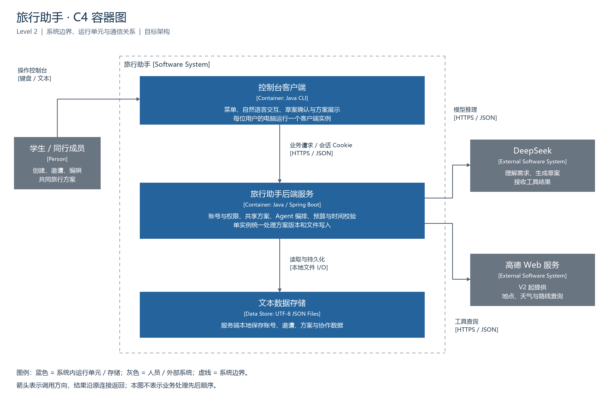
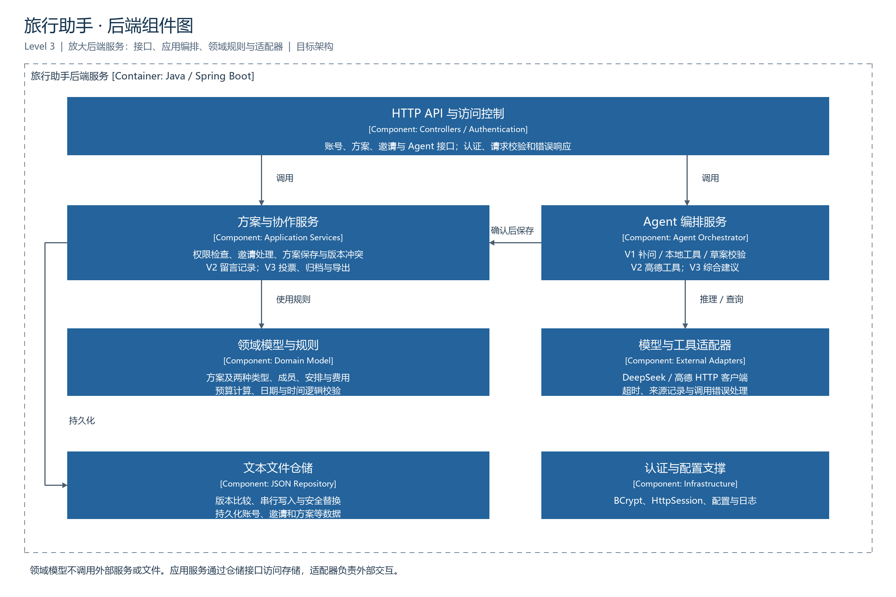

# 旅行助手架构设计

## 一、架构视图

采用 C4 的容器与组件视图表达目标架构，分别说明系统运行边界和后端内部职责。

### 容器图（Level 2）



### 后端组件图（Level 3）



组件图展示主要调用关系；认证与配置是供各组件使用的公共支撑，其连接为简洁起见省略。

## 二、各层涉及的内容

### 第一层：客户端表现层

运行在用户自己的电脑上，负责与用户交互。

- **账号操作**：注册、登录、退出及展示登录状态。
- **方案操作**：输入自然语言需求，查看、确认、编辑行程草案及历史方案。
- **协作操作**：邀请用户、处理邀请、查看共享方案。
- **结果展示**：显示预算、时间检查结果、操作错误及 Agent 建议。
- **网络访问**：通过 HTTP/HTTPS 调用共享服务接口；不直接修改服务端数据文件。
- **后续版本**：V2 展示查询结果、留言和修改记录；V3 展示投票、预算分析及导出功能。

### 第二层：服务接口层

运行在共享服务端，负责接收客户端请求并返回结果。

- **账号接口**：注册、登录和会话相关请求。
- **方案接口**：创建、查询、更新、删除方案。
- **协作接口**：发送邀请、接受或拒绝邀请、移除成员或退出方案。
- **Agent 接口**：提交自然语言需求、获取草案和建议。
- **公共处理**：解析请求、校验格式、识别登录身份，并把业务异常转换为清晰的错误响应。
- **版本扩展**：V2 增加地点、天气、路线、留言和记录接口；V3 增加投票、预算分析、导出和归档接口。

### 第三层：业务服务层

负责实际业务规则，是系统的核心。

- **账号与会话**：注册、登录和会话管理。
- **邀请与权限**：校验创建者和成员权限，处理邀请状态及成员关系。
- **行程管理**：创建、编辑、查询和删除方案；维护两种行程类型。
- **Agent 编排**：采用 Spring AI 单 Agent，V1 调用授权方案读取、预算及日期校验工具；V2 扩展高德查询，V3 扩展投票与支出分析。草案经校验后交用户确认，正式保存必须经过方案业务服务。
- **预算计算**：汇总已填写费用，标记缺失项；V3 增加实际支出、人均费用及超支分析。
- **时间校验**：V1 检查旅行起止时间；V2 检查具体安排的时间范围和重叠。
- **冲突处理**：检查方案版本，拒绝覆盖其他成员已保存的更新。
- **后续业务**：V2 维护留言和修改记录；V3 处理候选项、投票、归档与导出。

### 第四层：领域模型层

使用 Java 类描述系统中的业务对象和关系。

- **用户**：账号标识、登录信息及所属方案。
- **邀请**：方案、邀请人、受邀人和处理状态。
- **旅行方案**：创建者、成员、目的地、时间、预算、安排和版本号。
- **行程类型**：以旅行方案为基础，建模短途周末游和长途跨省游；共同字段由基础类维护，类型差异按实际业务逐步补充。
- **旅行安排**：交通、住宿、景点等对象及其时间、费用信息。
- **后续对象**：V2 增加留言和修改记录；V3 增加候选地点、投票和实际支出。

### 第五层：基础设施与外部服务层

为业务层提供存储、认证和外部查询能力。

- **本地文件存储**：服务端使用 UTF-8 JSON 文本文件读取和保存账号、邀请及方案等数据。
- **安全与配置**：使用成熟的密码哈希算法；API 密钥通过环境变量提供，会话和敏感信息不写入日志。
- **DeepSeek 接入**：发送模型请求、处理超时和错误，供 Agent 编排使用。
- **高德接入**：V2 起封装地点、天气和路线查询，记录来源及查询时间。
- **文件维护**：串行化写入并使用临时文件替换，发生错误时保留原数据；定期备份，损坏时从备份恢复。

## 三、典型业务调用路径

1. **生成方案**：客户端输入需求 → Agent 接口 → Agent 业务服务 → DeepSeek → 返回草案 → 用户修改确认 → 方案服务校验并保存。
2. **邀请成员**：客户端发送邀请 → 协作接口 → 邀请与权限服务 → 文件仓储保存邀请 → 受邀者接受后更新成员关系。
3. **共同编辑**：客户端读取方案及版本 → 修改后提交 → 业务服务检查权限与版本 → 文件仓储保存；版本不一致则返回冲突提示。
4. **查询路线（V2）**：客户端请求建议 → Agent 服务选择路线工具 → 高德接口查询 → 返回结果及来源 → 用户确认是否调整方案。

## 四、部署与限制

- 多个控制台客户端连接同一个 Spring Boot 服务。服务端需要位于各成员电脑可访问的网络中。
- 文本文件保存在服务端本地，服务重启后读取；客户端各自的本地文件不构成共享数据。
- 写入由单个服务进程串行管理；当前设计不支持多个服务实例同时写同一份文件。
- 服务停止或网络中断时无法共享编辑；文件损坏或磁盘故障仍有数据丢失风险，需要定期备份。
- 跨设备部署应使用 HTTPS，并保护服务端数据文件和备份。外部接口的权限、配额与费用在接入前核实。


## 五、技术选型与对应技术栈

下表为终版目标技术栈，不代表已完成实现。具体 Spring Boot 与 Spring AI 版本需按兼容性统一锁定，并通过构建和接口测试验证。

| 层次 / 能力 | 技术选择 | 用途 | 引入版本 |
| --- | --- | --- | --- |
| 开发语言 | Java 21 | 客户端、服务端和业务对象 | V1 |
| 控制台表现层 | Java Console / Scanner | 菜单、输入与结果展示；交互读取封装统一处理 | V1 |
| 客户端网络 | JDK HttpClient | 请求共享后端、通过 CookieManager 管理会话 Cookie | V1 |
| HTTP 接口层 | Spring Boot + Spring Web MVC | REST 接口、JSON 请求与响应 | V1 |
| 输入校验 | Jakarta Bean Validation + 业务校验 | 必填、格式、金额和日期规则 | V1 |
| 身份与权限 | Spring Security + HttpSession + BCrypt | 登录、密码哈希、成员权限校验；会话过期或退出后失效 | V1 |
| 业务服务与领域 | Java 类 / 接口 + Spring 服务组件 | 方案、邀请、两种行程类型与规则 | V1 |
| 金额与时间 | BigDecimal + java.time | 预算计算与时间校验 | V1；V2 扩展 |
| 模型接入 | Spring AI + DeepSeek API | 需求理解、补问、结构化草案 | V1 |
| Agent 本地工具 | Spring AI Tool Calling + Java 业务服务 | 授权方案读取、预算核算、日期校验 | V1 |
| Agent 外部工具 | 高德 Web API + HTTP 适配器 | 地点、天气、路线查询；服务端执行工具 | V2 |
| 文本持久化 | Jackson + Java NIO Files | UTF-8 JSON 序列化、读取、临时文件替换 | V1 |
| 编辑冲突 | 方案版本号 + 服务端锁 | 在同一临界区完成版本比较和文件保存 | V1 |
| 留言 / 投票 / 归档 | Java 业务服务 + JSON 仓储 | 复用已有架构逐步增加功能 | V2 / V3 |
| 日志与配置 | SLF4J + Logback + 环境变量 | 运行日志、密钥及服务配置 | V1 |
| 构建与测试 | Maven + JUnit + Spring Boot Test | 依赖管理、单元和接口测试 | V1 |
| 团队协作 | Git + GitHub | 分支、代码审查和版本管理 | V1 |

采用单体服务及模块化代码结构，客户端通过 HTTP 访问，不引入数据库、ORM、Redis 或消息队列。多人编辑先使用读取、提交与冲突提示，无需 WebSocket。V1 即具备本地工具调用与反馈能力，V2 扩展高德外部查询工具，V3 扩展投票与支出分析工具。

官方能力参考：[Spring AI DeepSeek 接入](https://docs.spring.io/spring-ai/reference/api/chat/deepseek-chat.html)、[Spring AI 工具调用](https://docs.spring.io/spring-ai/reference/api/tools.html)、[Spring Security 密码存储](https://docs.spring.io/spring-security/reference/7.0/features/authentication/password-storage.html)。

## 六、认证与 Agent 执行约定

- **认证采用服务端会话**：Spring Security 管理登录身份；客户端以 JDK CookieManager 管理服务端返回的会话 Cookie。退出时使服务端会话失效。会话保存在内存，重启后重新登录，历史方案不受影响。
- **权限实时检查**：服务端依据认证用户和当前成员关系授权；成员被移除后，不能继续访问方案。Agent 工具沿用同一权限检查，模型不能自行指定操作身份。
- **Agent 采用 Spring AI + DeepSeek 的单 Agent 工具调用流程**：理解需求、补问、选择工具、使用结果并输出结构化草案。V1 使用本地业务工具，V2 接入高德，V3 加入综合分析。
- **受控执行**：模型不直接读写文件；调用具有次数和超时限制，工具参数及模型输出均需校验；正式修改经用户确认后执行权限、时间及版本校验。
- **依赖管理**：Maven 统一管理多模块项目及兼容版本，具体版本号经构建与接口测试后锁定；API 密钥通过环境变量配置。

## 七、项目结构与模块依赖

```text
Travel-Assistant-Agent/
├── pom.xml                         # 父工程：统一 Java、依赖版本和模块
├── travel-common/                  # 仅共享传输契约，不依赖 Spring
│   └── src/main/java/com/travelassistant/common/api/
├── travel-client/                  # 可独立运行的控制台客户端
│   └── src/main/java/com/travelassistant/client/
│       └── TravelClient.java       # 连接后端的启动入口
├── travel-server/                  # Spring Boot 共享后端
│   └── src/
│       ├── main/
│       │   ├── java/com/travelassistant/server/
│       │   │   ├── TravelServerApplication.java
│       │   │   ├── interfaces/rest/          # HTTP 接口
│       │   │   ├── application/
│       │   │   │   ├── account/              # 账号与会话用例
│       │   │   │   ├── trip/                 # 方案与协作用例
│       │   │   │   └── agent/                # Agent 编排
│       │   │   ├── domain/
│       │   │   │   ├── trip/                 # 方案及类型、安排
│       │   │   │   ├── budget/               # 预算规则
│       │   │   │   └── repository/           # 仓储接口
│       │   │   └── infrastructure/
│       │   │       ├── security/             # Spring Security / 会话
│       │   │       ├── persistence/          # JSON 文件适配器
│       │   │       ├── ai/                   # Spring AI / DeepSeek
│       │   │       └── amap/                 # V2 高德工具
│       │   └── resources/application.yml
│       └── test/java/                        # 自动化测试
├── docs/
│   ├── assets/                               # 架构图
│   ├── tools/                                # 架构图生成脚本
│   └── *.md                                  # 需求、架构、实现方案及使用说明
└── data/                                     # 服务启动后写入，忽略版本控制
```

### 模块依赖约束

- `travel-client → travel-common`；`travel-server → travel-common`。客户端不依赖服务端实现。
- `interfaces → application → domain`；基础设施实现领域层定义的接口，通过依赖注入供应用层使用。
- `domain` 不依赖 HTTP、Spring AI 或具体文件格式。共享模块只放请求和响应契约，不把完整服务端领域对象直接暴露给客户端。
- V2、V3 在既有模块中扩展业务，不拆微服务。

### 当前落地状态

已建立三个 Maven 模块、共享健康响应、后端健康接口与安全配置、客户端连接入口和服务端集成测试。业务包通过 package-info 声明职责，尚未实现注册登录、行程、Agent、文件仓储及 V2/V3 功能。Spring AI 使用核心 DeepSeek 库依赖，不在启动时强制创建模型客户端，因此无密钥也能启动工程骨架。

旧配置的 JPA 和 MySQL 依赖已从构建中移除；旧数据库骨架已删除，不参与当前工程。

## 八、项目结构的设计理由与取舍

### 1. 设计三个 Maven 模块

跨电脑协作要求客户端通过同一后端访问共享数据，因此将交互和业务处理分开；共享传输契约单独维护，避免两端字段不一致。

| 模块 | 设计理由 | 边界 |
| --- | --- | --- |
| travel-client | 各成员在自己的电脑上交互，通过网络访问同一服务 | 不直接读写服务端文件，不依赖后端实现 |
| travel-server | 集中管理权限、行程、Agent、版本与文件写入 | 保持单体部署，不拆微服务 |
| travel-common | 复用请求和响应的数据结构，减少重复定义 | 不放服务端业务对象、存储实现或通用杂项 |

三个模块在同一个 Maven 父工程内构建和联调。独立模块是代码与依赖边界，不意味着三个独立服务。

### 2. 服务端按职责分层

| 目录 | 负责什么 | 分开的价值 |
| --- | --- | --- |
| interfaces/rest | 接收请求、解析输入、返回响应 | HTTP 交互变化不直接影响预算与时间规则 |
| application | 组织权限、校验、Agent 和保存等用例 | 将完整业务流程集中表达，供接口调用 |
| domain | 旅行方案、安排、费用及其业务规则 | 核心规则可独立于网络、模型和文件进行测试 |
| infrastructure | JSON 文件、模型、高德及安全等适配 | 隔离具体技术，便于替换及模拟失败情况 |

以成员修改方案为例：接口接收请求，应用服务检查身份和成员权限、调用领域校验，再通过仓储保存。版本比较与保存必须处于同一写入临界区。领域对象不直接调用文件或网络，避免业务规则依赖具体技术。

### 3. Agent 单独编排

Agent 负责需求理解、补问、工具调用及建议生成；方案业务服务负责正式修改。手动编辑与 Agent 建议确认后走同一套权限、预算、时间及版本检查，避免两套规则不一致。模型不能直接写文件，工具也不能绕过当前用户的授权范围。

