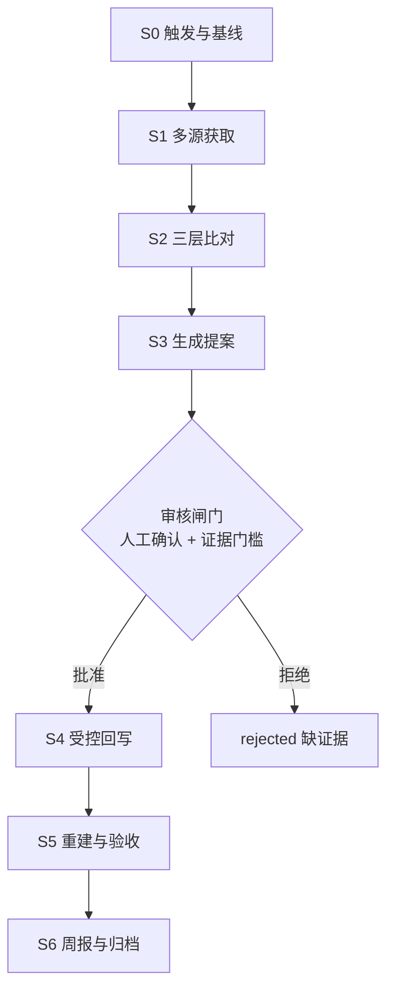
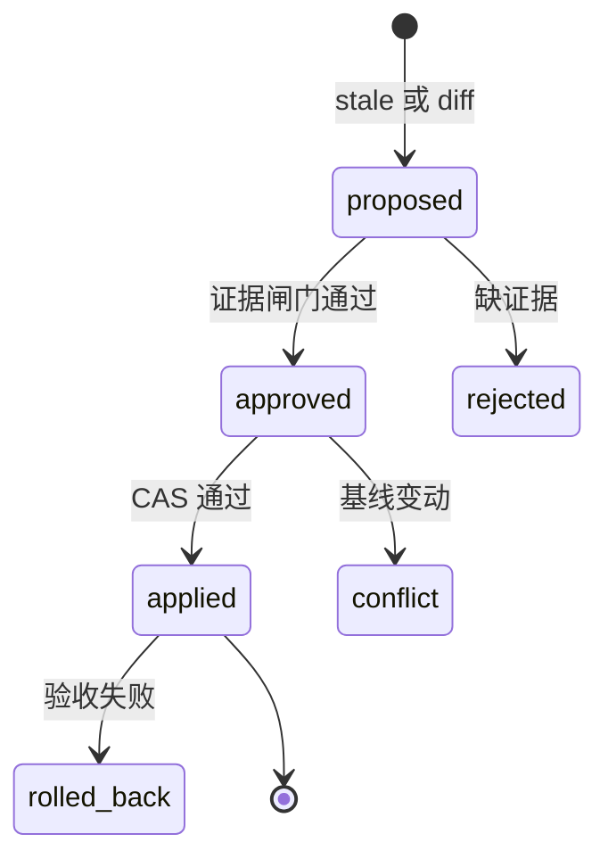

<!--
排版约束简报（refactoring-ui Workflow B · 内容分级留痕）
主级：结论摘要、目标分层架构、周更流水线、过时判定、证据门槛
次级：现状盘点、契约与幂等、调度选型、分阶段路线
三级：被否方案、风险、复核命令
唯一主操作：P0 建立字段契约与可观测基线；其余均为后续动作
规则：单一 h1；h2 只作章节标签；段落控制行宽；次要信息统一用引用块；
      状态一律用文字标签表达，不依赖颜色；不在正文滥用加粗
现有系统优先：项目已有 --primary/#2563eb 等轻量 token 与系统字体栈；
      本文是 Markdown，不引入新色板、不引入构建依赖
-->

# 知识库架构与周更工作流

> 设计稿 · 基准日期 2026-11-07 · 状态：未实施
> 本文只描述架构，不含实现。本轮未改动任何 Java / Python 代码或数据文件。

| 项 | 值 |
| --- | --- |
| 对应提交 | `3119c06`（湖北补全已合入当前分支） |
| 工作区状态 | 干净；本轮仅新增本文档与三张 SVG 图 |
| 适用范围 | `data/china_attractions.json` → `data/attractions_index.json` → Java 只读检索 |
| 上位文档 | `架构设计.md`、`服务端REST接口文档.md` |
| 配套报告 | 桌面《旅行助手-基础设施扫描报告》《旅行助手-知识库扫描报告》 |

## 一、结论摘要

现状是一条**离线构建、在线只读**的链路：一个 9.71 MB 主库、
一个 5.79 MB 派生索引，Java 启动时加载索引并自建检索结构。
链路本身是健康的，问题在于**契约没有单一来源，且"过时"目前不可判定**。

因此本文给出的不是"每周自动重抓并改库"，而是：

> 每周一次可审计的新鲜度巡检，产出结构化变更提案；
> 事实层写入必须经过证据闸门与人工审核，且可完整回滚。

自动改库会重演 `3537212` 那次把人工核验标记整体抹掉的事故。
可追溯是本项目最看重的纪律，工作流不能把它冲掉。

## 二、现状盘点（实测）

| 维度 | 实测值 |
| --- | --- |
| 源库 / 索引 | 11,927 条 / 11,927 条；9.71 MB / 5.79 MB |
| 顶层结构 | `attractions`、`city_introductions`(65)、`generated_at`、`enriched_at`、两组 `*_status_counts` |
| 字段契约 | 源库字段并集 **35**、模型 `models.py` **33**、`KEEP_FIELDS` **20**、索引 **20**、Java `Attraction` **20**、`AttractionView` **22** |
| 契约漂移 | 源库多出模型未声明的 `ticket_supporting_source`(20 条)、`open_time_supporting_source`(6 条) |
| 血缘 | `source_ids` 覆盖 11,858 / 11,927（新增 69 条缺失）；`coordinateSystem` 覆盖 11,927 / 11,927（WGS-84 4,138 / GCJ-02 7,789） |
| 核验状态（当前） | `ticket_status` verified 141 / unverified 738 / pending 11,048；`open_time_status` verified 103 / unverified 4,619 / pending 7,205 |
| 核验状态（`edbd517` 时） | 两组 verified 均为 0；`carried_status()` 改为按逐行证据定级后恢复 |
| 逐行时间字段 | `fetchedAt` / `updatedAt` / `expiresAt` / `last_checked_at` 覆盖 **0 / 11,927** |
| 现有核验证据 | `ticket_source` + `ticket_checked_at` 141 条，`open_time_source` + `open_time_checked_at` 103 条，日期为 2026-11-04 / 11-05；有票价 879 条 |
| 治理工具 | `tools/kb/*.py` 共 33 个，其中 `apply_*.py` 9 个；`reports/evidence/` 19 份证据文件 |
| 调度 | 无 `.github/workflows`，无 Python 测试框架配置 |
| 门禁 | `gate.sh` = 索引 `--check` → `mvn clean verify` → `acceptance.py`；361 用例、41/41 端到端 |

> 口径更正一：`build_attraction_index.py --check` 比对的是**规范化后的全量索引内容**
> （排除 `generated_at`），不是只比条数；但它不做治理语义审计。
>
> 口径更正二：`quality_report --strict` 当前 **exit=1**，共 5 类失败项：
> `cities_without_intro=16`、`missing_coordinates=2`、
> `records_missing_source_ids=69`、`records_missing_primary_source_id=69`
> （前三类为 `3119c06` 新增 69 条景点带入），以及存量
> `merged_rows_missing_amap_id=249`。`gate.sh` 没有接入它，长期静默。
>
> 口径更正三：上一轮口述的字段数（30 / 34 / 23）与脚本数（约 20）为估算，
> 以本表实测值为准。

值得注意的是，项目里已经存在一套**正确的手工范式**：
`reports/evidence/*.json` 带 `source` / `source_url` / `retrieved_at` / `records[]`，
`apply_*.py` 按 `kb_id + kb_name + kb_city` 三重校验身份、`--apply` 才写盘。
周更工作流应把这个范式**编排化与幂等化**，而不是另起炉灶。

> 全局架构上下文见仓库已有的三张图：`assets/旅行助手-技术架构图.png`、
> `旅行助手-C4容器图.png`、`旅行助手-后端组件图.png`。
> 本文新增的三张图只细化知识库子系统，不替代全局架构图。

## 三、五个结构性缺陷

| # | 缺陷 | 证据 |
| --- | --- | --- |
| 1 | 字段契约四处手写 | 35 / 33 / 20 / 22 个字段各写一遍；重建一次会静默丢掉模型未声明的字段 |
| 2 | 证据链在发布层断裂 | 141 + 103 条记录有逐行来源与核验日期，但这 4 个字段不在 `KEEP_FIELDS`、不在 Java record、不在 `AttractionView`；API 只能输出结论「已核验」，给不出理由与日期 |
| 3 | 坐标系标签丢失 | 全库都有 `coordinateSystem`，索引与发布层全无；动态 POI（GCJ-02）一接入即偏移 300–600 m |
| 4 | 两个"索引"职责混淆 | `build_unified_kb.py` 写 `china_attractions_index.json`（仅元数据、当前不存在、无人消费）；Java 读的是 `build_attraction_index.py` 产出的 `attractions_index.json`。重建主库不会刷新 Java 索引 |
| 5 | 门禁漏掉治理审计 | `--strict` 失败 5 类却不在门禁里；`--check` 只保证内容一致，不保证血缘与证据成立 |

## 四、目标分层架构

核心思路：**数据与契约分离，证据随结论一起发布，三路数据源在 DTO 层隔离**。


*图 1 · 五层流水线与贯穿式契约层。虚线表示约束关系，不是数据流。*

| 层 | 职责 | 关键产物 |
| --- | --- | --- |
| L0 契约层 | 唯一字段字典、TTL、可变性、证据要求 | `tools/kb/schema.json`、`validate_schema.py` |
| L1 获取层 | 白名单源适配器，声明 license / rateLimit / writableFields | `reports/weekly/<runId>/sources/` 不可变快照 |
| L2 比对层 | 字段级、治理级、发布级三路 diff | `diff.json` |
| L3 提案层 | 只描述变更，源库零写入 | `proposals.json`、周报草稿 |
| L4 闸门层 | 证据门槛、身份三重校验、CAS、人工审核 | `decisions.json` |
| L5 应用与发布层 | 原子写、备份、审计、索引重建、门禁、归档 | `audit.jsonl`、`backup/`、`verification.json` |

### 记录模型（按职责分组，不再平铺 35 个字段）

| 组 | 字段 | 契约要求 |
| --- | --- | --- |
| 身份 | `id`、`source_ids[]`、`same_name_group`、`merge_review` | `id` 一经分配不复用；融合声明必须能在 `source_ids` 里找到对应原始 id（249 条欠账即此层破了） |
| 地理 | `city`、`province`、`address`、`lat`、`lon`、`coordinateSystem` | 坐标与 CRS 必须成对，缺一即 `disable()` |
| 内容 | `name`、`name_zh`、`type`、`tags[]`、`description`、`image`、`photos[]`、`wikidata` | 只做描述，不承载事实判断 |
| 事实 | `level`、`rating`(数值)、`open_time`(结构)、`ticket`(结构) | 未知一律 `null`，不得转成「免费」或「全天开放」 |
| 血缘 | `source`、`sources[]`、`fetchedAt`、`license` | 每条可回答「从哪来、什么时候、什么许可」 |
| 证据 | `ticket: {display, tiers[], free, currency, status, sourceUrl, checkedAt}` | `display` 保留兼容旧前端；`tiers[]` 解决 879 条票价无法结构化 |
| 状态 | `schemaVersion`、`updatedAt`、`status`、`retired` | 让索引与 Java 能拒绝不兼容版本 |

### 四个关键取舍

| 决策 | 选择 | 否掉的方案与原因 | 何时改主意 |
| --- | --- | --- | --- |
| 存储 | 单文件主库 + 原子替换 + git 可 diff | 数据库 / ORM：项目明确不引入 DB，11,927 条离线可重放治理更契合 | 超过 10 万条，或需多实例并发写 |
| 契约 | `schema.json` 作唯一来源 + 校验脚本 + 一条 Java 断言 | 代码生成器生成 dataclass / record：对 20 个字段是过度设计，且引入构建期依赖 | 字段超过约 60 个，或跨语言消费者超过 2 个 |
| 坐标系 | 库内保留原值 + `coordinateSystem` 标签，展示层转换并标 `derived: true` | 落库时统一转 WGS-84：GCJ-02 逆向有误差且不可逆，属有损改写 | 不改；这是数据保真底线 |
| 证据 | 证据对象随发布层下发，但只对带证据的记录输出（票价 141 / 开放时间 103） | 全量下发（增加约 1 MB 空字段）或只发状态（现状，无法复核） | 证据覆盖超过 30% 时再评估压缩 |

> 证据字段只落在带证据的记录上，会让前端出现「有的记录有 `sourceUrl`、有的没有」。
> 这是刻意设计，接口文档要写明，别被当成字段缺失去补空值。

## 五、周更流水线


*图 2 · 六阶段流水线。蓝色段为每周自动只读巡检，红色闸门是唯一写入边界，
绿色段只在人工批准后执行；右侧为各阶段不可变产物。*

S0–S3 每周自动执行且**全程只读**；S4–S6 只在人工批准后本机执行。
闸门不是形式主义：它把「抓到了新值」和「有资格改库」分成两件事。

## 六、"过时"的可判定定义

没有时间基准时，"过时"会退化成「很久没抓了」或「抓一次就改一次」。
因此必须先定义可判定条件：

| 类型 | 判定条件 | 输出 | 处置 |
| --- | --- | --- | --- |
| T1 证据过期 | `verified` 且 `checkedAt + TTL(90d) < 本周` | `stale` | 停止对外显示「已核验」，进复核队列，不改值 |
| T2 值冲突 | 两个及以上独立权威源对同一字段给出不同值 | `conflict` | 只记提案，不自动选边 |
| T3 公告取代 | 文旅部 / 地方文旅公告含明确变更 | `superseded` | 事件驱动，附公告原件，人工复核 |
| T4 索引漂移 | `build_attraction_index.py --check` exit=5 | `index_drift` | 重建索引，不动源库 |
| T5 血缘欠账 | `quality_report --strict` 非零项（现为 5 类） | `lineage_debt` | 计入周报销项，带清零日期 |

> 反例同样重要：**字段为空不等于过时**，**上次抓取间隔久不等于过时**。
> 在 P0 补齐逐行时间基准之前，五条里只有 T4 / T5 真正判得出来。

分级 TTL 建议：票价与开放时间 90 天；坐标、名称、地址 180 天或按需；
A 级等级走事件驱动、不做周轮询；内容灵感层 7 天，且不进入事实层。

## 七、字段可变性与证据门槛

| 字段类 | 自动写 | 硬门槛 |
| --- | --- | --- |
| `ticket` / `open_time` | 否 | 官方 URL + `checkedAt` + `kb_id/name/city` 三重校验 + 人工确认 |
| `level`（5A / 4A） | 否 | 权威公告原件，且先做外部名录复核（现有库存在疑似误标） |
| `lat` / `lon` | 否 | 必须成对写 `coordinateSystem`；GCJ-02 与 WGS-84 不混 |
| `name` / `address` / `tel` | 仅补空 | 不覆盖已有值，旧值进审计 |
| `*_status = verified` | **永不自动写** | 只能由证据定级函数产生 |
| 删除记录 | **禁止** | 只标 `retired`，保留 11,927 条基线 |

这条纪律有历史依据：`3537212` 重建时把 733 条票价、4,510 条开放时间的
verified 抹成 0；复核发现那批历史标签没有逐行证据，
因此 `build_unified_kb.py` 「没有证据就不能继承 verified」是对的治理纪律，
不是 bug。**工作区当前的 `carried_status()` 改动已修正为按证据定级**
（有 `source` + `checked_at` 即 verified），使 141 / 103 条真正有证据的记录得到承认。
两者是不同问题，不能把 733 条回填回来。

## 八、提案状态机


*图 3 · 主链为提案流转，虚线为三条失败分支。状态一律配文字标签，
不单靠颜色区分。*

- `proposed`：提案生成，源库零写入。
- `approved`：人工确认 + 证据齐备，记录 `reviewedBy` / `reviewedAt`。
- `applied`：CAS 通过、原子写完成、索引已重建。
- `conflict`：应用时 `oldValue` 或 `baselineHash` 与当前不符，说明期间有人改过。
- `rolled_back`：`--check` / `--strict` / `gate.sh` 任一失败，源库与索引一起还原。

`verified` 是**结论**，证据对象是**理由**，两者必须由同一段代码产生，
不允许任何外部脚本直接写 `verified`。

## 九、数据契约、幂等与回滚

- **单一字段契约**：`tools/kb/schema.json` 声明每个字段的
  `ttlDays / writable / requiresEvidence / owner`；`validate_schema.py`
  同时校验源库与索引，解决四处手写漂移。
- **影子元数据**：不重构 11,927 条扁平结构，先给带证据的记录（票价 141 / 开放时间 103）补
  `fieldMeta: {observedAt, sourceUrl, checkedAt, expiresAt, status}`，
  旧扁平字段保持兼容，渐进迁移。
- **提案结构**：
  `{runId, baselineHash, kbId, field, oldValue, newValue, reason(T1–T5),
  evidence[], confidence, decision, reviewedBy, reviewedAt}`。
- **幂等**：`runId = ISO周 + 源库hash前8位`；同一 `runId` 重跑不产生二次写入。
  应用时用 `oldValue + baselineHash` 双 CAS。
- **回滚**：写前把源库与索引一起备份到 `reports/weekly/<runId>/backup/`；
  任一验收失败即整体还原；`audit.jsonl` 保留所有决策与拒绝原因。
- **产物落点**：统一放 `reports/weekly/YYYY-Www/`。
  `reports/` 未被忽略；若落 `data/` 会被 `/data/*` 黑名单吞掉，
  需要显式加白名单，不建议。

## 十、调度与源适配层

| 方式 | 定位 | 说明 |
| --- | --- | --- |
| GitHub Actions（`cron: 0 1 * * 1` 即周一 09:00 CST + 手动触发） | 主 | 云端执行 S0–S3 只读巡检，产出周报 artifact 与提案 PR；密钥走 Secrets。绕开本机 `github.com` 出口不稳的问题，不写库、不 push 数据改动 |
| 本机定时自动化 / 计划任务 | 审核入口 | 人工触发 S4–S6，可用本机 `F:\apache-maven-3.9.16` 跑完整门禁；依赖开机与环境变量 |
| 定时自动 apply + 自动 push | 否决 | 无人审核地改事实层，即 `3537212` 的复现路径 |

源适配层必须白名单化，每个适配器声明 `license / rateLimit / writableFields / freshness`：

| 源 | 频率 | 可写字段 | 约束 |
| --- | --- | --- | --- |
| 官方 / 政府公告（人工导入 `reports/evidence/`） | 事件 + 周巡检 | 票价、开放时间、等级 | 唯一能触发事实层变更的源 |
| 高德 POI（`tools/kb/amap_source.py`） | 周，按城市增量 | 仅新候选 | 翻页上限与存储、再分发限制；不直接落成自有库 |
| Wikivoyage MediaWiki API | 周 | 只进内容灵感层 | CC BY-SA 4.0 署名与 ShareAlike，须带 User-Agent |
| Wikidata SPARQL | 月 | 别名、官方链接 | 事实层补充，不覆盖已有值 |
| OSM Overpass | 季度离线 | 坐标、名称 | 公共实例配额极小，不做在线后端 |
| 小红书 / 马蜂窝 / 携程 / 点评 | 不接入 | 无 | robots 全禁或需商业授权，不写任何采集器 |

> 密钥有两套命名：Python 工具读 `.env` 的 `AMAP_API_KEY`，
> Java 服务读环境变量 `AMAP_KEY`，Spring Boot 不自动加载 `.env`。
> Actions Secrets 要分别配置，且两者当前在 shell 环境变量里都未设置。
>
> 内容灵感层必须与事实层隔离：`/api/attractions` 返回体不得出现任何灵感字段，
> 灵感条目不参与 `ticket_status` / `verified` 统计，这一点要写成回归断言。

## 十一、门禁总线

每个阶段统一执行，不新增测试框架：

```bash
PYTHONPATH=tools python -B -m kb.quality_report --strict
python -B tools/build_attraction_index.py --check
MAVEN_HOME=/f/apache-maven-3.9.16 bash tools/gate.sh
```

`--strict` 对存量 5 类失败项先用 allowlist 只告警、对新增不一致零容忍，
allowlist 必须带清单与销项日期，不能变成永久豁免。

## 十二、分阶段路线

| 阶段 | 动作 | 验收标准 |
| --- | --- | --- |
| P0 地基 | 以 `3119c06` 为基线；`schema.json` + 带证据记录的 `fieldMeta`；`--strict` 接门禁；销项 5 类失败项（249 条 Amap 血缘、69 条新增记录 `source_ids`、16 市简介、2 条坐标）；修 `架构设计.md` 两处失实引用 | T1 可判定；新增不一致使 `--strict` exit≠0；361 用例不退化 |
| P1 只读巡检 | 适配器 + 三层 diff + 提案 + Actions dry-run + 周报 | 连续两周 `runId` 不同，但源库 blob 完全不变 |
| P2 受控写入 | 审核队列 + 证据闸门 + CAS + 备份回滚 + 索引重建 | 注入批准 / 拒绝 / 冲突三类假提案，源库可 100% 还原 |
| P3 动态层 | `coordinateSystem` 与 4 个证据字段进 `KEEP_FIELDS` / `Attraction` / `AttractionView`；内容灵感层独立 DTO | 断言 `/api/attractions` 不含任何灵感字段 |

索引体积估算：CRS 全量约增加 0.15–0.25 MB，证据字段只落在带证据的记录上可忽略，
5.79 MB → 约 6.0 MB，冷启动增量预计低于 0.3 s（当前 4.9 s）。
**这是估算，未实测。**

## 十三、被否掉的方案

- **每周全量重抓高德重建库**：配额、翻页上限与服务协议存储限制之外，
  更致命的是会抹掉人工核验成果。
- **定时直接改库并 push**：重演 `3537212`，且无人审核。
- **引入数据库 / ORM 管新鲜度**：项目明确不引入 DB；
  单文件 9.71 MB 的 git diff 与离线重放更适合课程级治理。
- **OSM Overpass 当在线后端**：公共实例常态化使用需把官方配额除以 100 量级。
- **代码生成器统一字段契约**：20 余个字段的规模不值当，
  用校验脚本 + 一条 Java 断言即可。
- **抓取 UGC 内容**：robots 全禁与法律风险，成本远高于收益。

## 十四、风险与待确认

1. `3119c06` 新增 69 条景点带入 4 类 strict 失败项，不先销项则 P0 基线不稳。
2. 249 条 Amap 血缘欠账若直接阻断，门禁会长期红；allowlist 必须带销项日期。
3. 桌面《旅行助手-知识库扫描报告》的 K-1 结论（全库 verified=0、
   `carried_status()` 方向反了）**已过时**，不能继续作为整改依据。
4. 证据字段只在带证据记录上下发，前端呈现不一致是刻意设计，别补空值。
5. 本环境对 Wikimedia 域名的出口尚未打通，内容灵感层落地前需先确认可达。
6. 索引里 `level` / `address` 与源库的差异是 `normalize()` 的刻意清洗，
   `cityAliases` 已兜住「武汉 / 武汉市」查询，`AttractionStore.disable()`
   损坏即整体禁用——这三处是良好设计，整改时勿误伤。

## 附录：复核命令

```bash
# 源库与索引规模、字段并集
python -B tools/build_attraction_index.py --check

# 治理审计（当前 exit=1，共 5 类失败项）
#   cities_without_intro=16 / missing_coordinates=2
#   records_missing_source_ids=69 / records_missing_primary_source_id=69
#   merged_rows_missing_amap_id=249
PYTHONPATH=tools python -B -m kb.quality_report --strict

# 索引字段白名单 / 模型字段定义
grep -n -A22 "KEEP_FIELDS" tools/build_attraction_index.py
grep -n -A35 "class Attraction" tools/kb/models.py

# 发布层字段（当前 22 个，无 CRS 与证据字段）
grep -n -A25 "public record AttractionView" \
  travel-server/src/main/java/com/travelassistant/server/interfaces/rest/dto/AttractionView.java

# 一次性治理脚本与证据文件
ls tools/kb/apply_*.py
ls reports/evidence/

# 全量回归（本机 Maven 在 PATH 之外）
MAVEN_HOME=/f/apache-maven-3.9.16 bash tools/gate.sh
```

## 附录：图示清单与可编辑源码

| 图 | 文件 | 用途 |
| --- | --- | --- |
| 图 1 | `assets/kb-layered-architecture.svg` | 目标分层架构与贯穿式契约层 |
| 图 2 | `assets/kb-weekly-pipeline.svg` | 周更六阶段与审核闸门 |
| 图 3 | `assets/kb-proposal-state.svg` | 提案状态机与三条失败分支 |
| 全局 | `assets/旅行助手-*.png`（3 张，已有） | 系统技术架构、C4 容器、后端组件 |

三张 SVG 为矢量、无外部依赖，配色沿用 `static/index.html` 的
`--primary #2563eb` / `--ok #16a34a` / `--err #dc2626` /
`--bg #f1f5f9` / `--line #e2e8f0`，正文色补齐同族 slate-900。
保持扁平、无渐变与阴影；每个状态都带文字标签，不单靠颜色传达含义。
淡底由主色叠加低透明度派生，不额外引入色板。

如需改图，优先编辑下面这份纯文本源码，再同步更新 SVG；
Mermaid 在 Typora 与 GitHub 上均可直接渲染。




