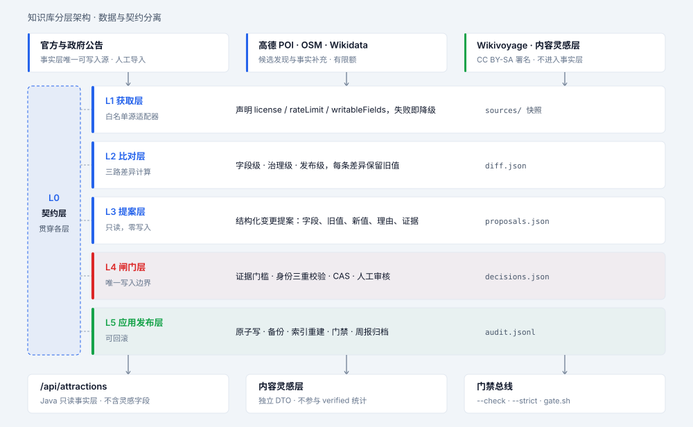
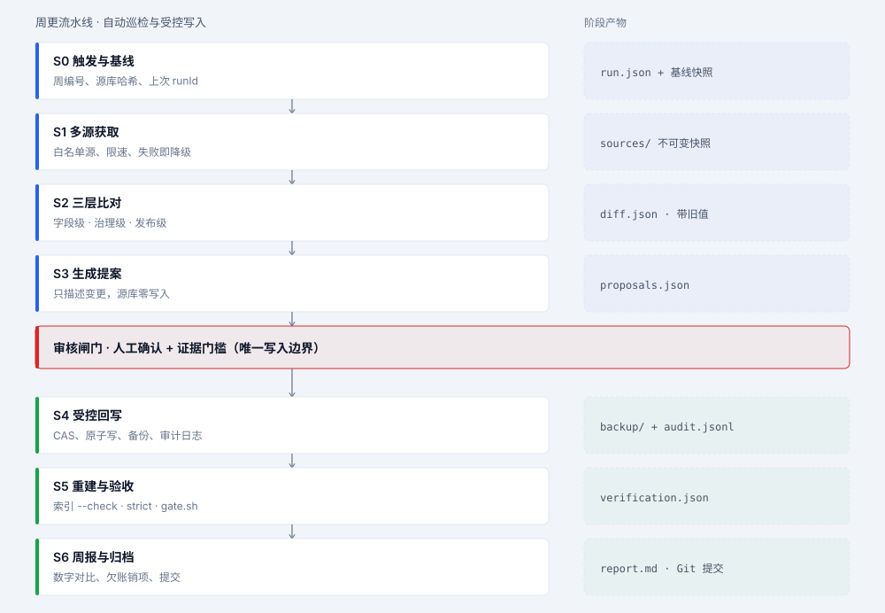
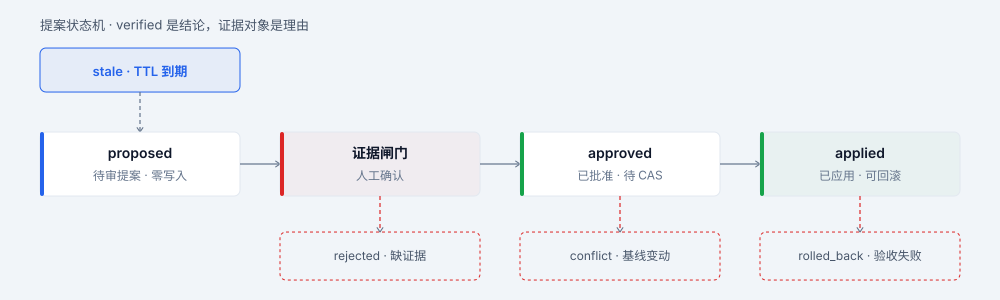
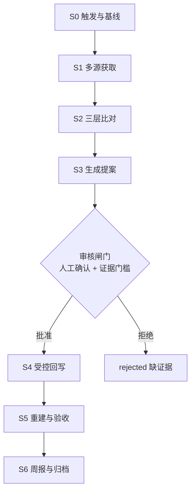
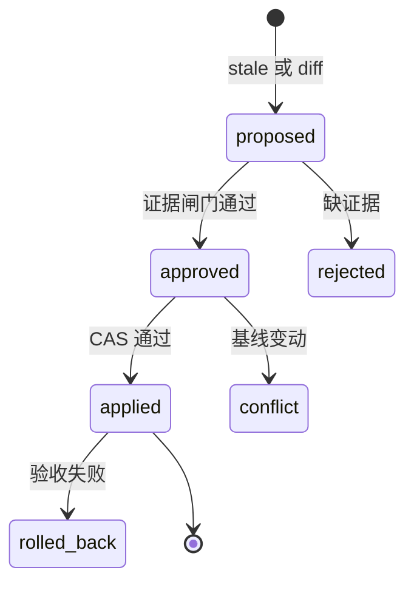

# 知识库架构与周更工作流

> 设计稿。事实数字为 2026-11-08 实测，基准提交 `66f00fa`。文中所有目标架构、拟新增脚本与接口都未落地，也未跑过完整门禁。

## 这份文档解决什么

如果你要改景点数据，这份文档回答三件事：什么算过时、什么能改、改完怎么留下证据。

事实层指 `data/china_attractions.json` → `data/attractions_index.json` → Java 只读检索这条链。Agent 怎么消费事实层，见《Agent运行时架构设计》的「事实、证据与安全」一节。

结论先说：我们不做每周自动重抓并改库。我们做每周一次只读巡检，产出变更提案。写入要过证据闸门和人工审核，并且能整体回滚。

理由是一条历史事故。`3537212` 重建主库时把 733 条票价、4,510 条开放时间的 `verified` 抹成 0。复核发现那批标签本来就没有逐行证据，所以 `build_unified_kb.py` 里 `carried_status()` 拒绝无证据继承，是正确的治理纪律。自动改库会让这类事故重演。上面两个数字属于事故当时，不是当前库的状态。

## 事实层现状

| 项 | 实测值 |
| --- | --- |
| 源库 | 7,745 条，6,607,331 字节（6.30 MiB） |
| 运行索引 | 7,745 条，4,134,100 字节（3.94 MiB） |
| 索引一致性 | `build_attraction_index.py --check` 通过，输出「索引与源库一致：7745 条」 |
| 源库字段并集 | 35 |
| 顶层 `city_introductions` | 65 条 |
| 坐标系 | WGS-84 3,350 / GCJ-02 4,395，无 `mixed`，无缺失 |
| `source_ids` 覆盖 | 7,676 / 7,745，69 条缺失 |
| 票价三态 | verified 145 / unverified 729 / pending 6,871；有票价 874 条 |
| 开放时间三态 | verified 104 / unverified 4,242 / pending 3,399；有值 4,346 条 |
| 逐行时间字段 | `fetchedAt` / `updatedAt` / `expiresAt` / `last_checked_at` 覆盖 0 / 7,745 |
| 治理工具 | `tools/kb/*.py` 33 个，其中 `apply_*.py` 9 个；`reports/evidence/*.json` 17 份 |
| 调度 | 无 `.github/workflows` |
| 治理审计 | `kb.quality_report --strict` exit=1，6 类失败 |

`--strict` 的 6 类失败是：`duplicate_description_rows=2`、`cities_without_intro=16`、`missing_coordinates=1`、`records_missing_source_ids=69`、`records_missing_primary_source_id=69`、`merged_rows_missing_amap_id=247`。`tools/gate.sh` 没有接入它，这些失败长期静默。

`--check` 比对的是规范化后的全量索引内容，排除 `generated_at`。它不检查血缘和证据，不能当治理审计用。

本节是三份设计文档和《服务端REST接口文档》的唯一数字基线。改动事实层后，先重跑本节复核命令，再同步所有引用处。`reports/archive/` 与 `docs/开发日志/` 里的旧数字是当时快照，不回填。

项目里已经有一套可用的手工范式。`reports/evidence/*.json` 带 `source`、`source_url`、`retrieved_at`、`records[]`；`apply_*.py` 按 `kb_id + kb_name + kb_city` 三重校验身份，只有 `--apply` 才写盘。周更工作流要做的是把这套范式编排起来，并做成幂等。

## 现在哪里会出问题

按后果从重到轻排五个问题。

**（1）字段契约写了四遍。** 源库字段并集 35、`models.py` 33、`KEEP_FIELDS` 20、索引 20、Java `Attraction` 20、`AttractionView` 22。重建一次会静默丢掉模型没声明的字段，例如 `ticket_supporting_source` 和 `open_time_supporting_source`。

**（2）证据链在发布层断了。** 145 条票价、104 条开放时间带逐行来源和核验日期。这 4 个字段不在 `KEEP_FIELDS`、不在 Java record、不在 `AttractionView`。接口只能输出「已核验」，给不出理由和日期。

**（3）坐标系标签没往下传。** 全库都有 `coordinateSystem`，索引和发布层没有。动态 POI 用 GCJ-02，一接入就偏移 300～600 m。

**（4）两个索引名字撞了。** `build_unified_kb.py` 写 `china_attractions_index.json`，只有元数据，当前不存在，也没人消费。Java 读的是 `build_attraction_index.py` 产出的 `attractions_index.json`。改了主库不重建后者，接口看不到变化。

**（5）门禁漏了治理审计。** `--strict` 有 6 类失败却不在门禁里，`--check` 只保证内容一致。

## 目标架构

核心是三件事：数据和契约分开，证据随结论一起发布，外部内容源在 DTO 层隔离。



*图 1 · L0 至 L5 分层与贯穿式契约层。虚线表示约束，不是数据流。*

| 层 | 职责 | 关键产物 |
| --- | --- | --- |
| L0 契约层 | 唯一字段字典、TTL、可变性、证据要求 | `tools/kb/schema.json`、`validate_schema.py` |
| L1 获取层 | 白名单源适配器，声明 license / rateLimit / writableFields | `reports/weekly/<runId>/sources/` 不可变快照 |
| L2 比对层 | 字段级、治理级、发布级三路 diff | `diff.json` |
| L3 提案层 | 只描述变更，源库零写入 | `proposals.json`、周报草稿 |
| L4 闸门层 | 证据门槛、身份三重校验、CAS、人工审核 | `decisions.json` |
| L5 应用与发布层 | 原子写、备份、审计、索引重建、门禁、归档 | `audit.jsonl`、`backup/`、`verification.json` |

### 记录模型

按职责分组，不平铺 35 个字段。

| 组 | 字段 | 契约要求 |
| --- | --- | --- |
| 身份 | `id`、`source_ids[]`、`same_name_group`、`merge_review` | `id` 一经分配不复用；融合声明要能在 `source_ids` 里找到对应原始 id，247 条欠账就出在这一层 |
| 地理 | `city`、`province`、`address`、`lat`、`lon`、`coordinateSystem` | 坐标与 CRS 必须成对，缺一即 `disable()` |
| 内容 | `name`、`name_zh`、`type`、`tags[]`、`description`、`image`、`photos[]`、`wikidata` | 只做描述，不承载事实判断 |
| 事实 | `level`、`rating`、`open_time`、`ticket` | 未知一律 `null`，不得转成「免费」或「全天开放」 |
| 血缘 | `source`、`sources[]`、`fetchedAt`、`license` | 每条能回答从哪来、什么时候、什么许可 |
| 证据 | `ticket: {display, tiers[], free, currency, status, sourceUrl, checkedAt}` | `display` 兼容旧前端，`tiers[]` 解决 874 条票价无法结构化 |
| 状态 | `schemaVersion`、`updatedAt`、`status`、`retired` | 让索引与 Java 能拒绝不兼容版本 |

### 四个取舍

| 决策 | 选择 | 否掉的方案与原因 | 何时改主意 |
| --- | --- | --- | --- |
| 存储 | 单文件主库，原子替换，git 可 diff | 数据库 / ORM：项目明确不引入 DB，7,745 条离线可重放治理更契合 | 超过 10 万条，或需要多实例并发写 |
| 契约 | `schema.json` 作唯一来源，加校验脚本和一条 Java 断言 | 代码生成器生成 dataclass / record：20 个字段的规模不值当，还引入构建期依赖 | 字段超过约 60 个，或跨语言消费者超过 2 个 |
| 坐标系 | 库内保留原值加 `coordinateSystem` 标签，展示层转换并标 `derived: true` | 落库统一转 WGS-84：GCJ-02 逆向有误差且不可逆，属于有损改写 | 不改，这是数据保真底线 |
| 证据 | 证据对象随发布层下发，只落在带证据的记录上 | 全量下发会多出约 1 MB 空字段；只发状态则无法复核 | 证据覆盖超过 30% 时再评估压缩 |

每周全量重抓高德重建库、定时直接改库并 push、引入数据库管新鲜度、把 OSM Overpass 当在线后端、抓取 UGC 内容，这五条都否掉了。理由分别是配额与存储限制、无人审核、项目不引入 DB、公共实例配额极小、robots 全禁。共同的一条是：它们都会冲掉人工核验成果。

证据字段只落在带证据的记录上，前端会看到有的记录有 `sourceUrl`、有的没有。这是刻意设计，接口文档要写明，别当字段缺失去补空值。

## 判断过时

没有时间基准时，「过时」会退化成「很久没抓了」或「抓一次就改一次」。先定义可判定条件。

| 类型 | 判定条件 | 输出 | 处置 |
| --- | --- | --- | --- |
| T1 证据过期 | `verified` 且 `checkedAt + TTL(90 d) < 本周` | `stale` | 停止显示「已核验」，进复核队列，不改值 |
| T2 值冲突 | 两个及以上独立权威源对同一字段给出不同值 | `conflict` | 只记提案，不自动选边 |
| T3 公告取代 | 文旅部或地方文旅公告含明确变更 | `superseded` | 事件驱动，附公告原件，人工复核 |
| T4 索引漂移 | `build_attraction_index.py --check` exit=5 | `index_drift` | 重建索引，不动源库 |
| T5 血缘欠账 | `quality_report --strict` 非零项，当前 6 类 | `lineage_debt` | 计入周报销项，带清零日期 |

两条反例：字段为空不等于过时，上次抓取间隔久也不等于过时。在 P0 补齐逐行时间基准之前，五条里只有 T4 和 T5 真正判得出来。

分级 TTL：票价与开放时间 90 天，坐标、名称、地址 180 天或按需，A 级等级走事件驱动不做周轮询，内容灵感层 7 天且不进入事实层。

## 周更怎么跑



*图 2 · S0 至 S6 六阶段。蓝色段每周自动只读巡检，红色闸门是唯一写入边界，绿色段只在人工批准后执行；右侧是各阶段不可变产物。*

S0 到 S3 每周自动执行，全程只读。S4 到 S6 只在人工批准后于本机执行。闸门把「抓到了新值」和「有资格改库」分成两件事。

| 阶段 | 动作 | 产物 | 写库 |
| --- | --- | --- | --- |
| S0 触发与基线 | 记录 `runId`、源库 hash、本周日期 | `baseline.json` | 否 |
| S1 多源获取 | 白名单适配器抓快照 | `sources/` | 否 |
| S2 三层比对 | 字段级、治理级、发布级 diff | `diff.json` | 否 |
| S3 生成提案 | 按 T1 至 T5 分类，写周报草稿 | `proposals.json` | 否 |
| S4 受控回写 | 证据闸门、身份校验、CAS、原子写 | `decisions.json` | 是 |
| S5 重建与验收 | 重建索引，跑门禁 | `verification.json` | 否 |
| S6 周报与归档 | 归档产物，清理临时文件 | `audit.jsonl` | 否 |

## 写入闸门

### 字段可变性

| 字段类 | 自动写 | 硬门槛 |
| --- | --- | --- |
| `ticket` / `open_time` | 否 | 官方 URL + `checkedAt` + `kb_id/name/city` 三重校验 + 人工确认 |
| `level`（5A / 4A） | 否 | 权威公告原件，先做外部名录复核，现有库存在疑似误标 |
| `lat` / `lon` | 否 | 必须成对写 `coordinateSystem`，GCJ-02 与 WGS-84 不混 |
| `name` / `address` / `tel` | 仅补空 | 不覆盖已有值，旧值进审计 |
| `*_status = verified` | **永不自动写** | 只能由证据定级函数产生 |
| 删除记录 | **禁止** | 只标 `retired`，保留 7,745 条基线 |

`verified` 是结论，证据对象是理由，两者必须由同一段代码产生。任何外部脚本都不能直接写 `verified`。

### 提案状态机



*图 3 · 主链为提案流转，虚线为三条失败分支。每个状态都带文字标签，不单靠颜色区分。*

| 状态 | 含义 |
| --- | --- |
| `proposed` | 提案生成，源库零写入 |
| `approved` | 人工确认加证据齐备，记录 `reviewedBy` / `reviewedAt` |
| `applied` | CAS 通过、原子写完成、索引已重建 |
| `conflict` | 应用时 `oldValue` 或 `baselineHash` 与当前不符，说明期间有人改过 |
| `rolled_back` | `--check` / `--strict` / `gate.sh` 任一失败，源库与索引一起还原 |

## 契约与产物落点

**单一字段契约。** `tools/kb/schema.json` 声明每个字段的 `ttlDays`、`writable`、`requiresEvidence`、`owner`。`validate_schema.py` 同时校验源库与索引，解决四处手写漂移。

**影子元数据。** 不重构 7,745 条扁平结构。先给带证据的记录补 `fieldMeta: {observedAt, sourceUrl, checkedAt, expiresAt, status}`，旧扁平字段保持兼容，渐进迁移。

**提案结构。** `{runId, baselineHash, kbId, field, oldValue, newValue, reason(T1–T5), evidence[], confidence, decision, reviewedBy, reviewedAt}`。

**幂等。** `runId = ISO周 + 源库 hash 前 8 位`，同一 `runId` 重跑不产生二次写入。应用时用 `oldValue + baselineHash` 双 CAS。

**回滚。** 写前把源库与索引一起备份到 `reports/weekly/<runId>/backup/`。任一验收失败即整体还原，`audit.jsonl` 保留所有决策与拒绝原因。

**产物落点。** 统一放 `reports/weekly/YYYY-Www/`。`reports/` 未被忽略。若落 `data/`，会被 `.gitignore` 的 `/data/*` 黑名单吞掉，需要显式加白名单，不建议。

## 内容分层（2026-11-08 上午，已移除）

上午先把 35 个记录字段按职责拆成 `identity` / `geo` / `content` / `facts` / `evidence` 五层，加 `city_introductions` / `meta` / `layout`，共 8 个模块放在 `data/kb_modules/`。`tools/kb_modules.py` 用 `layout.json` 的 19 种字段顺序模板逐字节复现主库，解决了「改一条只 diff 几行」。

下午追加按省分片后，分片成为唯一编辑源，`kb_modules/` 降级为纯派生视图。同日 data 目录优化把它从仓库移除：10.1 MiB 的模块与分片、主库内容完全重复，没有独立信息，也不参与运行。

`tools/kb_modules.py` 保留为可选的本地视图生成工具。运行 `--split` 可从当前主库重新生成视图，用完可删；生成的目录受 `/data/*` 黑名单约束，不入库、不参与门禁。

## 体积拆分落地（2026-11-08 下午）

字段分层解决了「改一条只 diff 几行」，但 `content.json` 仍有 4.3 MiB，6.3 MiB 的单行主库也还在。用户要的是把大 JSON 本身拆开，因此追加按省分片。两次拆分是正交的：一次按字段切，一次按记录切。

| 项 | 值 |
| --- | --- |
| 分片数 | 30 个省，另有 `manifest.json` |
| 分片合计 | 6.34 MiB |
| 最大分片 | `广东省.json`，524 KiB，728 条 |
| 最小分片 | `新疆维吾尔自治区.json`，82 KiB |
| 单片格式 | 一条记录一行，紧凑 JSON，不缩进展开 |
| 主库变化 | 无，SHA256 仍是 `17164e1a…4661` |

主库的 `attractions` 数组不按省聚簇，实测有 61 段省份交错。所以分片不能按文件名顺序拼接：`positions` 记下每条记录在原数组中的下标，合成时按下标归位，再按 `manifest.json` 的 `topLevelKeys` 组装顶层键，才能逐字节复现历史主库。

职责链只有一条编辑入口：

```text
data/attractions/*.json              唯一编辑源
  -> data/china_attractions.json    产物，旧脚本与索引构建读它
  -> data/attractions_index.json    Java 只读索引
```

```bash
python -B tools/kb_shards.py --check     # 门禁第一步
python -B tools/kb_shards.py --sync      # 改完分片，一键贯通全链路
python -B tools/kb_shards.py --split     # 主库被旧脚本改动后，反向重建分片
python -B tools/kb_shards.py --assemble  # 只写回主库，不碰索引
```

`--check` 的拒绝条件：分片缺失或多出未登记文件、清单条数不符、`positions` 重复或漏号、记录 `province` 与分片不符、合成结果与主库不逐字节一致。六类负例均已实测拦住，正例 `exit=0`。

`--sync` 在索引内容已一致时跳过重建。索引顶层 `generated_at` 是构建时刻，`build_attraction_index.py --check` 明确忽略它；无脑重写会让这个 3.94 MiB 文件每次都产生一次无意义提交。

单文件主库这条要分两层看：运行链仍是单文件产物，Java 不需要改代码；编辑链已不是单文件。仓库仍保留主库与索引，是为了让新克隆开箱即用；若要连它们一起移出版本控制，需同时把索引构建接进首次启动流程。

## 调度与外部源

| 方式 | 定位 | 说明 |
| --- | --- | --- |
| GitHub Actions，`cron: 0 1 * * 1`（周一 09:00 CST）加手动触发 | 主 | 云端执行 S0 至 S3 只读巡检，产出周报 artifact 与提案 PR，密钥走 Secrets。绕开本机 `github.com` 出口不稳，不写库、不 push 数据改动 |
| 本机定时自动化 / 计划任务 | 审核入口 | 人工触发 S4 至 S6，可用本机 `F:\apache-maven-3.9.16` 跑完整门禁；依赖开机与环境变量 |
| 定时自动 apply 加自动 push | 否决 | 无人审核地改事实层，即 `3537212` 的复现路径 |

源适配层必须白名单化。每个适配器声明 `license`、`rateLimit`、`writableFields`、`freshness`。

| 源 | 频率 | 可写字段 | 约束 |
| --- | --- | --- | --- |
| 官方 / 政府公告，人工导入 `reports/evidence/` | 事件加周巡检 | 票价、开放时间、等级 | 唯一能触发事实层变更的源 |
| 高德 POI，`tools/kb/amap_source.py` | 周，按城市增量 | 仅新候选 | 翻页上限与存储、再分发限制；不直接落成自有库 |
| Wikivoyage MediaWiki API | 周 | 只进内容灵感层 | CC BY-SA 4.0 署名与 ShareAlike，须带 User-Agent |
| Wikidata SPARQL | 月 | 别名、官方链接 | 事实层补充，不覆盖已有值 |
| OSM Overpass | 季度离线 | 坐标、名称 | 公共实例配额极小，不做在线后端 |
| 小红书 / 马蜂窝 / 携程 / 点评 | 不接入 | 无 | robots 全禁或需商业授权，不写任何采集器 |

密钥有两套命名。Python 工具读 `.env` 的 `AMAP_API_KEY`，Java 服务读环境变量 `AMAP_KEY`，Spring Boot 不自动加载 `.env`。Actions Secrets 要分别配置，两者当前在 shell 环境变量里都未设置。

内容灵感层必须与事实层隔离。`/api/attractions` 返回体不得出现任何灵感字段，灵感条目不参与 `ticket_status` / `verified` 统计。这一点要写成回归断言。

## 门禁与路线

每个阶段统一执行，不新增测试框架：

```bash
python -B tools/kb_shards.py --check
PYTHONPATH="tools;F:/pythons/pkgs" "C:/Users/zipei/.workbuddy/binaries/python/versions/3.13.12/python.exe" -B -m kb.quality_report --strict
PYTHONPATH="F:/pythons/pkgs" "C:/Users/zipei/.workbuddy/binaries/python/versions/3.13.12/python.exe" tools/build_attraction_index.py --check
MAVEN_HOME=/f/apache-maven-3.9.16 bash tools/gate.sh
```

`--strict` 对存量 6 类失败项先用 allowlist 只告警，对新增不一致零容忍。allowlist 必须带清单与销项日期，不能变成永久豁免。

| 阶段 | 动作 | 验收标准 |
| --- | --- | --- |
| P0 地基 | 以 `66f00fa` 为基线；`schema.json` 加带证据记录的 `fieldMeta`；`--strict` 接门禁；销项 6 类失败；统一上位文档的口径与过时数字（文档层已于 2026-11-08 更正，代码未动） | T1 可判定；新增不一致使 `--strict` exit≠0；此前记录的 361 用例不退化 |
| P1 只读巡检 | 适配器、三层 diff、提案、Actions dry-run、周报 | 连续两周 `runId` 不同，源库 blob 完全不变 |
| P2 受控写入 | 审核队列、证据闸门、CAS、备份回滚、索引重建 | 注入批准 / 拒绝 / 冲突三类假提案，源库可 100% 还原 |
| P3 动态层 | `coordinateSystem` 与 4 个证据字段进 `KEEP_FIELDS` / `Attraction` / `AttractionView`；内容灵感层独立 DTO | 断言 `/api/attractions` 不含任何灵感字段 |

索引体积估算：CRS 全量约增加 0.15～0.25 MB，证据字段只落在带证据的记录上可忽略，3.94 MB → 约 4.2 MB。冷启动增量预计低于 0.3 s。**这是估算，未实测。**

## 风险与已知坑

| 编号 | 风险 | 缓解 |
| --- | --- | --- |
| K-1 | 69 条新增景点带入 4 类 strict 失败项，不先销项则 P0 基线不稳 | 先销项再建基线 |
| K-2 | 247 条 Amap 血缘欠账若直接阻断，门禁会长期红 | allowlist 必须带销项日期 |
| K-3 | 桌面《旅行助手 - 知识库扫描报告》的 K-1 结论（全库 verified=0、`carried_status()` 方向反了）已过时 | 不能继续作为整改依据 |
| K-4 | 证据字段只在带证据记录上下发，前端呈现不一致是刻意设计 | 别补空值 |
| K-5 | 本环境对 Wikimedia 域名的出口尚未打通 | 内容灵感层落地前先确认可达 |
| K-6 | 索引里 `level` / `address` 与源库的差异是 `normalize()` 的刻意清洗；`cityAliases` 兜住「武汉 / 武汉市」查询；`AttractionStore.disable()` 损坏即整体禁用 | 这三处是良好设计，整改时勿误伤 |
| K-7 | 事实层质量门禁未纳入 `tools/gate.sh`，带病知识库会让上层输出看似有据的错误结论 | 在门禁里校验 `--strict` 结果快照 |

## 附录：复核命令

```bash
# 分片一致性（gate.sh 第一步）
python -B tools/kb_shards.py --check
python -B tools/kb_shards.py --sync       # 分片改动后贯通全链路
python -B tools/kb_shards.py --split      # 主库被外部脚本改动后反向对齐
python -B tools/kb_shards.py --assemble   # 只写回主库

# 按需生成本地字段视图（可选，不入库、不参与门禁）
python -B tools/kb_modules.py --split

# 源库与索引规模、索引一致性
PYTHONPATH="F:/pythons/pkgs" "C:/Users/zipei/.workbuddy/binaries/python/versions/3.13.12/python.exe" -B tools/build_attraction_index.py --check

# 治理审计，当前 exit=1，6 类失败项
PYTHONPATH="tools;F:/pythons/pkgs" "C:/Users/zipei/.workbuddy/binaries/python/versions/3.13.12/python.exe" -B -m kb.quality_report --strict

# 索引字段白名单与模型字段定义
grep -n -A22 "KEEP_FIELDS" tools/build_attraction_index.py
grep -n -A35 "class Attraction" tools/kb/models.py

# 发布层字段，当前 22 个，无 CRS 与证据字段
grep -n -A25 "public record AttractionView" \
  travel-server/src/main/java/com/travelassistant/server/interfaces/rest/dto/AttractionView.java

# 一次性治理脚本与证据文件
ls tools/kb/apply_*.py
ls reports/evidence/

# 全量回归，本机 Maven 在 PATH 之外
MAVEN_HOME=/f/apache-maven-3.9.16 bash tools/gate.sh
```

## 附录：图示清单与可编辑源码

| 图 | 文件 | 用途 |
| --- | --- | --- |
| 图 1 | `assets/kb-layered-architecture.svg` | 目标分层架构与贯穿式契约层 |
| 图 2 | `assets/kb-weekly-pipeline.svg` | 周更六阶段与审核闸门 |
| 图 3 | `assets/kb-proposal-state.svg` | 提案状态机与三条失败分支 |
| 全局 | `assets/旅行助手-*.png`（3 张，已有） | 系统技术架构、C4 容器、后端组件 |

三张 SVG 为矢量，无外部依赖。配色沿用 `static/api-console.html` 的 `--primary #2563eb`、`--ok #16a34a`、`--err #dc2626`、`--bg #f1f5f9`、`--line #e2e8f0`，正文色补齐同族 slate-900。保持扁平，无渐变与阴影。每个状态都带文字标签，不单靠颜色传达含义。淡底由主色叠加低透明度派生，不额外引入色板。

改图时优先编辑下面的纯文本源码，再同步更新 SVG。Mermaid 在 Typora 与 GitHub 上均可直接渲染。节点文本统一加双引号，避免数学符号触发词法错误。




