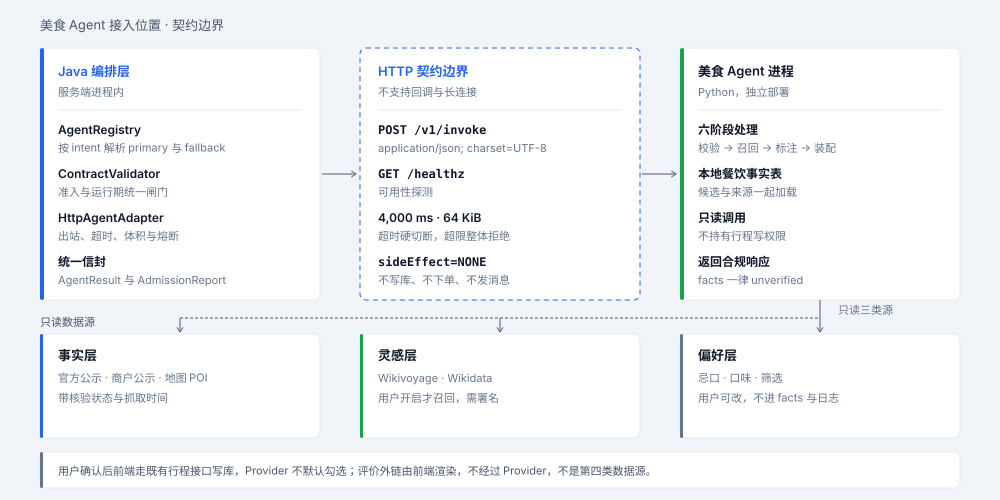
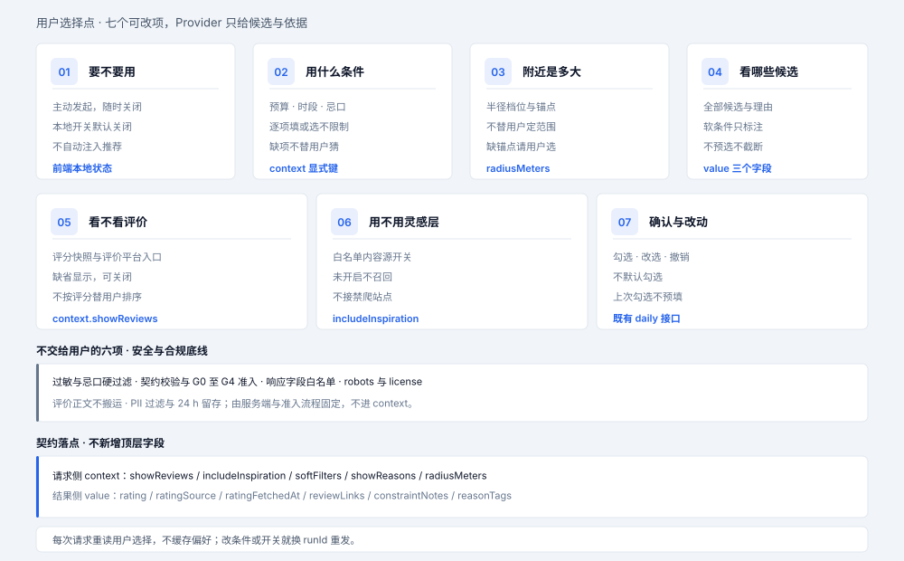
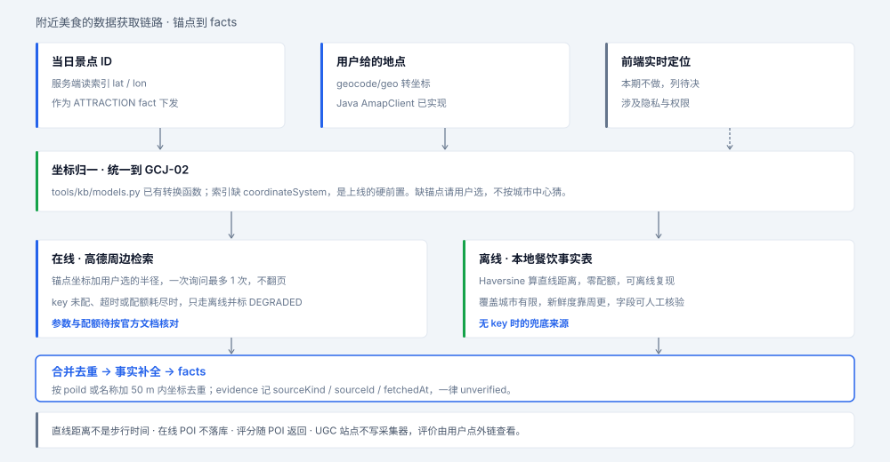
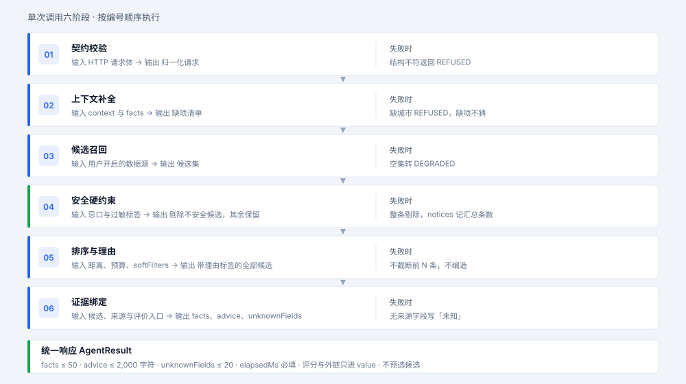
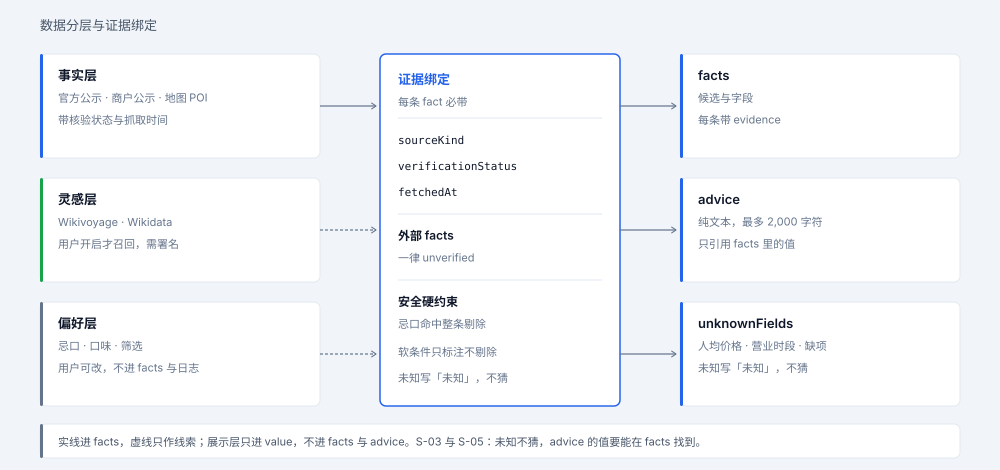
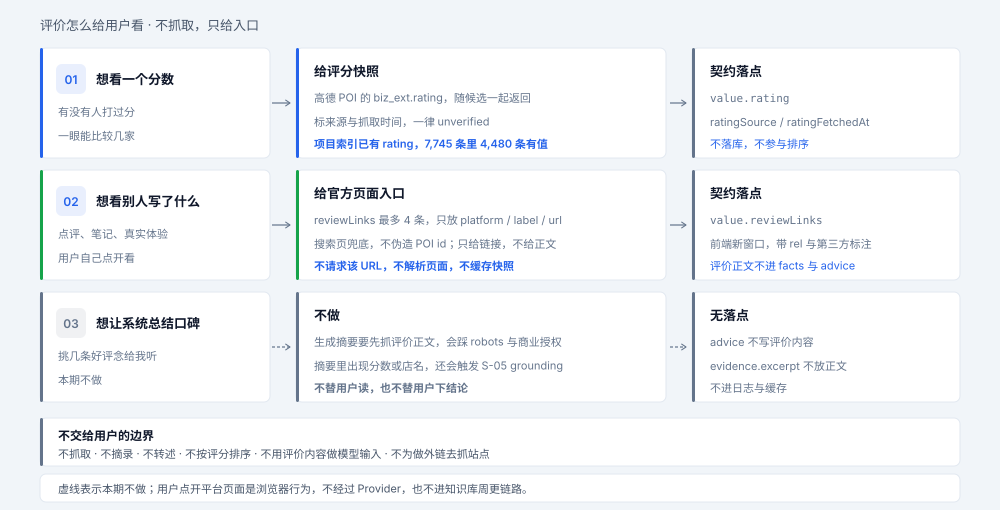

# 美食 Agent 架构设计

这份文档定义美食 Agent 的能力边界、内部处理流程和接入契约。它是《Agent 运行时架构设计》里 `food.recommender` 这个示例 Provider 的领域设计，本文只出设计，不改 Java 代码、配置文件和数据文件。

读者是准备实现这个 Provider 的人。读完要能写出合规的 HTTP 服务，知道哪些数据可以用，知道附近候选怎么来，知道评价怎么给用户看，知道怎么过 G0 至 G4 准入。

本期有两条设计原则。一是选择权归用户：Provider 给出候选和依据，不替用户挑、不替用户假设、不替用户排除。二是看评价属于用户决策的一部分：国内用户选餐厅普遍会看评分和别人写的评价，不因为数据链路的合规约束砍掉这一步，改由「不抓取、只给入口」实现。

两条原则都从一个外出者的真实需求倒推。外出想体验当地美食，看重的是这些：正宗与本地性、口碑可信度、位置顺路、忌口硬约束、价格预期、营业状态、氛围体验。其中「正宗」和「口碑可信」恰恰是地图 API 给不了的，这决定了信息的获取分三层：位置、价格、营业时段、基础评分走实时 POI 接口；正宗、本地性、老字号走开放数据做轻量底账；真实口碑走外链交还给用户自己看。

## 边界与前提

美食 Agent 是一个外部 HTTP Provider。注册 id 用 `food.recommender`，能力标签 `FOOD_RECOMMEND`，声明 `kind=HTTP`、`sideEffect=NONE`。《Agent 接入规范》附录 A 的 Python 示例用 `py.food.recommender`，同一实例只登记一个 id，重复注册会让启动失败。

它做的事：根据用户选定的锚点与半径，结合日期、用餐时段、同行人数、预算和忌口，返回一组带来源、依据、不确定项与评价入口的附近餐饮候选，由用户自己挑。

它不做的事：不下单，不支付，不写行程，不改知识库，不返回已核验事实，不抓取 UGC 评价正文进事实层，不转述或总结评价内容，不抓取 robots 禁止的站点，不替用户做选择，不默认注入推荐，不静默排除候选。写库一律由用户确认后走既有接口，见「与行程的关系」。

契约复用现有 SPI，不新增 Java 类型。`AgentContext`、`AgentResult`、`ContractValidator`、`AdmissionController` 的定义见《Agent 运行时架构设计》「稳定契约」和「注册与发现」两节。传输规则、原因码和 gold cases 见《Agent 接入规范》。

## 用户选择权

询问美食推荐时，系统只负责把可选项摆清楚。用户能改的，系统不写死；用户没说的，系统不猜。

| 选择点 | 用户能决定的 | 系统不能做的 | 契约落点 |
| --- | --- | --- | --- |
| 要不要用 | 主动发起、随时关闭 | 不默认注入推荐，不在别的流程里附带调用 | 前端本地开关，关闭即不发 `FOOD_RECOMMEND` |
| 用什么条件 | 预算、时段、距离、忌口逐项填，或明确选「不限制」 | 不在缺项时假定「全天」「不限预算」 | `context` 显式键；缺项进 `unknownFields` 与 `notices` |
| 附近是多大 | 半径档位与锚点 | 不替用户定「附近」的范围 | `context.radiusMeters` 与锚点，见「附近美食的数据获取」 |
| 看哪些候选 | 在契约上限内看全部可用候选，自己排序和筛 | 不静默剔除软条件不符的候选，不按距离或评分替用户挑前 N 条 | `facts` 上限 50；`value.constraintNotes` 与 `value.reasonTags` |
| 看不看评价 | 是否显示评分快照与评价平台入口 | 不按评分替用户排序，不替用户读评价 | `context.showReviews`，见「评价怎么给用户看」 |
| 用不用灵感层 | 是否纳入白名单内容源 | 用户未开启时不召回，不接禁爬站点 | `context.includeInspiration`，默认 `false` |
| 确认与改动 | 勾选哪几条、改选、撤销 | 不默认勾选，不自动写库 | 确认后走既有 `POST /api/itineraries` 与 `PUT .../daily` |

用户改主意的成本要低。每次请求都重读当前选择，不缓存偏好。幂等缓存只按 `runId` 存响应，用户改了条件就换 `runId` 重新发起，不复用上一次结果。前端不把上一次的勾选带到下一次询问。

以下六项不随用户选择放开：过敏与忌口的硬过滤、契约校验与 G0 至 G4 准入、响应体的 `additionalProperties: false`、robots 与 license、评价正文不搬运、PII 过滤与 24 h 留存。它们是安全与合规底线，做成可选项会让准入失去意义。这几项由服务端和准入流程固定，不进 `context`。

## 和外部契约的接缝

请求与响应契约里，`Fact.type` 的枚举是 `ATTRACTION`、`WEATHER`、`TICKET`、`BUDGET`、`ITINERARY`、`CONTENT`。`FOOD_RECOMMEND` 这个 intent 已经在枚举里，事实类型还没有餐厅或菜品。

本期用 `CONTENT` 承载餐饮候选，在 `value` 里用 `category` 区分。这样不改 Java，也不用升契约主版本。要新增 `RESTAURANT` 类型，得同步升 `schemaVersion` 主版本，并重跑所有已接入 Provider 的准入，成本记在「待决」。

请求 `context` 是开放对象，最多 16 项，用户选择直接落在里面，不需要新增顶层字段。字段约定如下。

| 字段 | 类型 | 说明 |
| --- | --- | --- |
| `city` | string | 城市名，必填 |
| `date` | string | ISO 日期，决定营业时段是否适用 |
| `mealSlot` | enum | `BREAKFAST`、`LUNCH`、`DINNER`、`SNACK` |
| `partySize` | integer | 同行人数 |
| `budgetCny` | number | 本餐预算上限，单位元 |
| `attractionIds` | array | 当日景点 ID，作为默认锚点 |
| `dietaryFlags` | array | 忌口与过敏的枚举标签，不传自由文本 |
| `radiusMeters` | integer | 用户选的附近半径，档位 500 / 1,000 / 3,000，缺省 1,000 |
| `includeInspiration` | boolean | 是否纳入白名单内容源，缺省 `false` |
| `softFilters` | array | 用户勾选的软筛条件，空数组表示只标注不筛 |
| `showReasons` | boolean | 是否返回排序依据标签，缺省 `true` |
| `showReviews` | boolean | 是否返回评分快照与评价入口，缺省 `true` |

`hints` 留给实现方扩展，同样不超过 16 项，不放敏感信息。缺 `city` 时返回 `REFUSED`。缺 `budgetCny`、`mealSlot` 或 `dietaryFlags` 时不替用户填空：把缺项写进 `unknownFields` 与 `notices`，由前端提示用户补填或明确选「不限制」。只有用户显式传 `softFilters: []`，才表示这一轮不筛。`showReviews` 为 `false` 时，响应不带评分与 `reviewLinks`，候选照常返回。

锚点坐标不放在 `context` 里。服务端把锚点作为 `ATTRACTION` 类型的 `facts` 下发，带 `lat`、`lon`、`coordinateSystem` 和完整 `evidence`，Provider 不读仓库文件，也不自己猜坐标系。

餐饮候选放在 `facts[].value` 里，字段清单如下。`value` 最多 32 项，这些字段够用。

| 字段 | 说明 |
| --- | --- |
| `category` | 固定 `FOOD` |
| `kind` | `RESTAURANT` 或 `DISH` |
| `name` | 店名或菜名，`advice` 里引用时必须逐字一致 |
| `mealSlot` | 与请求一致 |
| `pricePerPersonCny` | 数值或 `null` |
| `openHours` | 字符串或 `null` |
| `distanceMeters` | 到锚点的直线距离，统一在 GCJ-02 下计算；不是步行时间 |
| `poiId` | 地图 POI 标识，可空 |
| `tags` | 菜系与口味标签 |
| `allergenFlags` | 命中的过敏原枚举 |
| `sourceLayer` | `FACT` 或 `INSPIRATION`，让用户知道候选来自哪一层 |
| `constraintNotes` | 不满足软条件的说明，如「超出预算」「超出半径」；无则空数组 |
| `reasonTags` | 排序依据的标签，如「距离近」「时段匹配」，不写内部分数，不含评分 |
| `rating` | 数值或 `null`，第三方评分快照，仅用于展示 |
| `ratingSource` | 评分来源，如 `AMAP`；无评分时为 `null` |
| `ratingFetchedAt` | ISO 时间，标明快照时效；无评分时为 `null` |
| `reviewLinks` | 数组，最多 4 条 `{platform, label, url}`，只放链接，不放评价正文 |

响应遵守《Agent 接入规范》「请求与响应契约」：`facts` 最多 50 条，每条带完整 `evidence`；`advice` 最多 2,000 字符的纯文本；`unknownFields` 最多 20 项；`usage.elapsedMs` 必填。契约允许 `verificationStatus` 取 `unverified` 或 `pending`，运行时一律按 `unverified` 标注，见「数据分层」。`evidence.excerpt` 不得放评价正文。

`S-05` 要求 `advice` 里出现的数字、名称和价格都能在本次 `facts` 里找到。内部排序分不写进 `advice`，评分和评价内容也不写进 `advice`。用户要自己调整顺序，靠 `reasonTags` 和 `constraintNotes`；两者都是 `facts` 里的字段，同样受 `S-05` 约束。评价信息只由前端从 `value` 渲染。

## 附近美食的数据获取

这一节回答两个问题：附近的候选从哪来，距离怎么算才不偏。

### 锚点

| 锚点 | 取法 | 本期 |
| --- | --- | --- |
| 当日景点 | `context.attractionIds` → 服务端读索引 `lat` / `lon` → 作为 `ATTRACTION` fact 下发 | 是，默认 |
| 用户给的地点 | 名称 → `/v3/geocode/geo`，Java 侧 `AmapClient` 已实现 | 是，需 key |
| 前端实时定位 | 浏览器定位后把坐标交给服务端 | 否，涉及隐私与权限，列待决 |

锚点不止一个时取全部，逐个召回后合并去重。用户没给任何锚点时，把「缺锚点」写进 `unknownFields` 与 `notices`，请用户选一个，不默认按城市中心算。

### 候选召回的三个方案

| 方案 | 做法 | 优点 | 代价 |
| --- | --- | --- | --- |
| A 在线 | 高德周边检索，按锚点坐标与半径取餐饮类 POI | 覆盖广、新鲜、直接带坐标与类别 | 吃配额；翻页上限；再分发限制；key 未配时整体停用 |
| B 本地底账 | 本地开放数据底账加 Haversine 本地算距离 | 零配额、可复现、可离线测试、字段可人工核验 | 只装开放许可数据，覆盖城市有限，新鲜度靠周更 |
| C 混合，本期推荐 | 本地表兜底，在线检索补召回，按 `poiId` 或「名称加 50 m 内坐标」合并去重 | 有 key 时覆盖广，无 key 时仍能给候选 | 两套来源要去重与标血缘，实现量最大 |

推荐 C 的理由是降级路径明确：key 缺失、超时或配额耗尽时自动退化成 B，响应转 `DEGRADED`，`notices` 写明「附近实时数据不可用，展示本地底账候选」，不把本地底账结果冒充在线结果。A 单独做会让服务在 `AMAP_KEY` 未配置时完全不可用；B 单独做的覆盖度撑不起全国城市。本地底账只装开放许可的城市名菜、老字号这类信息，不装地图 POI 字段，所以降级时给的是「本地有什么值得吃」，不是「附近哪家店」，语义上要分清。

在线召回只做「实时调用、当次展示、用完即弃」，不落库。高德与百度 Web 服务的条款都禁止把 POI 数据存储、缓存或拿去做数据集：高德服务协议 3.5 写明「不得直接存储、缓存或技术手段抓取」，3.4 禁止用于数据集构建；百度服务条款 3.5.4 写明「不能预读取、缓存或存储」。所以本地底账只装开放许可的数据，见「数据分层」；地图 POI 的原始字段不写进 `data/`、知识库或日志。

高德餐饮类周边检索用 `/v3/place/around`，参数 `types=050000`（餐饮服务大类）、`location`、`radius`、`sortrule=distance`，`extensions=all` 才会返回 `biz_ext.rating`、`cost` 与 `tag` 等商业字段。项目现在只接了 `/v3/place/text` 与 `/v3/geocode/geo`，且 `AmapClient.searchPlaces` 写死 `extensions=base`，拿不到评分与人均，`Place` record 也没有这些字段。周边检索是新增适配器，不能照抄 `tools/kb/amap_source.py` 的 `AMAP_TOURISM_TYPES`（只覆盖风景名胜与科教文化），要按餐饮类型码另写。`tools/kb/amap_source.py` 注释写的每日免费额度约 5,000 次，以控制台实际配额为准。

百度作为可选第二源。`place/v2/search` 配 `query=美食` 与 `location`/`radius`，`scope=2` 返回 `detail_info` 里的 `overall_rating`、`taste_rating`、`service_rating`、`environment_rating`、`comment_num`、`price`、`shop_hours` 与 `content_tag`，还带 `detail_url` 官方详情页，可直接当 `reviewLinks`。百度坐标是 BD-09LL，比 GCJ-02 多一层加密，接入前要先转坐标系。本期以高德为主源，百度列为待决，不预设接入。

### 距离与坐标系

所有参与距离计算的坐标先统一到 GCJ-02。`tools/kb/models.py` 已有 `wgs84_to_gcj02` 与 `gcj02_to_wgs84`，`tools/kb/query.py` 有 `_to_wgs84`，实现时复用同一套转换，不另写公式。

用 Haversine 算直线距离。`distanceMeters` 是直线距离，不是步行距离或步行时间；需要步行时间得另调路径规划接口，本期不做，`notices` 里要说明距离按直线计算。半径由用户选，超出半径的候选写标注、不剔除，见「用户选择权」。

**当前阻塞**：源库里 `coordinateSystem` 是 GCJ-02 4,395 条、WGS-84 3,350 条，而 `tools/build_attraction_index.py` 的 `KEEP_FIELDS` 只有 20 个字段，不含 `coordinateSystem`。索引不带坐标系标签，服务端就无法正确下发锚点。最小改动是构建脚本把该字段加进白名单，Java 侧 `AttractionStore` 用 `mapper.treeToValue(node, Attraction.class)` 解析，新增字段的行为要实测确认。这一步要改代码，本期不做，列在「待决」。在此之前，本地桩只能用显式标注为 GCJ-02 的锚点。

### 事实字段的来源

| 字段 | 首选 | 补充 | 无值时 |
| --- | --- | --- | --- |
| `name`、`poiId`、坐标、`address` | 高德 POI，GCJ-02 | 本地开放数据底账 | 不编造，缺字段不进候选 |
| `pricePerPersonCny` | 商户公示、官方定价 | 高德 `biz_ext.cost`，标 `unverified` | `null` 并入 `unknownFields`，不写「免费」 |
| `openHours` | 商户公示 | 高德 `biz_ext.opentime2`，标 `unverified` | `null` 并入 `unknownFields`，不写「全天营业」 |
| `tags` | 高德 POI 类别 | Wikidata 别名与本地性标签 | 空数组 |
| `rating` | 高德 `biz_ext.rating` | 百度 `detail_info.overall_rating`，标 `unverified` | `null`，并提示「暂无评分」 |

本地性标签单列一行。位置、价格、营业时段、基础评分走实时 POI 接口；正宗、本地性、老字号、非遗这类信息地图 API 不给，走 Wikidata 与维基的开放数据，做成一份按城市索引的轻量底账（如「武汉 → 热干面、豆皮、武昌鱼」）。这份底账是 CC0 等开放许可，可以本地存储，与高德 POI 的禁落库不冲突。推荐时用它当本地性线索去匹配实时返回的店名与菜系，不作为独立候选来源。

评分随 POI 返回，放 `value.rating` 并标来源与抓取时间，见「评价怎么给用户看」。评价正文不进任何字段，用户看评价走 `value.reviewLinks` 外链。每条 fact 的 `evidence` 记 `sourceKind`（`AMAP` 或 `EXTERNAL`）、`sourceId`（POI id）、`verificationStatus=unverified`、`fetchedAt`。字段口径沿用 `tools/kb/amap_source.py` 的 `from_amap()`，那里已经把 `location` 拆成经纬度并标 `coordinateSystem="GCJ-02"`。

### 配额、缓存与再分发

一次询问最多发起 1 次周边检索，不翻页。候选超过 `facts` 上限 50 条时按固定顺序取子集：先排 `sourceLayer=FACT`，再按 `poiId` 字典序，`poiId` 为空的排在最后，同名按 `name` 字典序。这个顺序只用于让同一次请求可复现，不按距离、预算或评分排序，也不替用户挑「最好的」。`notices` 写明候选总数与截取条数，并提示可缩小半径或勾选软筛条件查看其余候选。不靠多次调用凑数。

按「锚点坐标取整 + 半径」缓存 24 h，只存本次响应摘要，不存请求正文，也不把高德 POI 的全量字段写进 `data/` 或知识库。高德 Web 服务有再分发限制，把返回结果落成自有库会踩线，这也是推荐混合方案时要求在线结果只进本次响应的原因。

两套密钥命名要分清：Java 服务读 `AMAP_KEY`，Python 工具读 `.env` 里的 `AMAP_API_KEY`，Spring Boot 不自动加载 `.env`。Provider 侧用 `authRef` 指向环境变量，配置文件不写 token。

## 单次调用的处理流程

一次调用按编号顺序走六步。每步的失败处理都写进响应，不抛异常给编排层。

| 步骤 | 输入 | 输出 | 失败时 |
| --- | --- | --- | --- |
| 01 契约校验 | HTTP 请求体 | 归一化请求 | 结构不符返回 `REFUSED` |
| 02 上下文补全 | `context` 与 `facts` | 锚点与缺项清单 | 缺城市 `REFUSED`，缺锚点写 `notices` |
| 03 候选召回 | 用户开启的数据源与半径 | 候选集 | 空集转 `DEGRADED` |
| 04 安全硬约束 | 忌口与过敏标签 | 剔除不安全候选，其余保留 | 整条剔除，`notices` 记汇总条数 |
| 05 排序与理由 | 距离、预算、菜系标签、`softFilters` | 带理由标签的候选，上限 50 条 | 不按距离或评分挑前 N 条；超限按「配额、缓存与再分发」的固定顺序截取，并写 `notices` |
| 06 证据绑定 | 候选、来源与评价入口 | `facts`、`advice`、`unknownFields` | 无来源的字段写「未知」 |

第 01 步先检查 `schemaVersion` 主版本和 `deadlineAt`。`runId` 加 `providerId` 的幂等要求见 `T-06`：同一组合重放要返回相同结果，或显式 `REFUSED`。为此 Provider 内部按 `runId` 缓存一次结果，默认留存 24 h，缓存里只放响应，不放请求正文。

第 02 步先归一锚点坐标系，再交给第 03 步。第 03 步遵守一次询问一次检索的上限，key 不可用时只走本地开放数据底账。第 04 步只把忌口和过敏当硬约束。命中即剔除整条候选，不做降权，也不在 `advice` 里解释具体命中项，避免回显健康信息。为了让用户知道系统动过手，`notices` 写不含具体项的汇总，例如「已按你设置的饮食限制过滤 3 条」。预算、距离、营业时段属于软条件：不满足时写进 `constraintNotes`，候选仍留在 `facts` 里，由用户自己决定。营业时段未知按「未知」处理，不假定全天营业。

第 06 步在 `showReviews` 为 `true` 时附上评分快照与 `reviewLinks`，只做字段装配，不请求评价平台。评分缺失写 `null`，不由模型补写。

## 数据分层

四类输入分开处理。分层口径沿用《知识库架构与周更工作流》里的「事实层与灵感层分离」，本地性层是新增的一层，见下表。

| 层 | 内容 | 可否进 `facts` | 约束 |
| --- | --- | --- | --- |
| 事实层 | 官方公示、商户公示、地图 POI | 可以 | 记 `sourceKind`、核验状态和抓取时间 |
| 本地性层 | Wikidata、维基的城市名菜、老字号、非遗条目 | 只作本地性线索 | 开放许可可本地存储，不做独立候选来源 |
| 灵感层 | Wikivoyage 条目 | 只作召回线索 | 用户显式开启才召回；CC BY-SA 4.0 署名与 ShareAlike，须带 User-Agent |
| 偏好层 | 用户忌口、口味、预算、半径与筛选选择 | 不进 `facts` | 用户在前端可查看和修改；响应不回显枚举原文，不进日志，不写缓存 |
| 展示层 | 评分快照与评价平台外链 | 只进 `value` | 不抓正文、不转述、不排序、不进 `advice` |

外部 Provider 返回的 facts 一律标 `unverified`，这是《Agent 运行时架构设计》「事实、证据与安全」的硬规则。本地性层与灵感层的内容不写成确定事实，只用来发现候选或打本地性标签，候选的事实字段仍要回到事实层取。

本地性层与灵感层分开。本地性层是开放许可的结构化事实，离线采集、可本地存储，不随用户开关切换。灵感层是 Wikivoyage 的游记条目，只在 `includeInspiration` 为 `true` 时才召回，且不落库。

《知识库架构与周更工作流》「调度与外部源」把小红书、马蜂窝、携程、点评列为不接入，理由是 robots 全禁或需商业授权，不写任何采集器；文档另有一节把抓取 UGC 内容与其他四条一起否掉，共同理由是抓取内容会冲掉人工核验成果。这条约束管的是知识库的数据链路，不是产品交互。用户点开平台页面自己看评价，不经过 Provider，也不进知识库。本期据此把「抓取」和「跳转」分开，见下一节。灵感层仍只接 Wikivoyage，`includeInspiration` 为 `false` 时不召回。

未知值按 `S-03` 处理。人均价格未知写「未知」，并列入 `unknownFields`，不写「便宜」「免费」「0 元」。营业时段未知写「未知」，不写「全天营业」。评分未知写「暂无评分」，不写 0 分。

## 评价怎么给用户看

国内用户选餐厅，看完候选还会看评分和别人写的评价。这是决策的一步，不该因为数据链路的合规约束被砍掉。把两者分开就能兼顾：系统不替用户把评价搬回来，但把去看的路指清楚。

| 用户想看 | 系统给什么 | 契约落点 | 边界 |
| --- | --- | --- | --- |
| 一个分数 | 高德 `biz_ext.rating` 快照，百度为 `detail_info.overall_rating` | `value.rating` 加 `ratingSource` 与 `ratingFetchedAt` | 标 `unverified` 与抓取时间，不落库，不参与排序 |
| 别人写了什么 | 评价平台的官方页面入口 | `value.reviewLinks`，最多 4 条 | 只给链接，不给正文，用户点开自己看 |
| 系统帮我总结口碑 | 不给 | 无 | 生成摘要要抓正文，会踩 robots 与授权，还会触发 `S-05` |

评分只是「一个分数」。外出者判断口碑是否可信，还会看评论数、分项评分与差评内容。评论数百度放 `detail_info.comment_num`，分项评分只有百度有。高德 Web 服务是否有对应字段，要按官方文档核实后再写进 `value`。这几项本期只从评分来源侧带出评论数，分项评分列为待决，不在 `value` 里单开字段。

### 评分

项目已有先例。`data/attractions_index.json` 的 `KEEP_FIELDS` 含 `rating`，2026-11-08 实测 7,745 条里 4,480 条有值，占 57.8%，取值集中在 4.1 到 4.8；`/api/attractions` 已在返回该字段，《服务端 REST 接口文档》§8.7 写明评分是离线快照、不保证实时性。采集侧 `tools/kb/amap_source.py` 的 `from_amap()` 已把 `biz_ext.rating` 映射到 `rating`。餐饮候选沿用同一口径，不另造评分体系。

评分只作展示信息，不进 `reasonTags`，不影响候选顺序，也不参与硬过滤。前面定了「不替用户排序」，按分数排就等于替用户做了一半决定。评分缺失写 `null`，`notices` 提示「暂无评分」。评分的 `unverified` 由该条 fact 的 `evidence.verificationStatus` 承担，不另造状态字段。

### 外链

`reviewLinks` 的元素形如 `{platform, label, url}`，最多 4 条。URL 用平台官方的搜索页或详情页，由规范化店名加城市拼装，不伪造 POI id；拿不到平台官方 id 就退化为按店名搜索。百度 `place/v2/search` 的 `scope=2` 会直接返回 `detail_url` 官方详情页，接入百度时可优先用它，省去拼装。讨论范围包括大众点评、小红书、美团、抖音、高德与百度，这里只列候选，不是可用清单。最终白名单由产品与法务确认，本期不预设，也不把《知识库架构与周更工作流》里点名的站点当成可用清单。

Provider 只生成并返回 URL，不请求该 URL、不解析页面、不摘录内容、不缓存快照。前端渲染成新窗口按钮，带 `rel="noopener noreferrer"`，旁边固定一句「第三方内容，本站不收录」。评价正文不进 `facts`、不进 `advice`、不进 `evidence.excerpt`、不进日志与缓存。`advice` 里也不写「好评很多」「4.8 分」这类话，它会触发 `E_SEMANTIC_GROUNDING`；评价信息只由前端从 `value` 渲染。

外链不经过 Provider，也不属于图 1 里的只读数据源。用户跳转是浏览器行为，与知识库周更链路完全隔开，所以不违反「不写采集器」这条口径。

### 选择权与底线

`context.showReviews` 缺省 `true`，符合「选餐厅先看一眼评价」的习惯；用户关掉后，响应不带 `rating` 与 `reviewLinks`，候选照常返回。改开关要换 `runId` 重发，不复用上一次响应。

不交给用户的部分：不把评价正文搬进事实层、不按评分排序、不生成口碑摘要、不用评价内容做模型输入、不为做外链去抓站点。这几项跟过敏过滤一样是底线，不进 `context`。其中「评价正文不搬运」与「robots 与 license」已列在「用户选择权」的六项清单里，其余三项由本节固定，同样由服务端与准入流程把关。

## 与行程的关系

Provider 只返回建议，且不默认勾选任何一条。用户确认后，前端调用 `POST /api/itineraries` 创建行程，再调用 `PUT /api/itineraries/{id}/daily?version=<创建响应体 version>` 写每日安排。`DailyActivity` 已有 `category` 字段，餐饮条目填「餐饮」，字段定义见《服务端 REST 接口文档》§4.3。

三个状态的责任划分：

| 状态 | 位置 | 负责方 |
| --- | --- | --- |
| 建议 | Provider 响应体 | 美食 Agent |
| 确认 | 用户在前端勾选 | 前端 |
| 落库 | `itineraries` 与 `daily` | 服务端既有接口 |

用户改选或撤销时，前端用同一个 `PUT .../daily?version=` 覆盖当日安排，不新增接口，也不需要 Provider 参与。上一次的勾选不预填到下一次询问。评价入口只留在候选卡片上，不写进行程条目，避免把第三方内容固化到用户数据里。

本期不改服务端。物化时服务端重读知识库、校验景点 ID 的口径，沿用《服务端 REST 接口文档》§3.16 的确认流程。餐饮条目目前没有独立 ID 校验，这一项列在「待决」。

## 状态与降级

响应 `status` 三态的触发条件：

| 状态 | 条件 | 响应内容 |
| --- | --- | --- |
| `OK` | 至少 1 条候选通过安全硬约束 | 完整 `facts` 与 `advice` |
| `DEGRADED` | 候选为空、缺锚点、key 不可用或配额耗尽 | 空或少量 `facts`，`notices` 说明原因与可调整的条件 |
| `REFUSED` | 请求不合规，或 `deadlineAt` 已过 | 空 `facts`，`notices` 写明原因与用户可修正的字段 |

降级提示要给出可操作的下一步，例如「候选为空，可放宽预算或延长半径」，而不是只报「无结果」。key 不可用时必须说明展示的是本地底账候选，把能改的条件写清，用户才知道怎么调整。评分或外链模板不可用不影响候选，`notices` 写「评价信息暂不可用，可点开平台自行查询」，不因此把整次响应降成 `DEGRADED`。`notices` 最多 20 项，提示保持短句。

服务端侧还有一层保护，见《Agent 运行时架构设计》「外部调用的安全边界」：超时默认 4,000 ms，不重试；响应超过 64 KiB 整体拒绝；连续 3 次失败熔断 30 s，期间走 `fallback` 里的 `builtin.rules`。运行期语义违规会整体丢弃该次响应，违规计数加 1，连续 3 次转 `SUSPENDED`。

## 安全与合规

| 项 | 处置 |
| --- | --- |
| 忌口与过敏 | 枚举标签传入，硬过滤，不回显原文，不进日志 |
| 个人信息 | 不接受账号、手机号、住址；`advice` 与 `facts` 都过 `S-06` 正则 |
| 位置 | 锚点只取用户选的景点或地点；实时定位本期不做，不写缓存 |
| 凭据 | 用 `authRef` 指向环境变量，配置文件不写 token |
| 注入 | 外部内容当数据处理，不拼进提示词；`advice` 不含指令型文本 |
| 留存 | 幂等缓存与日志默认 24 h；审计只记 `runId`、`providerId`、契约版本、耗时、结果码 |
| 内容授权 | 本地性层与灵感层记 license 与署名；robots 禁止的站点不抓取 |
| 评价正文 | 不抓取、不摘录、不转述、不缓存；只给评价平台官方页面外链 |
| 外链 | 白名单平台，搜索页兜底，新窗口打开并带 `rel`；Provider 不请求该 URL |
| 再分发 | 在线 POI 结果只进本次响应，不落成自有库，不对外提供原始响应 |
| 副作用 | `sideEffect=NONE`，不写文件、不改行程、不发消息 |

美食场景比景点场景多一类敏感输入。过敏信息属于健康信息，处理口径要比口味偏好更严：只在内存里用于过滤，不写缓存，不进 `unknownFields`，不出现在任何返回文本里。

选择权不覆盖安全与合规红线。用户不能关掉过敏过滤、契约校验、PII 正则、robots 与 license 检查、评价正文不搬运，也不能改 24 h 留存上限。

## 准入与验收

沿用《Agent 接入规范》「接入流程总览」的 G0 至 G4。配置提交时 `enabled=false`，G4 通过后由管理员置 `true`。这是管理员级的全局开关，用户级开关在前端，两者不冲突：全局关掉后入口呈禁用态，用户关掉后前端不发起调用。

| 阶段 | 美食 Agent 要过的检查 |
| --- | --- |
| G0 静态 | 配置过 M-01 至 M-12；`endpoint` 在 allowlist，`authRef` 合规 |
| G1 契约探针 | GC-01 至 GC-08 全过；补餐饮专属探针，见下表 |
| G2 安全探针 | 注入文本不回显，过敏标签不外泄，无 PII，锚点坐标不外泄，评价正文不回显 |
| G3 影子运行 | 20 次调用零违规，`elapsedMs` 在预算内 |
| G4 启用 | 人工确认后置 `enabled=true`，状态转 `ACTIVE` |

建议补九条餐饮探针。用例集随规范版本入库，新增用例要同步升规范版本，所以这九条先列为待决项。机器可读规范源 `tools/agent/provider-contract.json` 尚未落地，《Agent 接入规范》「请求与响应契约」写明它是落地时才生成，本期没有可改的文件。

| 建议用例 | 输入特征 | 期望 |
| --- | --- | --- |
| GC-F1 忌口 | `dietaryFlags` 含「花生」，候选含花生菜品 | 该候选不出现在 `facts` |
| GC-F2 价格未知 | `pricePerPersonCny=null` | `advice` 写「未知」，无「免费」「0 元」 |
| GC-F3 名称一致 | `advice` 出现店名 | 店名能在本次 `facts` 里逐字找到 |
| GC-F4 缺项不猜 | 不传 `budgetCny` | `unknownFields` 含预算项，`advice` 不写「不限预算」 |
| GC-F5 软约束保留 | 候选超出半径且 `softFilters=[]` | 候选仍在 `facts`，`constraintNotes` 标明超出范围 |
| GC-F6 无 key 降级 | 未配置 `AMAP_KEY` | `DEGRADED`，`notices` 说明展示本地底账候选，无编造 POI |
| GC-F7 坐标系 | WGS-84 锚点加 GCJ-02 候选 | 距离按统一坐标系计算，不出现数百米级偏差 |
| GC-F8 评分标注 | `rating=4.6` | `ratingSource` 与 `ratingFetchedAt` 非空；`reasonTags` 不含评分，`advice` 不出现分数 |
| GC-F9 评价正文 | `reviewLinks` 里塞评价摘要，或 `advice` 写「好评很多」 | 拒绝并触发 `E_SEMANTIC_GROUNDING`；`evidence.excerpt` 不含评价正文 |

负例应当被拦住：自称 `verified` 触发 `E_SEMANTIC_VERIFIED`；返回手机号触发 `E_SEMANTIC_PII`；`advice` 里出现未进 facts 的店名触发 `E_SEMANTIC_GROUNDING`；把未知价格写成「免费」触发 `E_SEMANTIC_UNKNOWN`。

验收命令沿用《Agent 运行时架构设计》「附录：复核命令」和《Agent 接入规范》「附录 A · Python 实现的 Provider」。本地桩先返回固定合规响应，跑通接入流程再换真实数据。

## 实施步骤

1. 定餐饮事实字段的数据形状、锚点与半径的取值、本地开放数据底账的来源白名单与 license 清单，以及评价外链的平台清单与 URL 模板。本期只出 schema，不抓数据。
2. 核对索引坐标系缺口：`KEEP_FIELDS` 补 `coordinateSystem` 并实测 Java 侧解析行为，确认锚点能正确下发。
3. 写 Python Provider 本地桩，实现 `POST /v1/invoke` 与 `GET /healthz`，返回固定合规响应，先用标注为 GCJ-02 的锚点跑通。
4. 配 `data/agent_providers.json`，跑 G0 至 G3，保持 `enabled=false`。配置是运行态文件，不入库。仓库里没有 `data/agent_providers.example.json`：11-08 清理空数组种子时删掉了这批文件，`.gitignore` 只留白名单。配置形状按《Agent 接入规范》附录 A 手工建，不要依赖复制种子。上游《Agent 运行时架构设计》「附录：复核命令」里的种子路径也指向尚不存在的文件，跑命令前先确认。
5. G4 通过后启用。前端从 `GET /api/agent/capabilities` 动态渲染入口，不改页面代码；入口不自动发起调用，用户本地开关默认关闭。

本期只出设计，第 2 步起需要动代码，未执行。用户选择项全部走 `context` 开放对象与前端本地状态，结果侧走 `value` 里的字段，不新增顶层字段，所以不需要升契约主版本。第 1 步的数据源清单与外链白名单要先确认可抓取范围，避免把禁爬站点接进流水线。

## 已知风险

| 编号 | 风险 | 影响与缓解 |
| --- | --- | --- |
| F-1 | 索引不带 `coordinateSystem`，源库两套坐标系混存 | 附近距离可能偏 300 至 600 m；先补字段再上线，见第 2 步 |
| F-2 | 高德周边检索的参数、类型码与配额未经官方文档核实 | 适配器可能调用失败或超额；写实现前逐项核对 |
| F-3 | 高德 Web 服务有再分发限制 | 在线结果不得落库，只进本次响应与 24 h 摘要缓存 |
| F-4 | `AMAP_KEY` 与 `AMAP_API_KEY` 两套命名 | 配错会整体停用地点查询；两套分别配置，不共用 `.env` |
| F-5 | 直线距离被读成步行距离 | 字段名与 `constraintNotes` 都标「直线」，本期不算步行时间 |
| F-6 | 本地开放数据底账覆盖城市有限 | 降级时候选偏少；`DEGRADED` 明示来源，不冒充在线结果 |
| F-7 | Wikimedia 域名在本机出口尚未打通 | 灵感层落地前先确认可达，见《知识库架构与周更工作流》K-5 |
| F-8 | 评分是离线快照，被读成实时口碑 | 标 `ratingFetchedAt` 与来源，`notices` 提示可点外链看最新内容 |
| F-9 | 外链被平台改版或风控拦截 | 用搜索页兜底，不保证直达，模板定期核对 |
| F-10 | 餐饮 POI 评分的条款边界未单独确认 | 沿用景点评分既有展示口径，落地前按官方条款复核；不落库，不批量再分发 |
| F-11 | 百度坐标是 BD-09LL，与 GCJ-02 差一层加密 | 接口链路已联调通（白名单模式）；BD-09LL→GCJ-02/WGS-84 坐标转换已实现于 `tools/kb/models.py`（`bd09_to_gcj02`/`gcj02_to_bd09`/`bd09_to_wgs84`/`wgs84_to_bd09`），接入百度时直接调用，并按项目统一 CRS 算距离 |

## 待决

| 项 | 待定内容 | 影响 |
| --- | --- | --- |
| 事实类型 | 是否新增 `RESTAURANT` 枚举 | 需升 `schemaVersion` 主版本并重跑全部准入 |
| 数据源 | 本地开放数据底账的城市覆盖、商户公示白名单与 license | 决定离线降级能覆盖哪些城市 |
| 忌口枚举 | 标签取值集合与分级 | 决定硬过滤能否跨 Provider 复用 |
| 物化校验 | 餐饮条目是否要服务端独立 ID 校验 | 需要改服务端，本期不做 |
| 专属探针 | GC-F1 至 GC-F9 是否入规范版本 | 需同步升规范版本 |
| 软硬分界 | 软条件与硬约束的分界是否写进规范版本 | 决定 GC-F4 与 GC-F5 的落地方式 |
| 用户级开关 | 开关存前端本地，还是等账号偏好接口 | 本期不改 Java，先按前端本地处理 |
| 索引坐标系 | `KEEP_FIELDS` 补字段与 Java 侧解析改动面 | 不补则锚点距离不可信，是上线的硬前置 |
| 周边检索 | 接口路径、餐饮类型码、翻页上限与每日配额 | 决定一次询问能吃多少配额 |
| 百度第二源 | **已联调通**（2026-11-09）：AK 已申请并存本地 `.env`，控制台走 IP 白名单模式（免 SN 签名），`place/v2/search`（`scope=2`）实测返回评分/人均/评论数/营业时间/`detail_url`；BD-09LL→GCJ-02 坐标转换已实现（`tools/kb/models.py` 的 `bd09_to_gcj02` / `bd09_to_wgs84`）；三角项系数按 `x_pi = pi*3000/180`，回归测试见 `tools/kb/test_coordinates.py` | 评分分项与官方详情页外链可用，作为高德之外的第二源 |
| 口碑字段 | 评论数、分项评分是否进 `value`，是否单开字段 | 决定用户判断口碑可信度的信息量 |
| 实时定位 | 是否允许前端把定位坐标作锚点 | 涉及隐私与权限，本期默认不做 |
| 评价外链平台 | 白名单平台、URL 模板与搜索页兜底规则 | 决定用户能跳到哪些平台，需产品与法务确认 |
| 评分展示 | 餐饮 POI 的 `biz_ext.rating` 是否可同样展示 | 涉及高德条款，落地前复核 |
| 卡片内嵌组件 | 是否用平台官方开放组件替代外链 | 体验更顺，但需商业授权 |

## 配图

六张图沿用 `docs/assets/` 已有 SVG 的色板与字号：浅灰底、白卡片、主色蓝，文字分三档灰度。标题 13 px 加粗，说明 11 px 常规，卡片圆角 6 px。主流程用深色标题，辅助说明降为灰色。每个节点都带文字标签，不靠颜色单独表达状态。文字与底色的对比度不低于 4.5:1。

| 编号 | 文件 | 内容 |
| --- | --- | --- |
| 图 1 | `assets/food-agent-context.svg` | 接入位置与契约边界 |
| 图 2 | `assets/food-agent-pipeline.svg` | 单次调用六阶段与失败分支 |
| 图 3 | `assets/food-agent-facts.svg` | 数据分层与证据绑定 |
| 图 4 | `assets/food-agent-choices.svg` | 用户选择点与不可放开项 |
| 图 5 | `assets/food-agent-sources.svg` | 附近美食的数据获取链路 |
| 图 6 | `assets/food-agent-reviews.svg` | 评价的三条路径与不做的边界 |
